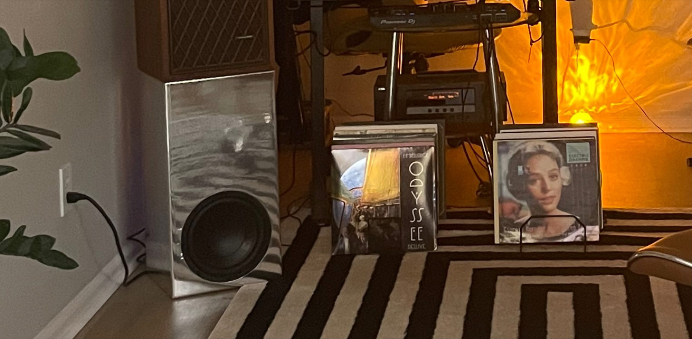

<!-- To replace the animation with a real video: generate an .mp4, then drag it into
     any GitHub comment box or the README web editor. GitHub returns a signed asset URL
     and inserts the tag for you. The URL is not a committed file and cannot be written
     from a script, which is why the GIF is the default here.
<video src="https://github.com/user-attachments/assets/REPLACE-ME" autoplay loop muted playsinline></video>
-->

**39.09 L · 36.2 Hz · Q 0.799 · $357.84 · 72 h · 3.65 dB**

<picture>
  <source media="(prefers-color-scheme: dark)" srcset="images/response-dark.svg">
  
</picture>

A monitor stands on it. That fixed the footprint before any acoustic decision was made,
and left height as the only dimension free to solve. Everything below follows from that.

<details>
<summary>The inverted design problem</summary>

Enclosure design normally begins with a target volume and arrives at proportions. R3
reverses it: requiring the cabinet to carry a monitor fixes its footprint, and a fixed
footprint fixes the internal cross-section once wall thickness is subtracted. **The
shape leads and the volume must follow.** Two dimensions imposed, one to solve.

Solving under that constraint produces a column roughly twice as tall as it is wide,
where an unconstrained enclosure of the same volume would approximate a cube. The
proportions are a consequence of a requirement, not a preference.

```bash
python3 calculations/derive_box.py
```

</details>

<details>
<summary>Q, and the one decision the rest rests on</summary>

A sealed enclosure is a second-order high-pass. Only two numbers appear in it:

$$H(s) = \frac{s^{2}}{s^{2} + \dfrac{s}{Q_{tc}} + 1}$$

The handle runs 0.50 to 1.20. The two ticks are Butterworth at 0.707 — maximally flat,
*F*<sub>3</sub> exactly at *F*<sub>c</sub> — and this build at **0.799**, which peaks
before it rolls off.

That was accepted rather than corrected. A small room contributes low-frequency gain of
its own, and a gently rising response combines with that gain more predictably than a
flat anechoic one does.

```bash
python3 scripts/model.py selftest
python3 scripts/sweep_qtc.py
```

</details>

<details>
<summary>Construction</summary>

Two sheets of 19 mm MDF, hand-held power tools throughout, no table saw and no router
table. The aperture is rebated — a shallow shoulder concentric with the through-hole, so
the 257 mm flange seats flush. Both are in the model below. Turn it to the baffle and
switch to wireframe to see straight through to the back panel, and that there is
nothing in there.

```stl
solid enclosure
  facet normal 0.000000 0.000000 -1.000000
    outer loop
      vertex -159.000 -330.500 0.000
      vertex -55.708 -115.796 0.000
      vertex -29.307 -125.113 0.000
    endloop
  endfacet
  facet normal 0.000000 0.000000 -1.000000
    outer loop
      vertex -159.000 -330.500 0.000
      vertex -29.307 -125.113 0.000
      vertex -77.417 -330.500 0.000
    endloop
  endfacet
  facet normal 0.000000 0.000000 -1.000000
    outer loop
      vertex -77.417 -330.500 0.000
      vertex -29.307 -125.113 0.000
      vertex 1.620 -128.490 0.000
    endloop
  endfacet
  facet normal 0.000000 0.000000 -1.000000
    outer loop
      vertex -77.417 -330.500 0.000
      vertex 1.620 -128.490 0.000
      vertex 4.167 -330.500 0.000
    endloop
  endfacet
  facet normal 0.000000 0.000000 -1.000000
    outer loop
      vertex 4.167 -330.500 0.000
      vertex 1.620 -128.490 0.000
      vertex 32.271 -124.382 0.000
    endloop
  endfacet
  facet normal 0.000000 0.000000 -1.000000
    outer loop
      vertex 4.167 -330.500 0.000
      vertex 32.271 -124.382 0.000
      vertex 85.750 -330.500 0.000
    endloop
  endfacet
  facet normal 0.000000 0.000000 -1.000000
    outer loop
      vertex 85.750 -330.500 0.000
      vertex 32.271 -124.382 0.000
      vertex 56.870 -115.230 0.000
    endloop
  endfacet
  facet normal 0.000000 0.000000 -1.000000
    outer loop
      vertex 85.750 -330.500 0.000
      vertex 56.870 -115.230 0.000
      vertex 159.000 -322.167 0.000
    endloop
  endfacet
  facet normal 0.000000 0.000000 -1.000000
    outer loop
      vertex 159.000 -322.167 0.000
      vertex 56.870 -115.230 0.000
      vertex 70.850 -107.203 0.000
    endloop
  endfacet
  facet normal 0.000000 0.000000 -1.000000
    outer loop
      vertex 159.000 -322.167 0.000
      vertex 70.850 -107.203 0.000
      vertex 159.000 -240.583 0.000
    endloop
  endfacet
  facet normal 0.000000 0.000000 -1.000000
    outer loop
      vertex 159.000 -240.583 0.000
      vertex 70.850 -107.203 0.000
      vertex 90.863 -90.863 0.000
    endloop
  endfacet
  facet normal 0.000000 0.000000 -1.000000
    outer loop
      vertex 159.000 -240.583 0.000
      vertex 90.863 -90.863 0.000
      vertex 159.000 -159.000 0.000
    endloop
  endfacet
  facet normal 0.000000 0.000000 -1.000000
    outer loop
      vertex 159.000 -159.000 0.000
      vertex 90.863 -90.863 0.000
      vertex 115.533 -56.253 0.000
    endloop
  endfacet
  facet normal 0.000000 0.000000 -1.000000
    outer loop
      vertex 159.000 -159.000 0.000
      vertex 115.533 -56.253 0.000
      vertex 159.000 -77.417 0.000
    endloop
  endfacet
  facet normal 0.000000 0.000000 -1.000000
    outer loop
      vertex 159.000 -77.417 0.000
      vertex 115.533 -56.253 0.000
      vertex 128.456 3.366 0.000
    endloop
  endfacet
  facet normal 0.000000 0.000000 -1.000000
    outer loop
      vertex 159.000 -77.417 0.000
      vertex 128.456 3.366 0.000
      vertex 159.000 4.167 0.000
    endloop
  endfacet
  facet normal -0.000000 0.000000 -1.000000
    outer loop
      vertex 159.000 4.167 0.000
      vertex 128.456 3.366 0.000
      vertex 113.101 60.996 0.000
    endloop
  endfacet
  facet normal 0.000000 0.000000 -1.000000
    outer loop
      vertex 159.000 4.167 0.000
      vertex 113.101 60.996 0.000
      vertex 159.000 85.750 0.000
    endloop
  endfacet
  facet normal -0.000000 0.000000 -1.000000
    outer loop
      vertex 159.000 85.750 0.000
      vertex 113.101 60.996 0.000
      vertex 88.514 93.153 0.000
    endloop
  endfacet
  facet normal 0.000000 0.000000 -1.000000
    outer loop
      vertex 159.000 85.750 0.000
      vertex 88.514 93.153 0.000
      vertex 159.000 167.333 0.000
    endloop
  endfacet
  facet normal 0.000000 0.000000 -1.000000
    outer loop
      vertex 159.000 167.333 0.000
      vertex 88.514 93.153 0.000
      vertex 69.174 108.292 0.000
    endloop
  endfacet
  facet normal -0.000000 0.000000 -1.000000
    outer loop
      vertex 159.000 167.333 0.000
      vertex 69.174 108.292 0.000
      vertex 159.000 248.917 0.000
    endloop
  endfacet
  facet normal 0.000000 0.000000 -1.000000
    outer loop
      vertex 159.000 248.917 0.000
      vertex 69.174 108.292 0.000
      vertex 55.708 115.796 0.000
    endloop
  endfacet
  facet normal -0.000000 0.000000 -1.000000
    outer loop
      vertex 159.000 248.917 0.000
      vertex 55.708 115.796 0.000
      vertex 159.000 330.500 0.000
    endloop
  endfacet
  facet normal 0.000000 0.000000 -1.000000
    outer loop
      vertex 159.000 330.500 0.000
      vertex 55.708 115.796 0.000
      vertex 29.307 125.113 0.000
    endloop
  endfacet
  facet normal -0.000000 0.000000 -1.000000
    outer loop
      vertex 159.000 330.500 0.000
      vertex 29.307 125.113 0.000
      vertex 77.417 330.500 0.000
    endloop
  endfacet
  facet normal 0.000000 0.000000 -1.000000
    outer loop
      vertex 77.417 330.500 0.000
      vertex 29.307 125.113 0.000
      vertex -1.620 128.490 0.000
    endloop
  endfacet
  facet normal -0.000000 0.000000 -1.000000
    outer loop
      vertex 77.417 330.500 0.000
      vertex -1.620 128.490 0.000
      vertex -4.167 330.500 0.000
    endloop
  endfacet
  facet normal 0.000000 -0.000000 -1.000000
    outer loop
      vertex -4.167 330.500 0.000
      vertex -1.620 128.490 0.000
      vertex -32.271 124.382 0.000
    endloop
  endfacet
  facet normal -0.000000 0.000000 -1.000000
    outer loop
      vertex -4.167 330.500 0.000
      vertex -32.271 124.382 0.000
      vertex -85.750 330.500 0.000
    endloop
  endfacet
  facet normal 0.000000 0.000000 -1.000000
    outer loop
      vertex -85.750 330.500 0.000
      vertex -32.271 124.382 0.000
      vertex -56.870 115.230 0.000
    endloop
  endfacet
  facet normal 0.000000 -0.000000 -1.000000
    outer loop
      vertex -85.750 330.500 0.000
      vertex -56.870 115.230 0.000
      vertex -159.000 322.167 0.000
    endloop
  endfacet
  facet normal 0.000000 0.000000 -1.000000
    outer loop
      vertex -159.000 322.167 0.000
      vertex -56.870 115.230 0.000
      vertex -70.850 107.203 0.000
    endloop
  endfacet
  facet normal 0.000000 0.000000 -1.000000
    outer loop
      vertex -159.000 322.167 0.000
      vertex -70.850 107.203 0.000
      vertex -159.000 240.583 0.000
    endloop
  endfacet
  facet normal 0.000000 0.000000 -1.000000
    outer loop
      vertex -159.000 240.583 0.000
      vertex -70.850 107.203 0.000
      vertex -90.863 90.863 0.000
    endloop
  endfacet
  facet normal 0.000000 0.000000 -1.000000
    outer loop
      vertex -159.000 240.583 0.000
      vertex -90.863 90.863 0.000
      vertex -159.000 159.000 0.000
    endloop
  endfacet
  facet normal 0.000000 0.000000 -1.000000
    outer loop
      vertex -159.000 159.000 0.000
      vertex -90.863 90.863 0.000
      vertex -115.533 56.253 0.000
    endloop
  endfacet
  facet normal 0.000000 0.000000 -1.000000
    outer loop
      vertex -159.000 159.000 0.000
      vertex -115.533 56.253 0.000
      vertex -159.000 77.417 0.000
    endloop
  endfacet
  facet normal 0.000000 0.000000 -1.000000
    outer loop
      vertex -159.000 77.417 0.000
      vertex -115.533 56.253 0.000
      vertex -128.456 -3.366 0.000
    endloop
  endfacet
  facet normal 0.000000 0.000000 -1.000000
    outer loop
      vertex -159.000 77.417 0.000
      vertex -128.456 -3.366 0.000
      vertex -159.000 -4.167 0.000
    endloop
  endfacet
  facet normal 0.000000 0.000000 -1.000000
    outer loop
      vertex -159.000 -4.167 0.000
      vertex -128.456 -3.366 0.000
      vertex -113.101 -60.996 0.000
    endloop
  endfacet
  facet normal 0.000000 0.000000 -1.000000
    outer loop
      vertex -159.000 -4.167 0.000
      vertex -113.101 -60.996 0.000
      vertex -159.000 -85.750 0.000
    endloop
  endfacet
  facet normal 0.000000 0.000000 -1.000000
    outer loop
      vertex -159.000 -85.750 0.000
      vertex -113.101 -60.996 0.000
      vertex -88.514 -93.153 0.000
    endloop
  endfacet
  facet normal 0.000000 0.000000 -1.000000
    outer loop
      vertex -159.000 -85.750 0.000
      vertex -88.514 -93.153 0.000
      vertex -159.000 -167.333 0.000
    endloop
  endfacet
  facet normal 0.000000 0.000000 -1.000000
    outer loop
      vertex -159.000 -167.333 0.000
      vertex -88.514 -93.153 0.000
      vertex -69.174 -108.292 0.000
    endloop
  endfacet
  facet normal 0.000000 0.000000 -1.000000
    outer loop
      vertex -159.000 -167.333 0.000
      vertex -69.174 -108.292 0.000
      vertex -159.000 -248.917 0.000
    endloop
  endfacet
  facet normal 0.000000 0.000000 -1.000000
    outer loop
      vertex -159.000 -248.917 0.000
      vertex -69.174 -108.292 0.000
      vertex -55.708 -115.796 0.000
    endloop
  endfacet
  facet normal 0.000000 0.000000 -1.000000
    outer loop
      vertex -159.000 -248.917 0.000
      vertex -55.708 -115.796 0.000
      vertex -159.000 -330.500 0.000
    endloop
  endfacet
  facet normal -0.332779 -0.943005 0.000000
    outer loop
      vertex -55.708 -115.796 0.000
      vertex -29.307 -125.113 0.000
      vertex -29.307 -125.113 6.000
    endloop
  endfacet
  facet normal -0.332779 -0.943005 0.000000
    outer loop
      vertex -55.708 -115.796 0.000
      vertex -29.307 -125.113 6.000
      vertex -55.708 -115.796 6.000
    endloop
  endfacet
  facet normal -0.000000 0.000000 1.000000
    outer loop
      vertex -55.708 -115.796 6.000
      vertex -29.307 -125.113 6.000
      vertex -26.570 -113.430 6.000
    endloop
  endfacet
  facet normal 0.000000 0.000000 1.000000
    outer loop
      vertex -55.708 -115.796 6.000
      vertex -26.570 -113.430 6.000
      vertex -50.506 -104.983 6.000
    endloop
  endfacet
  facet normal -0.332779 -0.943005 0.000000
    outer loop
      vertex -50.506 -104.983 6.000
      vertex -26.570 -113.430 6.000
      vertex -26.570 -113.430 19.000
    endloop
  endfacet
  facet normal -0.332779 -0.943005 0.000000
    outer loop
      vertex -50.506 -104.983 6.000
      vertex -26.570 -113.430 19.000
      vertex -50.506 -104.983 19.000
    endloop
  endfacet
  facet normal -0.108529 -0.994093 0.000000
    outer loop
      vertex -29.307 -125.113 0.000
      vertex 1.620 -128.490 0.000
      vertex 1.620 -128.490 6.000
    endloop
  endfacet
  facet normal -0.108529 -0.994093 0.000000
    outer loop
      vertex -29.307 -125.113 0.000
      vertex 1.620 -128.490 6.000
      vertex -29.307 -125.113 6.000
    endloop
  endfacet
  facet normal -0.000000 0.000000 1.000000
    outer loop
      vertex -29.307 -125.113 6.000
      vertex 1.620 -128.490 6.000
      vertex 1.469 -116.491 6.000
    endloop
  endfacet
  facet normal 0.000000 0.000000 1.000000
    outer loop
      vertex -29.307 -125.113 6.000
      vertex 1.469 -116.491 6.000
      vertex -26.570 -113.430 6.000
    endloop
  endfacet
  facet normal -0.108529 -0.994093 0.000000
    outer loop
      vertex -26.570 -113.430 6.000
      vertex 1.469 -116.491 6.000
      vertex 1.469 -116.491 19.000
    endloop
  endfacet
  facet normal -0.108529 -0.994093 0.000000
    outer loop
      vertex -26.570 -113.430 6.000
      vertex 1.469 -116.491 19.000
      vertex -26.570 -113.430 19.000
    endloop
  endfacet
  facet normal 0.132838 -0.991138 0.000000
    outer loop
      vertex 1.620 -128.490 0.000
      vertex 32.271 -124.382 0.000
      vertex 32.271 -124.382 6.000
    endloop
  endfacet
  facet normal 0.132838 -0.991138 0.000000
    outer loop
      vertex 1.620 -128.490 0.000
      vertex 32.271 -124.382 6.000
      vertex 1.620 -128.490 6.000
    endloop
  endfacet
  facet normal 0.000000 0.000000 1.000000
    outer loop
      vertex 1.620 -128.490 6.000
      vertex 32.271 -124.382 6.000
      vertex 29.258 -112.766 6.000
    endloop
  endfacet
  facet normal 0.000000 -0.000000 1.000000
    outer loop
      vertex 1.620 -128.490 6.000
      vertex 29.258 -112.766 6.000
      vertex 1.469 -116.491 6.000
    endloop
  endfacet
  facet normal 0.132838 -0.991138 0.000000
    outer loop
      vertex 1.469 -116.491 6.000
      vertex 29.258 -112.766 6.000
      vertex 29.258 -112.766 19.000
    endloop
  endfacet
  facet normal 0.132838 -0.991138 0.000000
    outer loop
      vertex 1.469 -116.491 6.000
      vertex 29.258 -112.766 19.000
      vertex 1.469 -116.491 19.000
    endloop
  endfacet
  facet normal 0.348677 -0.937243 0.000000
    outer loop
      vertex 32.271 -124.382 0.000
      vertex 56.870 -115.230 0.000
      vertex 56.870 -115.230 6.000
    endloop
  endfacet
  facet normal 0.348677 -0.937243 0.000000
    outer loop
      vertex 32.271 -124.382 0.000
      vertex 56.870 -115.230 6.000
      vertex 32.271 -124.382 6.000
    endloop
  endfacet
  facet normal 0.000000 0.000000 1.000000
    outer loop
      vertex 32.271 -124.382 6.000
      vertex 56.870 -115.230 6.000
      vertex 51.559 -104.470 6.000
    endloop
  endfacet
  facet normal 0.000000 -0.000000 1.000000
    outer loop
      vertex 32.271 -124.382 6.000
      vertex 51.559 -104.470 6.000
      vertex 29.258 -112.766 6.000
    endloop
  endfacet
  facet normal 0.348677 -0.937243 0.000000
    outer loop
      vertex 29.258 -112.766 6.000
      vertex 51.559 -104.470 6.000
      vertex 51.559 -104.470 19.000
    endloop
  endfacet
  facet normal 0.348677 -0.937243 0.000000
    outer loop
      vertex 29.258 -112.766 6.000
      vertex 51.559 -104.470 19.000
      vertex 29.258 -112.766 19.000
    endloop
  endfacet
  facet normal 0.497946 -0.867208 0.000000
    outer loop
      vertex 56.870 -115.230 0.000
      vertex 70.850 -107.203 0.000
      vertex 70.850 -107.203 6.000
    endloop
  endfacet
  facet normal 0.497946 -0.867208 0.000000
    outer loop
      vertex 56.870 -115.230 0.000
      vertex 70.850 -107.203 6.000
      vertex 56.870 -115.230 6.000
    endloop
  endfacet
  facet normal 0.000000 0.000000 1.000000
    outer loop
      vertex 56.870 -115.230 6.000
      vertex 70.850 -107.203 6.000
      vertex 64.234 -97.192 6.000
    endloop
  endfacet
  facet normal 0.000000 -0.000000 1.000000
    outer loop
      vertex 56.870 -115.230 6.000
      vertex 64.234 -97.192 6.000
      vertex 51.559 -104.470 6.000
    endloop
  endfacet
  facet normal 0.497946 -0.867208 0.000000
    outer loop
      vertex 51.559 -104.470 6.000
      vertex 64.234 -97.192 6.000
      vertex 64.234 -97.192 19.000
    endloop
  endfacet
  facet normal 0.497946 -0.867208 0.000000
    outer loop
      vertex 51.559 -104.470 6.000
      vertex 64.234 -97.192 19.000
      vertex 51.559 -104.470 19.000
    endloop
  endfacet
  facet normal 0.632438 -0.774611 0.000000
    outer loop
      vertex 70.850 -107.203 0.000
      vertex 90.863 -90.863 0.000
      vertex 90.863 -90.863 6.000
    endloop
  endfacet
  facet normal 0.632438 -0.774611 0.000000
    outer loop
      vertex 70.850 -107.203 0.000
      vertex 90.863 -90.863 6.000
      vertex 70.850 -107.203 6.000
    endloop
  endfacet
  facet normal 0.000000 0.000000 1.000000
    outer loop
      vertex 70.850 -107.203 6.000
      vertex 90.863 -90.863 6.000
      vertex 82.378 -82.378 6.000
    endloop
  endfacet
  facet normal 0.000000 -0.000000 1.000000
    outer loop
      vertex 70.850 -107.203 6.000
      vertex 82.378 -82.378 6.000
      vertex 64.234 -97.192 6.000
    endloop
  endfacet
  facet normal 0.632438 -0.774611 0.000000
    outer loop
      vertex 64.234 -97.192 6.000
      vertex 82.378 -82.378 6.000
      vertex 82.378 -82.378 19.000
    endloop
  endfacet
  facet normal 0.632438 -0.774611 0.000000
    outer loop
      vertex 64.234 -97.192 6.000
      vertex 82.378 -82.378 19.000
      vertex 64.234 -97.192 19.000
    endloop
  endfacet
  facet normal 0.814311 -0.580428 0.000000
    outer loop
      vertex 90.863 -90.863 0.000
      vertex 115.533 -56.253 0.000
      vertex 115.533 -56.253 6.000
    endloop
  endfacet
  facet normal 0.814311 -0.580428 0.000000
    outer loop
      vertex 90.863 -90.863 0.000
      vertex 115.533 -56.253 6.000
      vertex 90.863 -90.863 6.000
    endloop
  endfacet
  facet normal 0.000000 0.000000 1.000000
    outer loop
      vertex 90.863 -90.863 6.000
      vertex 115.533 -56.253 6.000
      vertex 104.744 -51.000 6.000
    endloop
  endfacet
  facet normal 0.000000 -0.000000 1.000000
    outer loop
      vertex 90.863 -90.863 6.000
      vertex 104.744 -51.000 6.000
      vertex 82.378 -82.378 6.000
    endloop
  endfacet
  facet normal 0.814311 -0.580428 0.000000
    outer loop
      vertex 82.378 -82.378 6.000
      vertex 104.744 -51.000 6.000
      vertex 104.744 -51.000 19.000
    endloop
  endfacet
  facet normal 0.814311 -0.580428 0.000000
    outer loop
      vertex 82.378 -82.378 6.000
      vertex 104.744 -51.000 19.000
      vertex 82.378 -82.378 19.000
    endloop
  endfacet
  facet normal 0.977305 -0.211838 0.000000
    outer loop
      vertex 115.533 -56.253 0.000
      vertex 128.456 3.366 0.000
      vertex 128.456 3.366 6.000
    endloop
  endfacet
  facet normal 0.977305 -0.211838 0.000000
    outer loop
      vertex 115.533 -56.253 0.000
      vertex 128.456 3.366 6.000
      vertex 115.533 -56.253 6.000
    endloop
  endfacet
  facet normal 0.000000 0.000000 1.000000
    outer loop
      vertex 115.533 -56.253 6.000
      vertex 128.456 3.366 6.000
      vertex 116.460 3.052 6.000
    endloop
  endfacet
  facet normal 0.000000 -0.000000 1.000000
    outer loop
      vertex 115.533 -56.253 6.000
      vertex 116.460 3.052 6.000
      vertex 104.744 -51.000 6.000
    endloop
  endfacet
  facet normal 0.977305 -0.211838 0.000000
    outer loop
      vertex 104.744 -51.000 6.000
      vertex 116.460 3.052 6.000
      vertex 116.460 3.052 19.000
    endloop
  endfacet
  facet normal 0.977305 -0.211838 0.000000
    outer loop
      vertex 104.744 -51.000 6.000
      vertex 116.460 3.052 19.000
      vertex 104.744 -51.000 19.000
    endloop
  endfacet
  facet normal 0.966287 0.257466 0.000000
    outer loop
      vertex 128.456 3.366 0.000
      vertex 113.101 60.996 0.000
      vertex 113.101 60.996 6.000
    endloop
  endfacet
  facet normal 0.966287 0.257466 -0.000000
    outer loop
      vertex 128.456 3.366 0.000
      vertex 113.101 60.996 6.000
      vertex 128.456 3.366 6.000
    endloop
  endfacet
  facet normal 0.000000 0.000000 1.000000
    outer loop
      vertex 128.456 3.366 6.000
      vertex 113.101 60.996 6.000
      vertex 102.539 55.300 6.000
    endloop
  endfacet
  facet normal 0.000000 0.000000 1.000000
    outer loop
      vertex 128.456 3.366 6.000
      vertex 102.539 55.300 6.000
      vertex 116.460 3.052 6.000
    endloop
  endfacet
  facet normal 0.966287 0.257466 0.000000
    outer loop
      vertex 116.460 3.052 6.000
      vertex 102.539 55.300 6.000
      vertex 102.539 55.300 19.000
    endloop
  endfacet
  facet normal 0.966287 0.257466 -0.000000
    outer loop
      vertex 116.460 3.052 6.000
      vertex 102.539 55.300 19.000
      vertex 116.460 3.052 19.000
    endloop
  endfacet
  facet normal 0.794409 0.607384 0.000000
    outer loop
      vertex 113.101 60.996 0.000
      vertex 88.514 93.153 0.000
      vertex 88.514 93.153 6.000
    endloop
  endfacet
  facet normal 0.794409 0.607384 -0.000000
    outer loop
      vertex 113.101 60.996 0.000
      vertex 88.514 93.153 6.000
      vertex 113.101 60.996 6.000
    endloop
  endfacet
  facet normal 0.000000 0.000000 1.000000
    outer loop
      vertex 113.101 60.996 6.000
      vertex 88.514 93.153 6.000
      vertex 80.248 84.454 6.000
    endloop
  endfacet
  facet normal 0.000000 0.000000 1.000000
    outer loop
      vertex 113.101 60.996 6.000
      vertex 80.248 84.454 6.000
      vertex 102.539 55.300 6.000
    endloop
  endfacet
  facet normal 0.794409 0.607384 0.000000
    outer loop
      vertex 102.539 55.300 6.000
      vertex 80.248 84.454 6.000
      vertex 80.248 84.454 19.000
    endloop
  endfacet
  facet normal 0.794409 0.607384 -0.000000
    outer loop
      vertex 102.539 55.300 6.000
      vertex 80.248 84.454 19.000
      vertex 102.539 55.300 19.000
    endloop
  endfacet
  facet normal 0.616392 0.787439 0.000000
    outer loop
      vertex 88.514 93.153 0.000
      vertex 69.174 108.292 0.000
      vertex 69.174 108.292 6.000
    endloop
  endfacet
  facet normal 0.616392 0.787439 -0.000000
    outer loop
      vertex 88.514 93.153 0.000
      vertex 69.174 108.292 6.000
      vertex 88.514 93.153 6.000
    endloop
  endfacet
  facet normal 0.000000 0.000000 1.000000
    outer loop
      vertex 88.514 93.153 6.000
      vertex 69.174 108.292 6.000
      vertex 62.714 98.179 6.000
    endloop
  endfacet
  facet normal 0.000000 0.000000 1.000000
    outer loop
      vertex 88.514 93.153 6.000
      vertex 62.714 98.179 6.000
      vertex 80.248 84.454 6.000
    endloop
  endfacet
  facet normal 0.616392 0.787439 0.000000
    outer loop
      vertex 80.248 84.454 6.000
      vertex 62.714 98.179 6.000
      vertex 62.714 98.179 19.000
    endloop
  endfacet
  facet normal 0.616392 0.787439 -0.000000
    outer loop
      vertex 80.248 84.454 6.000
      vertex 62.714 98.179 19.000
      vertex 80.248 84.454 19.000
    endloop
  endfacet
  facet normal 0.486799 0.873514 0.000000
    outer loop
      vertex 69.174 108.292 0.000
      vertex 55.708 115.796 0.000
      vertex 55.708 115.796 6.000
    endloop
  endfacet
  facet normal 0.486799 0.873514 -0.000000
    outer loop
      vertex 69.174 108.292 0.000
      vertex 55.708 115.796 6.000
      vertex 69.174 108.292 6.000
    endloop
  endfacet
  facet normal 0.000000 0.000000 1.000000
    outer loop
      vertex 69.174 108.292 6.000
      vertex 55.708 115.796 6.000
      vertex 50.506 104.983 6.000
    endloop
  endfacet
  facet normal 0.000000 0.000000 1.000000
    outer loop
      vertex 69.174 108.292 6.000
      vertex 50.506 104.983 6.000
      vertex 62.714 98.179 6.000
    endloop
  endfacet
  facet normal 0.486799 0.873514 0.000000
    outer loop
      vertex 62.714 98.179 6.000
      vertex 50.506 104.983 6.000
      vertex 50.506 104.983 19.000
    endloop
  endfacet
  facet normal 0.486799 0.873514 -0.000000
    outer loop
      vertex 62.714 98.179 6.000
      vertex 50.506 104.983 19.000
      vertex 62.714 98.179 19.000
    endloop
  endfacet
  facet normal 0.332779 0.943005 0.000000
    outer loop
      vertex 55.708 115.796 0.000
      vertex 29.307 125.113 0.000
      vertex 29.307 125.113 6.000
    endloop
  endfacet
  facet normal 0.332779 0.943005 -0.000000
    outer loop
      vertex 55.708 115.796 0.000
      vertex 29.307 125.113 6.000
      vertex 55.708 115.796 6.000
    endloop
  endfacet
  facet normal 0.000000 0.000000 1.000000
    outer loop
      vertex 55.708 115.796 6.000
      vertex 29.307 125.113 6.000
      vertex 26.570 113.430 6.000
    endloop
  endfacet
  facet normal 0.000000 0.000000 1.000000
    outer loop
      vertex 55.708 115.796 6.000
      vertex 26.570 113.430 6.000
      vertex 50.506 104.983 6.000
    endloop
  endfacet
  facet normal 0.332779 0.943005 0.000000
    outer loop
      vertex 50.506 104.983 6.000
      vertex 26.570 113.430 6.000
      vertex 26.570 113.430 19.000
    endloop
  endfacet
  facet normal 0.332779 0.943005 -0.000000
    outer loop
      vertex 50.506 104.983 6.000
      vertex 26.570 113.430 19.000
      vertex 50.506 104.983 19.000
    endloop
  endfacet
  facet normal 0.108529 0.994093 0.000000
    outer loop
      vertex 29.307 125.113 0.000
      vertex -1.620 128.490 0.000
      vertex -1.620 128.490 6.000
    endloop
  endfacet
  facet normal 0.108529 0.994093 -0.000000
    outer loop
      vertex 29.307 125.113 0.000
      vertex -1.620 128.490 6.000
      vertex 29.307 125.113 6.000
    endloop
  endfacet
  facet normal 0.000000 0.000000 1.000000
    outer loop
      vertex 29.307 125.113 6.000
      vertex -1.620 128.490 6.000
      vertex -1.469 116.491 6.000
    endloop
  endfacet
  facet normal 0.000000 0.000000 1.000000
    outer loop
      vertex 29.307 125.113 6.000
      vertex -1.469 116.491 6.000
      vertex 26.570 113.430 6.000
    endloop
  endfacet
  facet normal 0.108529 0.994093 0.000000
    outer loop
      vertex 26.570 113.430 6.000
      vertex -1.469 116.491 6.000
      vertex -1.469 116.491 19.000
    endloop
  endfacet
  facet normal 0.108529 0.994093 -0.000000
    outer loop
      vertex 26.570 113.430 6.000
      vertex -1.469 116.491 19.000
      vertex 26.570 113.430 19.000
    endloop
  endfacet
  facet normal -0.132838 0.991138 0.000000
    outer loop
      vertex -1.620 128.490 0.000
      vertex -32.271 124.382 0.000
      vertex -32.271 124.382 6.000
    endloop
  endfacet
  facet normal -0.132838 0.991138 0.000000
    outer loop
      vertex -1.620 128.490 0.000
      vertex -32.271 124.382 6.000
      vertex -1.620 128.490 6.000
    endloop
  endfacet
  facet normal 0.000000 0.000000 1.000000
    outer loop
      vertex -1.620 128.490 6.000
      vertex -32.271 124.382 6.000
      vertex -29.258 112.766 6.000
    endloop
  endfacet
  facet normal 0.000000 0.000000 1.000000
    outer loop
      vertex -1.620 128.490 6.000
      vertex -29.258 112.766 6.000
      vertex -1.469 116.491 6.000
    endloop
  endfacet
  facet normal -0.132838 0.991138 0.000000
    outer loop
      vertex -1.469 116.491 6.000
      vertex -29.258 112.766 6.000
      vertex -29.258 112.766 19.000
    endloop
  endfacet
  facet normal -0.132838 0.991138 0.000000
    outer loop
      vertex -1.469 116.491 6.000
      vertex -29.258 112.766 19.000
      vertex -1.469 116.491 19.000
    endloop
  endfacet
  facet normal -0.348677 0.937243 0.000000
    outer loop
      vertex -32.271 124.382 0.000
      vertex -56.870 115.230 0.000
      vertex -56.870 115.230 6.000
    endloop
  endfacet
  facet normal -0.348677 0.937243 0.000000
    outer loop
      vertex -32.271 124.382 0.000
      vertex -56.870 115.230 6.000
      vertex -32.271 124.382 6.000
    endloop
  endfacet
  facet normal 0.000000 0.000000 1.000000
    outer loop
      vertex -32.271 124.382 6.000
      vertex -56.870 115.230 6.000
      vertex -51.559 104.470 6.000
    endloop
  endfacet
  facet normal 0.000000 0.000000 1.000000
    outer loop
      vertex -32.271 124.382 6.000
      vertex -51.559 104.470 6.000
      vertex -29.258 112.766 6.000
    endloop
  endfacet
  facet normal -0.348677 0.937243 0.000000
    outer loop
      vertex -29.258 112.766 6.000
      vertex -51.559 104.470 6.000
      vertex -51.559 104.470 19.000
    endloop
  endfacet
  facet normal -0.348677 0.937243 0.000000
    outer loop
      vertex -29.258 112.766 6.000
      vertex -51.559 104.470 19.000
      vertex -29.258 112.766 19.000
    endloop
  endfacet
  facet normal -0.497946 0.867208 0.000000
    outer loop
      vertex -56.870 115.230 0.000
      vertex -70.850 107.203 0.000
      vertex -70.850 107.203 6.000
    endloop
  endfacet
  facet normal -0.497946 0.867208 0.000000
    outer loop
      vertex -56.870 115.230 0.000
      vertex -70.850 107.203 6.000
      vertex -56.870 115.230 6.000
    endloop
  endfacet
  facet normal 0.000000 0.000000 1.000000
    outer loop
      vertex -56.870 115.230 6.000
      vertex -70.850 107.203 6.000
      vertex -64.234 97.192 6.000
    endloop
  endfacet
  facet normal 0.000000 0.000000 1.000000
    outer loop
      vertex -56.870 115.230 6.000
      vertex -64.234 97.192 6.000
      vertex -51.559 104.470 6.000
    endloop
  endfacet
  facet normal -0.497946 0.867208 0.000000
    outer loop
      vertex -51.559 104.470 6.000
      vertex -64.234 97.192 6.000
      vertex -64.234 97.192 19.000
    endloop
  endfacet
  facet normal -0.497946 0.867208 0.000000
    outer loop
      vertex -51.559 104.470 6.000
      vertex -64.234 97.192 19.000
      vertex -51.559 104.470 19.000
    endloop
  endfacet
  facet normal -0.632438 0.774611 0.000000
    outer loop
      vertex -70.850 107.203 0.000
      vertex -90.863 90.863 0.000
      vertex -90.863 90.863 6.000
    endloop
  endfacet
  facet normal -0.632438 0.774611 0.000000
    outer loop
      vertex -70.850 107.203 0.000
      vertex -90.863 90.863 6.000
      vertex -70.850 107.203 6.000
    endloop
  endfacet
  facet normal 0.000000 0.000000 1.000000
    outer loop
      vertex -70.850 107.203 6.000
      vertex -90.863 90.863 6.000
      vertex -82.378 82.378 6.000
    endloop
  endfacet
  facet normal 0.000000 0.000000 1.000000
    outer loop
      vertex -70.850 107.203 6.000
      vertex -82.378 82.378 6.000
      vertex -64.234 97.192 6.000
    endloop
  endfacet
  facet normal -0.632438 0.774611 0.000000
    outer loop
      vertex -64.234 97.192 6.000
      vertex -82.378 82.378 6.000
      vertex -82.378 82.378 19.000
    endloop
  endfacet
  facet normal -0.632438 0.774611 0.000000
    outer loop
      vertex -64.234 97.192 6.000
      vertex -82.378 82.378 19.000
      vertex -64.234 97.192 19.000
    endloop
  endfacet
  facet normal -0.814311 0.580428 0.000000
    outer loop
      vertex -90.863 90.863 0.000
      vertex -115.533 56.253 0.000
      vertex -115.533 56.253 6.000
    endloop
  endfacet
  facet normal -0.814311 0.580428 0.000000
    outer loop
      vertex -90.863 90.863 0.000
      vertex -115.533 56.253 6.000
      vertex -90.863 90.863 6.000
    endloop
  endfacet
  facet normal 0.000000 0.000000 1.000000
    outer loop
      vertex -90.863 90.863 6.000
      vertex -115.533 56.253 6.000
      vertex -104.744 51.000 6.000
    endloop
  endfacet
  facet normal 0.000000 0.000000 1.000000
    outer loop
      vertex -90.863 90.863 6.000
      vertex -104.744 51.000 6.000
      vertex -82.378 82.378 6.000
    endloop
  endfacet
  facet normal -0.814311 0.580428 0.000000
    outer loop
      vertex -82.378 82.378 6.000
      vertex -104.744 51.000 6.000
      vertex -104.744 51.000 19.000
    endloop
  endfacet
  facet normal -0.814311 0.580428 0.000000
    outer loop
      vertex -82.378 82.378 6.000
      vertex -104.744 51.000 19.000
      vertex -82.378 82.378 19.000
    endloop
  endfacet
  facet normal -0.977305 0.211838 0.000000
    outer loop
      vertex -115.533 56.253 0.000
      vertex -128.456 -3.366 0.000
      vertex -128.456 -3.366 6.000
    endloop
  endfacet
  facet normal -0.977305 0.211838 0.000000
    outer loop
      vertex -115.533 56.253 0.000
      vertex -128.456 -3.366 6.000
      vertex -115.533 56.253 6.000
    endloop
  endfacet
  facet normal 0.000000 0.000000 1.000000
    outer loop
      vertex -115.533 56.253 6.000
      vertex -128.456 -3.366 6.000
      vertex -116.460 -3.052 6.000
    endloop
  endfacet
  facet normal 0.000000 0.000000 1.000000
    outer loop
      vertex -115.533 56.253 6.000
      vertex -116.460 -3.052 6.000
      vertex -104.744 51.000 6.000
    endloop
  endfacet
  facet normal -0.977305 0.211838 0.000000
    outer loop
      vertex -104.744 51.000 6.000
      vertex -116.460 -3.052 6.000
      vertex -116.460 -3.052 19.000
    endloop
  endfacet
  facet normal -0.977305 0.211838 0.000000
    outer loop
      vertex -104.744 51.000 6.000
      vertex -116.460 -3.052 19.000
      vertex -104.744 51.000 19.000
    endloop
  endfacet
  facet normal -0.966287 -0.257466 0.000000
    outer loop
      vertex -128.456 -3.366 0.000
      vertex -113.101 -60.996 0.000
      vertex -113.101 -60.996 6.000
    endloop
  endfacet
  facet normal -0.966287 -0.257466 0.000000
    outer loop
      vertex -128.456 -3.366 0.000
      vertex -113.101 -60.996 6.000
      vertex -128.456 -3.366 6.000
    endloop
  endfacet
  facet normal 0.000000 0.000000 1.000000
    outer loop
      vertex -128.456 -3.366 6.000
      vertex -113.101 -60.996 6.000
      vertex -102.539 -55.300 6.000
    endloop
  endfacet
  facet normal -0.000000 0.000000 1.000000
    outer loop
      vertex -128.456 -3.366 6.000
      vertex -102.539 -55.300 6.000
      vertex -116.460 -3.052 6.000
    endloop
  endfacet
  facet normal -0.966287 -0.257466 0.000000
    outer loop
      vertex -116.460 -3.052 6.000
      vertex -102.539 -55.300 6.000
      vertex -102.539 -55.300 19.000
    endloop
  endfacet
  facet normal -0.966287 -0.257466 0.000000
    outer loop
      vertex -116.460 -3.052 6.000
      vertex -102.539 -55.300 19.000
      vertex -116.460 -3.052 19.000
    endloop
  endfacet
  facet normal -0.794409 -0.607384 0.000000
    outer loop
      vertex -113.101 -60.996 0.000
      vertex -88.514 -93.153 0.000
      vertex -88.514 -93.153 6.000
    endloop
  endfacet
  facet normal -0.794409 -0.607384 0.000000
    outer loop
      vertex -113.101 -60.996 0.000
      vertex -88.514 -93.153 6.000
      vertex -113.101 -60.996 6.000
    endloop
  endfacet
  facet normal 0.000000 0.000000 1.000000
    outer loop
      vertex -113.101 -60.996 6.000
      vertex -88.514 -93.153 6.000
      vertex -80.248 -84.454 6.000
    endloop
  endfacet
  facet normal -0.000000 0.000000 1.000000
    outer loop
      vertex -113.101 -60.996 6.000
      vertex -80.248 -84.454 6.000
      vertex -102.539 -55.300 6.000
    endloop
  endfacet
  facet normal -0.794409 -0.607384 0.000000
    outer loop
      vertex -102.539 -55.300 6.000
      vertex -80.248 -84.454 6.000
      vertex -80.248 -84.454 19.000
    endloop
  endfacet
  facet normal -0.794409 -0.607384 0.000000
    outer loop
      vertex -102.539 -55.300 6.000
      vertex -80.248 -84.454 19.000
      vertex -102.539 -55.300 19.000
    endloop
  endfacet
  facet normal -0.616392 -0.787439 0.000000
    outer loop
      vertex -88.514 -93.153 0.000
      vertex -69.174 -108.292 0.000
      vertex -69.174 -108.292 6.000
    endloop
  endfacet
  facet normal -0.616392 -0.787439 0.000000
    outer loop
      vertex -88.514 -93.153 0.000
      vertex -69.174 -108.292 6.000
      vertex -88.514 -93.153 6.000
    endloop
  endfacet
  facet normal 0.000000 0.000000 1.000000
    outer loop
      vertex -88.514 -93.153 6.000
      vertex -69.174 -108.292 6.000
      vertex -62.714 -98.179 6.000
    endloop
  endfacet
  facet normal -0.000000 0.000000 1.000000
    outer loop
      vertex -88.514 -93.153 6.000
      vertex -62.714 -98.179 6.000
      vertex -80.248 -84.454 6.000
    endloop
  endfacet
  facet normal -0.616392 -0.787439 0.000000
    outer loop
      vertex -80.248 -84.454 6.000
      vertex -62.714 -98.179 6.000
      vertex -62.714 -98.179 19.000
    endloop
  endfacet
  facet normal -0.616392 -0.787439 0.000000
    outer loop
      vertex -80.248 -84.454 6.000
      vertex -62.714 -98.179 19.000
      vertex -80.248 -84.454 19.000
    endloop
  endfacet
  facet normal -0.486799 -0.873514 0.000000
    outer loop
      vertex -69.174 -108.292 0.000
      vertex -55.708 -115.796 0.000
      vertex -55.708 -115.796 6.000
    endloop
  endfacet
  facet normal -0.486799 -0.873514 0.000000
    outer loop
      vertex -69.174 -108.292 0.000
      vertex -55.708 -115.796 6.000
      vertex -69.174 -108.292 6.000
    endloop
  endfacet
  facet normal -0.000000 0.000000 1.000000
    outer loop
      vertex -69.174 -108.292 6.000
      vertex -55.708 -115.796 6.000
      vertex -50.506 -104.983 6.000
    endloop
  endfacet
  facet normal 0.000000 0.000000 1.000000
    outer loop
      vertex -69.174 -108.292 6.000
      vertex -50.506 -104.983 6.000
      vertex -62.714 -98.179 6.000
    endloop
  endfacet
  facet normal -0.486799 -0.873514 0.000000
    outer loop
      vertex -62.714 -98.179 6.000
      vertex -50.506 -104.983 6.000
      vertex -50.506 -104.983 19.000
    endloop
  endfacet
  facet normal -0.486799 -0.873514 0.000000
    outer loop
      vertex -62.714 -98.179 6.000
      vertex -50.506 -104.983 19.000
      vertex -62.714 -98.179 19.000
    endloop
  endfacet
  facet normal 0.000000 -0.000000 -1.000000
    outer loop
      vertex -50.506 -104.983 19.000
      vertex -26.570 -113.430 19.000
      vertex -77.417 -330.500 19.000
    endloop
  endfacet
  facet normal 0.000000 0.000000 -1.000000
    outer loop
      vertex -50.506 -104.983 19.000
      vertex -77.417 -330.500 19.000
      vertex -159.000 -330.500 19.000
    endloop
  endfacet
  facet normal 0.000000 0.000000 -1.000000
    outer loop
      vertex -26.570 -113.430 19.000
      vertex 1.469 -116.491 19.000
      vertex 4.167 -330.500 19.000
    endloop
  endfacet
  facet normal 0.000000 -0.000000 -1.000000
    outer loop
      vertex -26.570 -113.430 19.000
      vertex 4.167 -330.500 19.000
      vertex -77.417 -330.500 19.000
    endloop
  endfacet
  facet normal 0.000000 0.000000 -1.000000
    outer loop
      vertex 1.469 -116.491 19.000
      vertex 29.258 -112.766 19.000
      vertex 85.750 -330.500 19.000
    endloop
  endfacet
  facet normal 0.000000 0.000000 -1.000000
    outer loop
      vertex 1.469 -116.491 19.000
      vertex 85.750 -330.500 19.000
      vertex 4.167 -330.500 19.000
    endloop
  endfacet
  facet normal 0.000000 0.000000 -1.000000
    outer loop
      vertex 29.258 -112.766 19.000
      vertex 51.559 -104.470 19.000
      vertex 159.000 -322.167 19.000
    endloop
  endfacet
  facet normal 0.000000 0.000000 -1.000000
    outer loop
      vertex 29.258 -112.766 19.000
      vertex 159.000 -322.167 19.000
      vertex 85.750 -330.500 19.000
    endloop
  endfacet
  facet normal 0.000000 0.000000 -1.000000
    outer loop
      vertex 51.559 -104.470 19.000
      vertex 64.234 -97.192 19.000
      vertex 159.000 -240.583 19.000
    endloop
  endfacet
  facet normal 0.000000 0.000000 -1.000000
    outer loop
      vertex 51.559 -104.470 19.000
      vertex 159.000 -240.583 19.000
      vertex 159.000 -322.167 19.000
    endloop
  endfacet
  facet normal 0.000000 0.000000 -1.000000
    outer loop
      vertex 64.234 -97.192 19.000
      vertex 82.378 -82.378 19.000
      vertex 159.000 -159.000 19.000
    endloop
  endfacet
  facet normal 0.000000 0.000000 -1.000000
    outer loop
      vertex 64.234 -97.192 19.000
      vertex 159.000 -159.000 19.000
      vertex 159.000 -240.583 19.000
    endloop
  endfacet
  facet normal 0.000000 0.000000 -1.000000
    outer loop
      vertex 82.378 -82.378 19.000
      vertex 104.744 -51.000 19.000
      vertex 159.000 -77.417 19.000
    endloop
  endfacet
  facet normal 0.000000 0.000000 -1.000000
    outer loop
      vertex 82.378 -82.378 19.000
      vertex 159.000 -77.417 19.000
      vertex 159.000 -159.000 19.000
    endloop
  endfacet
  facet normal 0.000000 0.000000 -1.000000
    outer loop
      vertex 104.744 -51.000 19.000
      vertex 116.460 3.052 19.000
      vertex 159.000 4.167 19.000
    endloop
  endfacet
  facet normal 0.000000 0.000000 -1.000000
    outer loop
      vertex 104.744 -51.000 19.000
      vertex 159.000 4.167 19.000
      vertex 159.000 -77.417 19.000
    endloop
  endfacet
  facet normal 0.000000 0.000000 -1.000000
    outer loop
      vertex 116.460 3.052 19.000
      vertex 102.539 55.300 19.000
      vertex 159.000 85.750 19.000
    endloop
  endfacet
  facet normal 0.000000 0.000000 -1.000000
    outer loop
      vertex 116.460 3.052 19.000
      vertex 159.000 85.750 19.000
      vertex 159.000 4.167 19.000
    endloop
  endfacet
  facet normal 0.000000 0.000000 -1.000000
    outer loop
      vertex 102.539 55.300 19.000
      vertex 80.248 84.454 19.000
      vertex 159.000 167.333 19.000
    endloop
  endfacet
  facet normal 0.000000 0.000000 -1.000000
    outer loop
      vertex 102.539 55.300 19.000
      vertex 159.000 167.333 19.000
      vertex 159.000 85.750 19.000
    endloop
  endfacet
  facet normal 0.000000 0.000000 -1.000000
    outer loop
      vertex 80.248 84.454 19.000
      vertex 62.714 98.179 19.000
      vertex 159.000 248.917 19.000
    endloop
  endfacet
  facet normal 0.000000 0.000000 -1.000000
    outer loop
      vertex 80.248 84.454 19.000
      vertex 159.000 248.917 19.000
      vertex 159.000 167.333 19.000
    endloop
  endfacet
  facet normal 0.000000 0.000000 -1.000000
    outer loop
      vertex 62.714 98.179 19.000
      vertex 50.506 104.983 19.000
      vertex 159.000 330.500 19.000
    endloop
  endfacet
  facet normal 0.000000 0.000000 -1.000000
    outer loop
      vertex 62.714 98.179 19.000
      vertex 159.000 330.500 19.000
      vertex 159.000 248.917 19.000
    endloop
  endfacet
  facet normal 0.000000 0.000000 -1.000000
    outer loop
      vertex 50.506 104.983 19.000
      vertex 26.570 113.430 19.000
      vertex 77.417 330.500 19.000
    endloop
  endfacet
  facet normal 0.000000 0.000000 -1.000000
    outer loop
      vertex 50.506 104.983 19.000
      vertex 77.417 330.500 19.000
      vertex 159.000 330.500 19.000
    endloop
  endfacet
  facet normal 0.000000 0.000000 -1.000000
    outer loop
      vertex 26.570 113.430 19.000
      vertex -1.469 116.491 19.000
      vertex -4.167 330.500 19.000
    endloop
  endfacet
  facet normal 0.000000 0.000000 -1.000000
    outer loop
      vertex 26.570 113.430 19.000
      vertex -4.167 330.500 19.000
      vertex 77.417 330.500 19.000
    endloop
  endfacet
  facet normal -0.000000 0.000000 -1.000000
    outer loop
      vertex -1.469 116.491 19.000
      vertex -29.258 112.766 19.000
      vertex -85.750 330.500 19.000
    endloop
  endfacet
  facet normal 0.000000 0.000000 -1.000000
    outer loop
      vertex -1.469 116.491 19.000
      vertex -85.750 330.500 19.000
      vertex -4.167 330.500 19.000
    endloop
  endfacet
  facet normal -0.000000 0.000000 -1.000000
    outer loop
      vertex -29.258 112.766 19.000
      vertex -51.559 104.470 19.000
      vertex -159.000 322.167 19.000
    endloop
  endfacet
  facet normal 0.000000 0.000000 -1.000000
    outer loop
      vertex -29.258 112.766 19.000
      vertex -159.000 322.167 19.000
      vertex -85.750 330.500 19.000
    endloop
  endfacet
  facet normal -0.000000 0.000000 -1.000000
    outer loop
      vertex -51.559 104.470 19.000
      vertex -64.234 97.192 19.000
      vertex -159.000 240.583 19.000
    endloop
  endfacet
  facet normal 0.000000 0.000000 -1.000000
    outer loop
      vertex -51.559 104.470 19.000
      vertex -159.000 240.583 19.000
      vertex -159.000 322.167 19.000
    endloop
  endfacet
  facet normal -0.000000 0.000000 -1.000000
    outer loop
      vertex -64.234 97.192 19.000
      vertex -82.378 82.378 19.000
      vertex -159.000 159.000 19.000
    endloop
  endfacet
  facet normal 0.000000 0.000000 -1.000000
    outer loop
      vertex -64.234 97.192 19.000
      vertex -159.000 159.000 19.000
      vertex -159.000 240.583 19.000
    endloop
  endfacet
  facet normal 0.000000 0.000000 -1.000000
    outer loop
      vertex -82.378 82.378 19.000
      vertex -104.744 51.000 19.000
      vertex -159.000 77.417 19.000
    endloop
  endfacet
  facet normal -0.000000 0.000000 -1.000000
    outer loop
      vertex -82.378 82.378 19.000
      vertex -159.000 77.417 19.000
      vertex -159.000 159.000 19.000
    endloop
  endfacet
  facet normal 0.000000 0.000000 -1.000000
    outer loop
      vertex -104.744 51.000 19.000
      vertex -116.460 -3.052 19.000
      vertex -159.000 -4.167 19.000
    endloop
  endfacet
  facet normal -0.000000 0.000000 -1.000000
    outer loop
      vertex -104.744 51.000 19.000
      vertex -159.000 -4.167 19.000
      vertex -159.000 77.417 19.000
    endloop
  endfacet
  facet normal 0.000000 -0.000000 -1.000000
    outer loop
      vertex -116.460 -3.052 19.000
      vertex -102.539 -55.300 19.000
      vertex -159.000 -85.750 19.000
    endloop
  endfacet
  facet normal 0.000000 0.000000 -1.000000
    outer loop
      vertex -116.460 -3.052 19.000
      vertex -159.000 -85.750 19.000
      vertex -159.000 -4.167 19.000
    endloop
  endfacet
  facet normal 0.000000 -0.000000 -1.000000
    outer loop
      vertex -102.539 -55.300 19.000
      vertex -80.248 -84.454 19.000
      vertex -159.000 -167.333 19.000
    endloop
  endfacet
  facet normal 0.000000 0.000000 -1.000000
    outer loop
      vertex -102.539 -55.300 19.000
      vertex -159.000 -167.333 19.000
      vertex -159.000 -85.750 19.000
    endloop
  endfacet
  facet normal 0.000000 -0.000000 -1.000000
    outer loop
      vertex -80.248 -84.454 19.000
      vertex -62.714 -98.179 19.000
      vertex -159.000 -248.917 19.000
    endloop
  endfacet
  facet normal 0.000000 0.000000 -1.000000
    outer loop
      vertex -80.248 -84.454 19.000
      vertex -159.000 -248.917 19.000
      vertex -159.000 -167.333 19.000
    endloop
  endfacet
  facet normal 0.000000 -0.000000 -1.000000
    outer loop
      vertex -62.714 -98.179 19.000
      vertex -50.506 -104.983 19.000
      vertex -159.000 -330.500 19.000
    endloop
  endfacet
  facet normal 0.000000 0.000000 -1.000000
    outer loop
      vertex -62.714 -98.179 19.000
      vertex -159.000 -330.500 19.000
      vertex -159.000 -248.917 19.000
    endloop
  endfacet
  facet normal 0.000000 0.000000 1.000000
    outer loop
      vertex -159.000 -330.500 280.000
      vertex 159.000 -330.500 280.000
      vertex 159.000 330.500 280.000
    endloop
  endfacet
  facet normal 0.000000 0.000000 1.000000
    outer loop
      vertex -159.000 -330.500 280.000
      vertex 159.000 330.500 280.000
      vertex -159.000 330.500 280.000
    endloop
  endfacet
  facet normal -1.000000 0.000000 0.000000
    outer loop
      vertex -159.000 -330.500 0.000
      vertex -159.000 -330.500 280.000
      vertex -159.000 330.500 280.000
    endloop
  endfacet
  facet normal -1.000000 0.000000 0.000000
    outer loop
      vertex -159.000 -330.500 0.000
      vertex -159.000 330.500 280.000
      vertex -159.000 330.500 0.000
    endloop
  endfacet
  facet normal 1.000000 0.000000 0.000000
    outer loop
      vertex 159.000 -330.500 0.000
      vertex 159.000 330.500 0.000
      vertex 159.000 330.500 280.000
    endloop
  endfacet
  facet normal 1.000000 0.000000 0.000000
    outer loop
      vertex 159.000 -330.500 0.000
      vertex 159.000 330.500 280.000
      vertex 159.000 -330.500 280.000
    endloop
  endfacet
  facet normal 0.000000 -1.000000 0.000000
    outer loop
      vertex -159.000 -330.500 0.000
      vertex 159.000 -330.500 0.000
      vertex 159.000 -330.500 280.000
    endloop
  endfacet
  facet normal 0.000000 -1.000000 0.000000
    outer loop
      vertex -159.000 -330.500 0.000
      vertex 159.000 -330.500 280.000
      vertex -159.000 -330.500 280.000
    endloop
  endfacet
  facet normal 0.000000 1.000000 0.000000
    outer loop
      vertex -159.000 330.500 0.000
      vertex -159.000 330.500 280.000
      vertex 159.000 330.500 280.000
    endloop
  endfacet
  facet normal 0.000000 1.000000 0.000000
    outer loop
      vertex -159.000 330.500 0.000
      vertex 159.000 330.500 280.000
      vertex 159.000 330.500 0.000
    endloop
  endfacet
endsolid enclosure
```

Joints glued and clamped for **72 hours**. A sealed alignment is only valid if the
enclosure is airtight, and at this panel size a joint left to cure under its own weight
will creep.

**No internal bracing was fitted.** `DISCUSSION.md` §6.2 establishes that none was
required.

</details>

<details>
<summary>Why the finish is the flatwork</summary>

Hand-sanding, three coats of primer sanded between coats, final sanding, then vinyl.

MDF is porous and its routed edges more so; an unsealed surface absorbs unevenly and
telegraphs its own fibre through any film laid over it. Successive coats fill that
structure and sanding removes what each coat raises, converging on a flat, sealed,
non-absorbent substrate.

Preparation is the operation. The wrap is the short step at the end.

</details>

<details>
<summary>How it was measured</summary>

Stepped sine, not a sweep: playback and capture ran on separate devices sharing no
clock, and a swept measurement assumes the two can be aligned in time. Each tone is an
independent observation at a frequency known exactly, so there is no timeline for drift
to corrupt.

The instrument is an uncalibrated recorder. Every curve here is **relative** — spectral
shape is available, absolute sound pressure is not.

`scripts/METHOD.md` carries the window lengths, the manifest, the single-bin extraction
and the two alignment failures that produced it.

```bash
python3 scripts/analyse_response.py selftest
```

</details>

<details>
<summary>What is still unexplained</summary>

Between 32 and 56 Hz, clear of the filter chain, measurement exceeds prediction by about
3 dB. Three candidates: the published Thiele–Small parameters do not describe this
specimen; boundary reinforcement, the cabinet being against a wall; or non-flat
microphone response.

**None is eliminated by the present data.** The residual is a maximum centred near
*F*<sub>c</sub> rather than a monotonic rise toward low frequency, which weakly favours
the first without establishing it.

The driver parameters were never measured. That is a methodological weakness stated
rather than concealed, and the first thing to do differently.

</details>

---

Documentation CC BY-SA 4.0, code MIT — [`LICENSE`](LICENSE).
