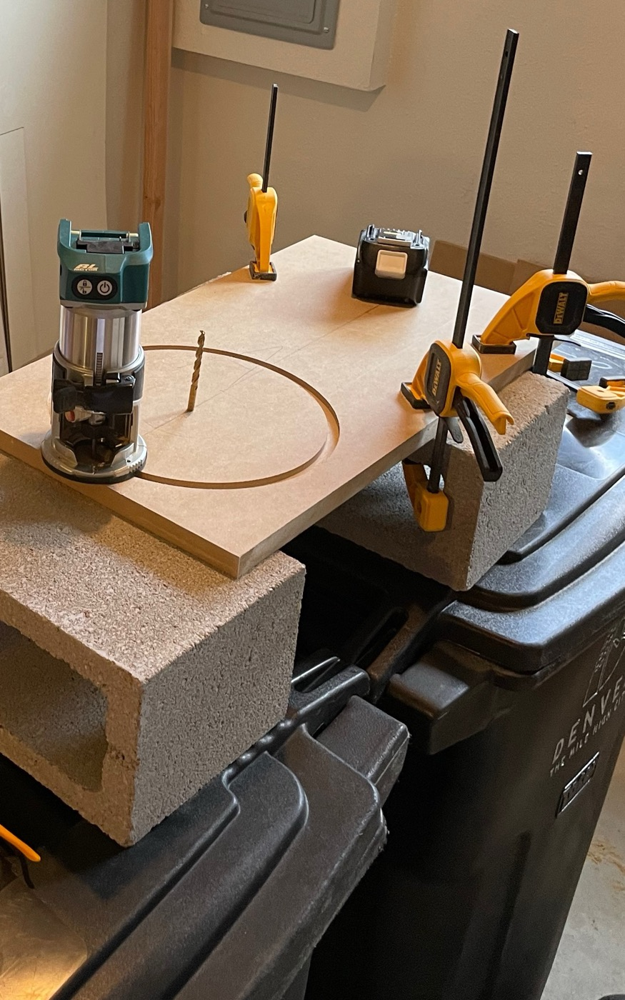
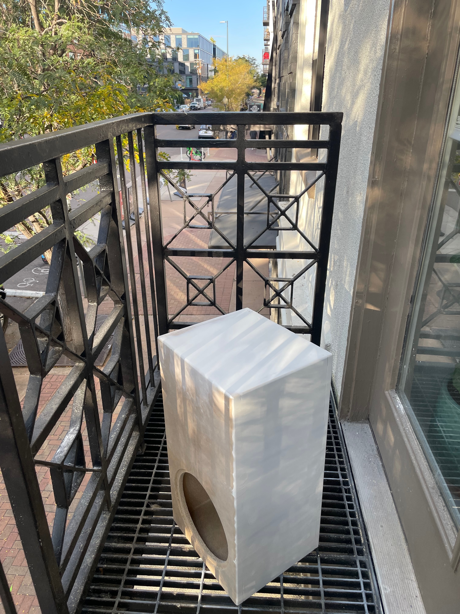
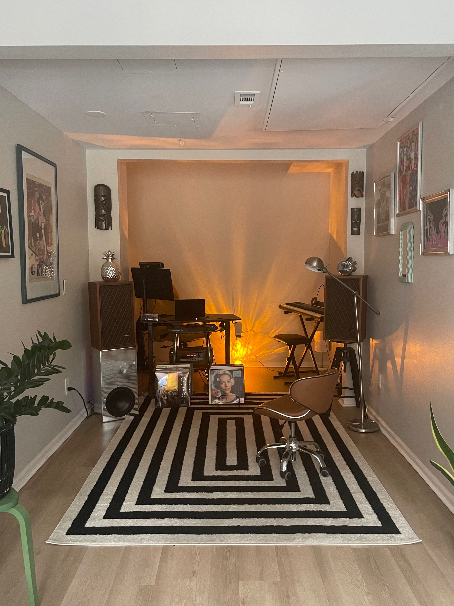
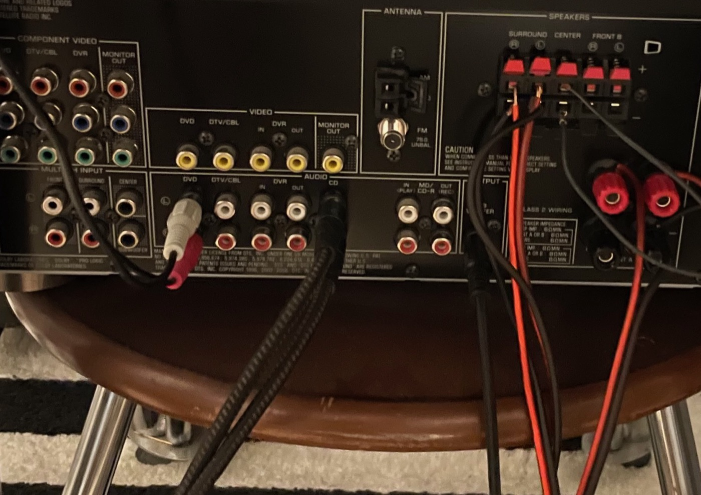
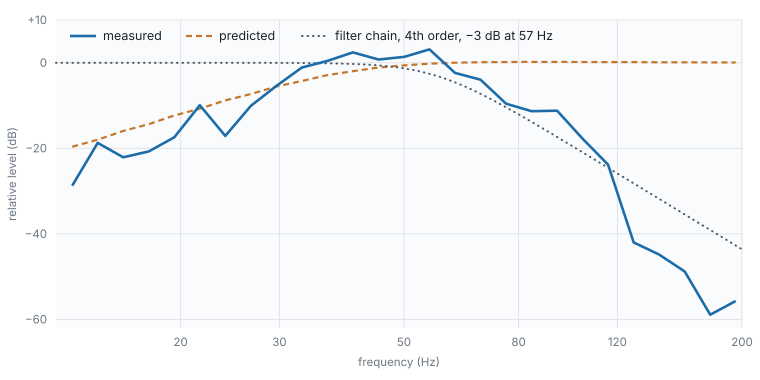

# A chrome-wrapped sealed subwoofer for a home studio

**Ezkeisac — 2026**

---

## Abstract

A sealed 10-inch subwoofer for a small home studio, presented as a constrained design
problem: a requirement that the cabinet serve as a stand for an existing monitor fixes
its cross-section, leaving height as the only dimension by which the target internal
volume can be reached.

The cabinet was built from two sheets of 19 mm MDF with hand-held power tools, glued and
clamped for 72 hours, then primed in three sanded coats and finished in chrome vinyl.
Performance predicted from the manufacturer's published Thiele–Small parameters was
compared against acoustic measurement with a Tascam DR-05 portable recorder, using a
stepped-sine method.

The enclosure meets every requirement it was designed against: footprint and finish by
construction, integration with the mains within the resolution of the method, and the
60 Hz crossover to within 2 Hz once the receiver's own fixed filter stage is deconvolved.
The low-frequency requirement is supported — predicted *F*<sub>3</sub> is 36.2 Hz — but
not confirmed absolutely, the instrument being uncalibrated. Prediction and measurement
agree to 3.65 dB mean absolute error over 20–80 Hz.

---

## Nomenclature

| Term | Definition |
|---|---|
| Driver | The electro-acoustic transducer; the moving cone assembly |
| Enclosure | The sealed cabinet housing the driver. The enclosed air is an acoustic element of the system, not packaging |
| Sealed alignment | An airtight enclosure. The alternative, a vented alignment, extends response lower but terminates more abruptly below tuning |
| *V*<sub>b</sub> | Enclosure internal air volume, litres |
| Thiele–Small parameters | The small-signal parameters describing driver behaviour: *F*<sub>s</sub> free-air resonance, *Q*<sub>ts</sub> total damping, *V*<sub>as</sub> equivalent compliance volume |
| *F*<sub>c</sub> | System resonance with the driver mounted in the enclosure. Always above *F*<sub>s</sub>, the enclosed air adding stiffness |
| *Q*<sub>tc</sub> | Total system damping. 0.707 gives maximally flat response |
| Butterworth | The alignment with the flattest passband obtainable without a peak before roll-off. For the second-order response of a sealed enclosure it is one specific value, *Q*<sub>tc</sub> = 0.707, which places *F*<sub>3</sub> exactly at *F*<sub>c</sub>. Above it the response rises before falling; below it the roll-off starts earlier and more gently |
| Filter order | How steeply a filter falls once past its corner, in multiples of 6 dB per octave. Second order is 12 dB per octave, fourth order 24 dB. Filters in series add their orders |
| *F*<sub>3</sub> | Frequency at which response has fallen 3 dB below the passband |
| Crossover | The frequency at which the subwoofer yields to the main loudspeakers |
| dB | A ratio, not an absolute level. −3 dB denotes half power |
| Nearfield measurement | Measurement with the microphone within centimetres of the radiating surface, minimising room contribution |

---

## 1. Design requirements

Requirements were stated such that each could be evaluated against measurement on
completion. Verification is reported in [`DISCUSSION.md`](DISCUSSION.md) §6.1.

| # | Requirement |
|---|---|
| **R1** | Useful output to approximately 35 Hz |
| **R2** | Seamless integration with a pair of Realistic Nova 7B main loudspeakers |
| **R3** | Cross-sectional area equal to that of a Nova 7B, permitting the subwoofer to serve as its base |
| **R4** | Mirror-finish chrome exterior |
| **R6** | Crossover to the mains at 60 Hz |

R3 and R6 determined the rest. R3 converts the enclosure from a free design into a
constrained one (§2), and R6 fixes where the subwoofer's work begins and ends. Of the
five, two look like numbers chosen by taste — 35 Hz and 60 Hz — and those are the two
worth justifying.

### 1.1 Why 35 Hz (R1)

**35 Hz is where the programme material stops, not where the cabinet stops.**

The sources are a turntable and a DJ controller (§4.1), so the material is records and
dance music, and the lowest fundamentals occurring in it are bounded. The open E of a bass
guitar is 41.2 Hz and the low B of a five-string 30.9 Hz; a tuned drum-machine kick sits
around 40–60 Hz with its skirt reaching into the thirties. Vinyl imposes a second floor
from the other direction: low frequencies demand groove excursion, so cutting practice
attenuates and mono-sums the bottom end, and little below roughly 30 Hz survives onto a
record in useful quantity. A requirement at 35 Hz therefore sits just beneath the lowest
fundamental reliably present, and just above the region the sources cannot deliver in the
first place.

Going lower is not free, and under R3 it is costly in one particular way. In a sealed
alignment *F*<sub>3</sub> falls only as the enclosure grows, and a fixed cross-section
leaves volume purchasable in a single currency: height. Every further step down raises the
cabinet — and the cabinet is a stand. Past some height the monitor standing on it is no
longer at ear level, and R3 has been satisfied in letter while being defeated in purpose.
**R1 and R3 trade directly against one another along the only free dimension**, which is
why the depth target had to be argued rather than aspired to.

### 1.2 Why 60 Hz (R6)

A crossover is two decisions, a frequency and a pair of slopes, and theory constrains
each.

**That a crossover may sit here at all.** At 60 Hz a wavelength is about 5.7 m, against a
head some 0.17 m across, so the interaural time and level differences that carry direction
are vanishingly small. Below roughly 80 Hz a source cannot be localised. That is what
permits one subwoofer to serve a stereo pair without the bass acquiring a position of its
own, and it is what frees the cabinet to be placed for the room rather than for the stereo
image.

**Where the frequency should fall.** At the point where the mains run out, near their own
−3 dB corner. Higher, and both sources work the same band, where the summed level depends
on their relative phase rather than on either response alone. Lower, and a gap opens in
which the mains have rolled off and the subwoofer has not yet taken over. 60 Hz is thus a
property of the Nova 7B pair rather than a choice about the subwoofer; the customary
consumer figure of 80 Hz would leave the mains doing work they are no longer good at.

**That two halves meeting do not sum flat on their own.** If each side is −3 dB at the
crossover and the two arrive in phase, the sum is **+3 dB** — a bump, not a handover. The
alignment that sums flat is the one where each side is −6 dB there: a Linkwitz–Riley,
formed by cascading two Butterworth sections and therefore fourth order. The order matters
as much as the frequency, which is why §6.1 has to establish the order of the chain before
it can say whether R6 was met.

**What complicates it in this system.** The low-pass is not one filter but two in series
(§4.1) — the receiver's fixed stage and the plate amplifier's dial — and only their
product can be measured. The high-pass side is not a filter at all, but the mains' own
natural roll-off, of whatever order their cabinets happen to give. R6 therefore states a
target for the acoustic handover, not a dial setting. What the dial must be doing to
produce that handover is solved in
[`derive_crossover.py`](calculations/derive_crossover.py), assumptions stated.

---

## 2. Enclosure design

All dimensional and volumetric figures, and the derivation that produces them, are in
[`calculations/`](calculations/) — [`derive_box.py`](calculations/derive_box.py),
[`box-dimensions.csv`](calculations/box-dimensions.csv),
[`volume.csv`](calculations/volume.csv),
[`driver-parameters.csv`](calculations/driver-parameters.csv).

```bash
python3 calculations/derive_box.py
```

### 2.1 An inverted design problem

Enclosure design normally begins with a target volume and arrives at proportions, which
are chosen for whatever suits — a cube for stiffness, a slim tower for floor area, a
squat box to sit under a desk. The acoustic requirement leads and the shape follows.

R3 inverts that. Requiring the cabinet to carry a monitor fixes its footprint before any
acoustic consideration is admitted, and a fixed footprint fixes the internal
cross-sectional area once wall thickness is subtracted. **The shape leads and the volume
must follow.**

This leaves the design with a single degree of freedom. Where a conventional enclosure is
specified by three dimensions chosen together, this one has two imposed and one to solve:
height is whatever satisfies the volume requirement across the area already given. The
derivation is therefore a division, and the interesting work lies in what that division
constrains rather than in performing it.

### 2.2 Accounting for the driver

The volume the driver experiences is not the volume enclosed. Magnet and basket intrude
into the interior and must be deducted before any prediction is made, because every figure
downstream is a function of the effective volume rather than the internal one. The
deduction here is 3.13 L against an internal 42.21 L — about 7% of the box, which is not a
rounding detail in a quantity everything else depends on.

**What water displacement would establish.** The method is Archimedes'. The intruding part
of the driver is lowered into a filled vessel and the water pushed out is caught and
measured; the volume displaced equals the volume submerged, whatever its shape. That
indifference to shape is the whole point, a motor assembly and a cast basket being solids
no formula describes. It needs nothing beyond a graduated container, and it is the only
route to the figure for **this** driver rather than for its model.

**It was not performed.** The 3.13 L is the nominal figure from the driver's published
data, exactly as the Thiele–Small parameters are (§2.4), and it carries the same standing:
it describes a GRS 10SW-4HE, not necessarily the one in this cabinet. An afternoon with a
bucket would settle it, and it is listed in [`DISCUSSION.md`](DISCUSSION.md) §6.4 among the
things to do differently.

### 2.3 Consequence of the constraint

Solving under R3 produces a column roughly twice as tall as it is wide, where an
unconstrained enclosure of the same volume would approximate a cube. The proportions are
therefore a consequence of a requirement rather than a preference — and they are not
acoustically neutral, since a tall narrow box has one panel substantially larger than the
others. Whether that matters is the question §6.2 answers.

### 2.4 Driver parameters and their standing

Prediction proceeds from the **manufacturer's published Thiele–Small parameters** for the
GRS 10SW-4HE, taken from the driver manual. They were not independently measured.

This is a methodological weakness stated rather than concealed. Unit-to-unit tolerance on
these parameters is routinely ±10–20%, so they describe a driver of this model rather
than necessarily this specimen, and every quantity derived from them inherits that
uncertainty. §6.3 returns to it: one unresolved residual would be accounted for if the
published figures do not describe the driver actually fitted.

Substituting them into the standard sealed-alignment relations gives a system damping
slightly above Butterworth. That was accepted deliberately rather than corrected — a
small room contributes low-frequency gain of its own, and a gently rolling response
combines with that gain more predictably than a flat anechoic one does.

### 2.5 Transfer function

A sealed enclosure is a second-order high-pass. Normalising frequency to the system
resonance, with $s = j\,(f/F_c)$:

$$H(s) = \frac{s^{2}}{s^{2} + \dfrac{s}{Q_{tc}} + 1}$$

Only *F*<sub>c</sub> and *Q*<sub>tc</sub> appear. Everything the prediction claims —
*F*<sub>3</sub>, the slope below it, whether the response peaks before rolling off — is
carried by those two numbers. That is why §2.1 can treat the design as a single-variable
problem and still say something about how it will behave.

Writing $x = f/F_c$, the magnitude plotted in Figure 5 is

$$|H(x)| = \frac{x^{2}}{\sqrt{\left(1 - x^{2}\right)^{2} + \left(\dfrac{x}{Q_{tc}}\right)^{2}}}$$

Far below resonance the numerator dominates and output falls at 12 dB per octave; far
above it the expression tends to unity and the response is flat. $Q_{tc} = 0.707$ places
*F*<sub>3</sub> exactly at *F*<sub>c</sub>; above that value the response peaks before
rolling off, which is the case here.

Implemented in [`scripts/model.py`](scripts/model.py), whose `selftest` verifies the
Butterworth identity, the 12 dB per octave asymptote and the flat passband rather than
assuming them.

---

## 3. Construction

### 3.1 Fabrication

Hand-held power tools throughout; no table saw or router table. Panels were cut from two
sheets of 19 mm MDF.

The driver aperture was set out with a pivot and rule, then cut with a compact router on
a circle-cutting jig (Figure 1). The aperture is **rebated**: a shallow circular shoulder
is machined concentric with the through-hole so the 257 mm driver flange seats flush with
the baffle. A routed aperture gives a consistent radius and a clean rebate shoulder,
neither reliably achievable with a jigsaw.


**Figure 1.** Driver aperture marked and about to be routed, the pivot at centre. Work is
clamped to masonry blocks over a wheeled bin — the whole build used hand-held tools on an
improvised bench. Respiratory and eye protection were worn throughout; MDF dust is a
recognised hazard.

Joints were **glued and clamped for 72 hours**. Extended clamping is material rather than
precautionary: a sealed alignment is only valid if the enclosure is airtight, and at this
panel size a joint left to cure under its own weight will creep.

**No internal bracing was fitted.** §6.2 establishes that none was required.

### 3.2 Surface preparation

Preparation, not wrapping, is the operation that produces a mirror finish. The sequence
was:

1. **Hand-sanding over every surface.**
2. **Three coats of primer, sanded between coats.** This is the white coating visible in
   Figure 2.
3. Final sanding, then vinyl.

Priming is not cosmetic here and cannot be skipped. MDF is porous and its routed edges
more so; an unsealed surface absorbs unevenly and telegraphs its own fibre through any
film laid over it. Successive primer coats fill that structure, and sanding between coats
removes what each coat raises, converging on a flat, sealed, non-absorbent substrate.


**Figure 2.** Cabinet after priming, before vinyl. The white coating is the third primer coat;
the baffle is still bare MDF, showing the rebated aperture and the exposed core at the cut
edge.

### 3.3 Vinyl application

VViViD DECO65 chrome vinyl, one roll of 20 ft × 11.8 in. **Pieces were cut from the roll
and fitted at the joints of the cabinet.**

The placement is deliberate. On a specular finish a seam is permanent and conspicuous,
the reflection rendering the join visible from any angle. Sited on a corner, where the
surface is already turning away from the observer, a seam is read as an edge; displaced
40 mm onto a flat face, the same seam is read as a defect.


**Figure 3.** Completed cabinet in position, a Nova 7B standing on it per R3.

---

## 4. Measurement method

Implementation, entirely in the Python standard library with nothing to install:
[`scripts/`](scripts/). Each script carries a `selftest`.

### 4.1 Signal path

The subwoofer is one element of a 5.1 system, and what the receiver does to the signal
before it reaches the plate amplifier turns out to matter more than anything downstream
of it.


**Figure 4.** The system as wired. Nova 7B mains on the FRONT A binding posts at right; two
surround speakers and a small booth monitor on the SURROUND and CENTER clip terminals; the
subwoofer on the SUB WOOFER RCA output. Source equipment occupies the AUDIO inputs — a
turntable on DVD, a DJ controller on CD.

The consequential detail is that the subwoofer is driven from SUB WOOFER rather than a
full-range output. **That places two low-pass filters in series**, the receiver's own and
the plate amplifier's, and their slopes sum. A measurement of the system therefore
characterises the pair, and attributing the result to the amplifier alone would be an
error — one §6.1 has to unpick.

Receiver signal processing was disabled and the volume control marked, so the path is
linear and identical between takes. A gain change between takes would introduce a fixed
error into every subsequent comparison with nothing in the data to reveal it.

Only the main pair and the subwoofer carry signal. The surround and centre channels were
left connected and idle, which was a decision rather than an omission: on a receiver with
bass management, what arrives at SUB WOOFER is determined by the speaker configuration the
receiver believes it has, so unplugging a channel between takes risks altering the
subwoofer feed itself. Leaving the configuration untouched is the same precaution as
marking the volume control. Those channels stay idle **because** processing was disabled —
in an upmixing mode the receiver would spread a two-channel source across all of them, and
the bass it then redirected would reach the subwoofer by a route the measurement does not
account for.

### 4.2 Why stepped tones rather than a sweep

Playback and capture ran on separate devices sharing no clock — a laptop and the DR-05.
Swept measurement assumes the two can be aligned in time, and they cannot be.

Stepped tones remove the assumption instead of working around it. Each tone is an
independent observation at a frequency known exactly, so there is no timeline for drift to
corrupt — only a set of separate readings. Knowing the frequency in advance also means the
level can be read out at that frequency directly, which is why the analysis needs no
numerical libraries.

What follows from that choice — how long each tone runs, how the two programs agree on
where it landed, and how a recording is aligned when the marker itself is unmeasurable —
is set out in [`scripts/METHOD.md`](scripts/METHOD.md).

### 4.3 What the method can establish

The instrument is an uncalibrated recorder, so the measurements are **relative**. Spectral
shape is available — the position of a knee, the slope below it, where one source yields
to another — and absolute sound pressure is not.

This is a real limitation and it bounds what §6.1 may claim. It is also a tolerable one,
because every prediction made here is a statement about shape.

### 4.4 Error sources identified during measurement

Three procedural errors are recorded because each produced a plausible result rather than
an obviously broken one, and a plausible wrong answer is the more dangerous failure:

1. **An alignment marker outside the system's passband is not reproduced.** A 1 kHz
   marker cannot survive a chain that low-passes, so automatic detection locks to the
   first loud event instead and displaces every window.
2. **Clipping synthesises a flat response.** A saturated take measured flat across an
   octave and agreed with prediction *better* than the valid one. Saturation must be
   excluded before a result is interpreted, not after it looks wrong.
3. **A microphone near the subwoofer is not measuring the subwoofer.** With a main
   loudspeaker standing on the cabinet, no proximate position is acoustically isolated.
   See §6.2.

---

## 5. Results


**Figure 5.** Measured response of the isolated subwoofer against the sealed-alignment
prediction, 12–200 Hz. Relative level, normalised to a reference band; the uncalibrated
instrument gives no absolute reference. Regenerate with
`python3 scripts/plot_response.py`.

Measurement source: [`data/response_sub_isolated.csv`](data/response_sub_isolated.csv) —
mains disconnected, 24-bit, peak −2.8 dBFS, no saturation, 45 of 45 tones recovered.
Point-by-point values:
[`calculations/measured-vs-predicted.csv`](calculations/measured-vs-predicted.csv).

Over 20–80 Hz the mean absolute difference is **3.65 dB**. Two structures are present in
the residual, and they have different causes. An excess in the region of
*F*<sub>c</sub> is unexplained and treated in §6.3. The attenuation above 60 Hz is not a
property of the enclosure at all but of the signal path described in §4.1, and is
resolved in §6.1.

---

## 6. Discussion

Verification against each requirement, the bracing question, the superseded panel result,
the unresolved residual and recommendations for repetition are set out in
**[`DISCUSSION.md`](DISCUSSION.md)**.

---

## 7. Materials

Total **$357.84**, itemised in
[`calculations/materials-cost.csv`](calculations/materials-cost.csv). Fasteners, adhesive,
primer and sealant are not costed.

---

## References

[1] Yamaha Corporation, *RX-V361 AV Receiver Owner's Manual*.
https://data.yamaha.com/files/download/other_assets/3/319863/RX-V361_manual.pdf

---

## Repository

| | Contents |
|---|---|
| [`DISCUSSION.md`](DISCUSSION.md) | Verification against requirements, the bracing question, the superseded panel result, and recommendations |
| [`calculations/`](calculations/) | Dimensions, volumes, driver parameters, the measured-against-predicted table, cost schedule, and executable derivations |
| [`scripts/`](scripts/) | Excitation, analysis and plotting. Standard library only; each carries a `selftest`. [`METHOD.md`](scripts/METHOD.md) gives the measurement detail |
| [`data/`](data/) | Raw measurement data with provenance and stated limitations |
| [`images/`](images/) | Construction, system and completed-assembly photographs |

Licence: documentation CC BY-SA 4.0, code MIT — [`LICENSE`](LICENSE).
