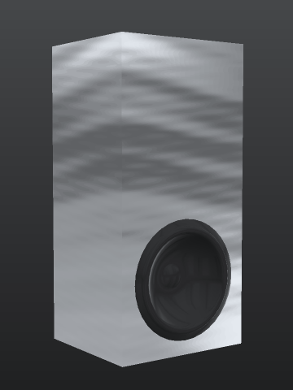

# DIY chrome subwoofer bc Everything is chrome in the future

Building a subwoofer for my home studio. A ten-inch driver, a sealed cabinet, a mirror
finish, a monitor base.

**318 × 661 × 280 mm · $380**



<details open>
<summary>The chrome</summary>

The finish is the flatwork.

A mirror is a measuring instrument for whatever lies under it. Hand-sand every surface.
Lay three coats of primer and sand between them. Sand once more. Then the vinyl.

MDF is porous and its routed edges more so. Unsealed, it absorbs unevenly and telegraphs
its fibre through any film laid over it. Each coat fills that structure. Each sanding
removes what the coat raised. What remains is flat, sealed and non-absorbent.


Preparation is the operation. The wrap is the short step at the end: VViViD DECO65, cut
from the roll in pieces and fitted at the joints.

On a specular finish a seam is permanent. On a corner, where the surface already turns
away, it reads as an edge. Forty millimetres onto a flat face, the same seam reads as a
defect.

</details>

<details open>
<summary>The shape</summary>

A monitor stands on it. That fixed the footprint before any acoustic decision was made,
and left height as the only dimension free to solve.

An enclosure normally begins with a volume and arrives at proportions. This one runs the
other way. The footprint fixes the cross-section. **The shape leads and the volume must
follow.** Two dimensions imposed, one to solve.

The answer is a column more than twice as tall as it is wide. The same volume, unconstrained,
is a cube.

The footprint here is a Realistic Nova 7B's. Another monitor is another footprint, and
the height is solved again.

```bash
python3 calculations/derive_box.py
```

</details>

<details open>
<summary>The model</summary>

Turn it. Switch to wireframe. There is no bracing.

```stl
solid enclosure
  facet normal 0.0000 -1.0000 0.0000
    outer loop
      vertex -128.50 0.00 -171.50
      vertex -159.00 0.00 -128.90
      vertex -159.00 0.00 -171.50
    endloop
  endfacet
  facet normal 0.0000 -1.0000 0.0000
    outer loop
      vertex -128.50 0.00 -171.50
      vertex -124.12 0.00 -138.24
      vertex -159.00 0.00 -128.90
    endloop
  endfacet
  facet normal 0.0000 -1.0000 0.0000
    outer loop
      vertex -124.12 0.00 -138.24
      vertex -159.00 0.00 -79.70
      vertex -159.00 0.00 -128.90
    endloop
  endfacet
  facet normal 0.0000 -1.0000 0.0000
    outer loop
      vertex -124.12 0.00 -138.24
      vertex -111.28 0.00 -107.25
      vertex -159.00 0.00 -79.70
    endloop
  endfacet
  facet normal 0.0000 -1.0000 0.0000
    outer loop
      vertex -111.28 0.00 -107.25
      vertex -159.00 0.00 -12.50
      vertex -159.00 0.00 -79.70
    endloop
  endfacet
  facet normal 0.0000 -1.0000 0.0000
    outer loop
      vertex -111.28 0.00 -107.25
      vertex -90.86 0.00 -80.64
      vertex -159.00 0.00 -12.50
    endloop
  endfacet
  facet normal 0.0000 -1.0000 0.0000
    outer loop
      vertex -90.86 0.00 -80.64
      vertex -159.00 0.00 103.90
      vertex -159.00 0.00 -12.50
    endloop
  endfacet
  facet normal 0.0000 -1.0000 0.0000
    outer loop
      vertex -90.86 0.00 -80.64
      vertex -64.25 0.00 -60.22
      vertex -159.00 0.00 103.90
    endloop
  endfacet
  facet normal 0.0000 -1.0000 0.0000
    outer loop
      vertex -64.25 0.00 -60.22
      vertex -159.00 0.00 330.50
      vertex -159.00 0.00 103.90
    endloop
  endfacet
  facet normal 0.0000 -1.0000 0.0000
    outer loop
      vertex -64.25 0.00 -60.22
      vertex -134.51 0.00 330.50
      vertex -159.00 0.00 330.50
    endloop
  endfacet
  facet normal 0.0000 -1.0000 0.0000
    outer loop
      vertex -64.25 0.00 -60.22
      vertex -33.26 0.00 -47.38
      vertex -134.51 0.00 330.50
    endloop
  endfacet
  facet normal 0.0000 -1.0000 0.0000
    outer loop
      vertex -33.26 0.00 -47.38
      vertex -0.00 0.00 330.50
      vertex -134.51 0.00 330.50
    endloop
  endfacet
  facet normal 0.0000 -1.0000 0.0000
    outer loop
      vertex -33.26 0.00 -47.38
      vertex -0.00 0.00 -43.00
      vertex -0.00 0.00 330.50
    endloop
  endfacet
  facet normal 0.0000 -1.0000 0.0000
    outer loop
      vertex -0.00 0.00 -43.00
      vertex 134.51 0.00 330.50
      vertex -0.00 0.00 330.50
    endloop
  endfacet
  facet normal 0.0000 -1.0000 0.0000
    outer loop
      vertex -0.00 0.00 -43.00
      vertex 33.26 0.00 -47.38
      vertex 134.51 0.00 330.50
    endloop
  endfacet
  facet normal 0.0000 -1.0000 0.0000
    outer loop
      vertex 33.26 0.00 -47.38
      vertex 159.00 0.00 330.50
      vertex 134.51 0.00 330.50
    endloop
  endfacet
  facet normal 0.0000 -1.0000 0.0000
    outer loop
      vertex 33.26 0.00 -47.38
      vertex 159.00 0.00 103.90
      vertex 159.00 0.00 330.50
    endloop
  endfacet
  facet normal 0.0000 -1.0000 0.0000
    outer loop
      vertex 33.26 0.00 -47.38
      vertex 64.25 0.00 -60.22
      vertex 159.00 0.00 103.90
    endloop
  endfacet
  facet normal 0.0000 -1.0000 0.0000
    outer loop
      vertex 64.25 0.00 -60.22
      vertex 159.00 0.00 -12.50
      vertex 159.00 0.00 103.90
    endloop
  endfacet
  facet normal 0.0000 -1.0000 0.0000
    outer loop
      vertex 64.25 0.00 -60.22
      vertex 90.86 0.00 -80.64
      vertex 159.00 0.00 -12.50
    endloop
  endfacet
  facet normal 0.0000 -1.0000 0.0000
    outer loop
      vertex 90.86 0.00 -80.64
      vertex 159.00 0.00 -79.70
      vertex 159.00 0.00 -12.50
    endloop
  endfacet
  facet normal 0.0000 -1.0000 0.0000
    outer loop
      vertex 90.86 0.00 -80.64
      vertex 111.28 0.00 -107.25
      vertex 159.00 0.00 -79.70
    endloop
  endfacet
  facet normal 0.0000 -1.0000 0.0000
    outer loop
      vertex 111.28 0.00 -107.25
      vertex 159.00 0.00 -128.90
      vertex 159.00 0.00 -79.70
    endloop
  endfacet
  facet normal 0.0000 -1.0000 0.0000
    outer loop
      vertex 111.28 0.00 -107.25
      vertex 124.12 0.00 -138.24
      vertex 159.00 0.00 -128.90
    endloop
  endfacet
  facet normal 0.0000 -1.0000 0.0000
    outer loop
      vertex 124.12 0.00 -138.24
      vertex 159.00 0.00 -171.50
      vertex 159.00 0.00 -128.90
    endloop
  endfacet
  facet normal 0.0000 -1.0000 0.0000
    outer loop
      vertex 124.12 0.00 -138.24
      vertex 128.50 0.00 -171.50
      vertex 159.00 0.00 -171.50
    endloop
  endfacet
  facet normal 0.0000 -1.0000 0.0000
    outer loop
      vertex 128.50 0.00 -171.50
      vertex 159.00 0.00 -214.10
      vertex 159.00 0.00 -171.50
    endloop
  endfacet
  facet normal 0.0000 -1.0000 -0.0000
    outer loop
      vertex 128.50 0.00 -171.50
      vertex 124.12 0.00 -204.76
      vertex 159.00 0.00 -214.10
    endloop
  endfacet
  facet normal 0.0000 -1.0000 0.0000
    outer loop
      vertex 124.12 0.00 -204.76
      vertex 159.00 0.00 -263.30
      vertex 159.00 0.00 -214.10
    endloop
  endfacet
  facet normal 0.0000 -1.0000 -0.0000
    outer loop
      vertex 124.12 0.00 -204.76
      vertex 111.28 0.00 -235.75
      vertex 159.00 0.00 -263.30
    endloop
  endfacet
  facet normal 0.0000 -1.0000 0.0000
    outer loop
      vertex 111.28 0.00 -235.75
      vertex 159.00 0.00 -330.50
      vertex 159.00 0.00 -263.30
    endloop
  endfacet
  facet normal 0.0000 -1.0000 -0.0000
    outer loop
      vertex 111.28 0.00 -235.75
      vertex 90.86 0.00 -262.36
      vertex 159.00 0.00 -330.50
    endloop
  endfacet
  facet normal 0.0000 -1.0000 0.0000
    outer loop
      vertex 90.86 0.00 -262.36
      vertex 159.00 0.00 -330.50
      vertex 159.00 0.00 -330.50
    endloop
  endfacet
  facet normal 0.0000 -1.0000 0.0000
    outer loop
      vertex 90.86 0.00 -262.36
      vertex 91.80 0.00 -330.50
      vertex 159.00 0.00 -330.50
    endloop
  endfacet
  facet normal 0.0000 -1.0000 -0.0000
    outer loop
      vertex 90.86 0.00 -262.36
      vertex 64.25 0.00 -282.78
      vertex 91.80 0.00 -330.50
    endloop
  endfacet
  facet normal 0.0000 -1.0000 -0.0000
    outer loop
      vertex 64.25 0.00 -282.78
      vertex 42.60 0.00 -330.50
      vertex 91.80 0.00 -330.50
    endloop
  endfacet
  facet normal 0.0000 -1.0000 0.0000
    outer loop
      vertex 64.25 0.00 -282.78
      vertex 33.26 0.00 -295.62
      vertex 42.60 0.00 -330.50
    endloop
  endfacet
  facet normal 0.0000 -1.0000 -0.0000
    outer loop
      vertex 33.26 0.00 -295.62
      vertex 0.00 0.00 -330.50
      vertex 42.60 0.00 -330.50
    endloop
  endfacet
  facet normal 0.0000 -1.0000 0.0000
    outer loop
      vertex 33.26 0.00 -295.62
      vertex 0.00 0.00 -300.00
      vertex 0.00 0.00 -330.50
    endloop
  endfacet
  facet normal 0.0000 -1.0000 -0.0000
    outer loop
      vertex 0.00 0.00 -300.00
      vertex -42.60 0.00 -330.50
      vertex 0.00 0.00 -330.50
    endloop
  endfacet
  facet normal -0.0000 -1.0000 0.0000
    outer loop
      vertex 0.00 0.00 -300.00
      vertex -33.26 0.00 -295.62
      vertex -42.60 0.00 -330.50
    endloop
  endfacet
  facet normal 0.0000 -1.0000 0.0000
    outer loop
      vertex -33.26 0.00 -295.62
      vertex -91.80 0.00 -330.50
      vertex -42.60 0.00 -330.50
    endloop
  endfacet
  facet normal -0.0000 -1.0000 0.0000
    outer loop
      vertex -33.26 0.00 -295.62
      vertex -64.25 0.00 -282.78
      vertex -91.80 0.00 -330.50
    endloop
  endfacet
  facet normal 0.0000 -1.0000 0.0000
    outer loop
      vertex -64.25 0.00 -282.78
      vertex -159.00 0.00 -330.50
      vertex -91.80 0.00 -330.50
    endloop
  endfacet
  facet normal -0.0000 -1.0000 0.0000
    outer loop
      vertex -64.25 0.00 -282.78
      vertex -90.86 0.00 -262.36
      vertex -159.00 0.00 -330.50
    endloop
  endfacet
  facet normal 0.0000 -1.0000 0.0000
    outer loop
      vertex -90.86 0.00 -262.36
      vertex -159.00 0.00 -263.30
      vertex -159.00 0.00 -330.50
    endloop
  endfacet
  facet normal -0.0000 -1.0000 0.0000
    outer loop
      vertex -90.86 0.00 -262.36
      vertex -111.28 0.00 -235.75
      vertex -159.00 0.00 -263.30
    endloop
  endfacet
  facet normal -0.0000 -1.0000 0.0000
    outer loop
      vertex -111.28 0.00 -235.75
      vertex -159.00 0.00 -214.10
      vertex -159.00 0.00 -263.30
    endloop
  endfacet
  facet normal 0.0000 -1.0000 0.0000
    outer loop
      vertex -111.28 0.00 -235.75
      vertex -124.12 0.00 -204.76
      vertex -159.00 0.00 -214.10
    endloop
  endfacet
  facet normal -0.0000 -1.0000 0.0000
    outer loop
      vertex -124.12 0.00 -204.76
      vertex -159.00 0.00 -171.50
      vertex -159.00 0.00 -214.10
    endloop
  endfacet
  facet normal 0.0000 -1.0000 0.0000
    outer loop
      vertex -124.12 0.00 -204.76
      vertex -128.50 0.00 -171.50
      vertex -159.00 0.00 -171.50
    endloop
  endfacet
  facet normal -0.9914 0.0000 0.1305
    outer loop
      vertex -128.50 0.00 -171.50
      vertex -124.12 0.00 -138.24
      vertex -124.12 6.00 -138.24
    endloop
  endfacet
  facet normal -0.9914 0.0000 0.1305
    outer loop
      vertex -128.50 0.00 -171.50
      vertex -124.12 6.00 -138.24
      vertex -128.50 6.00 -171.50
    endloop
  endfacet
  facet normal 0.0000 1.0000 0.0000
    outer loop
      vertex -128.50 6.00 -171.50
      vertex -124.12 6.00 -138.24
      vertex -112.53 6.00 -141.35
    endloop
  endfacet
  facet normal 0.0000 1.0000 0.0000
    outer loop
      vertex -128.50 6.00 -171.50
      vertex -112.53 6.00 -141.35
      vertex -116.50 6.00 -171.50
    endloop
  endfacet
  facet normal -0.9914 0.0000 0.1305
    outer loop
      vertex -116.50 6.00 -171.50
      vertex -112.53 6.00 -141.35
      vertex -112.53 19.00 -141.35
    endloop
  endfacet
  facet normal -0.9914 0.0000 0.1305
    outer loop
      vertex -116.50 6.00 -171.50
      vertex -112.53 19.00 -141.35
      vertex -116.50 19.00 -171.50
    endloop
  endfacet
  facet normal -0.9239 0.0000 0.3827
    outer loop
      vertex -124.12 0.00 -138.24
      vertex -111.28 0.00 -107.25
      vertex -111.28 6.00 -107.25
    endloop
  endfacet
  facet normal -0.9239 0.0000 0.3827
    outer loop
      vertex -124.12 0.00 -138.24
      vertex -111.28 6.00 -107.25
      vertex -124.12 6.00 -138.24
    endloop
  endfacet
  facet normal 0.0000 1.0000 0.0000
    outer loop
      vertex -124.12 6.00 -138.24
      vertex -111.28 6.00 -107.25
      vertex -100.89 6.00 -113.25
    endloop
  endfacet
  facet normal -0.0000 1.0000 0.0000
    outer loop
      vertex -124.12 6.00 -138.24
      vertex -100.89 6.00 -113.25
      vertex -112.53 6.00 -141.35
    endloop
  endfacet
  facet normal -0.9239 0.0000 0.3827
    outer loop
      vertex -112.53 6.00 -141.35
      vertex -100.89 6.00 -113.25
      vertex -100.89 19.00 -113.25
    endloop
  endfacet
  facet normal -0.9239 0.0000 0.3827
    outer loop
      vertex -112.53 6.00 -141.35
      vertex -100.89 19.00 -113.25
      vertex -112.53 19.00 -141.35
    endloop
  endfacet
  facet normal -0.7934 0.0000 0.6088
    outer loop
      vertex -111.28 0.00 -107.25
      vertex -90.86 0.00 -80.64
      vertex -90.86 6.00 -80.64
    endloop
  endfacet
  facet normal -0.7934 0.0000 0.6088
    outer loop
      vertex -111.28 0.00 -107.25
      vertex -90.86 6.00 -80.64
      vertex -111.28 6.00 -107.25
    endloop
  endfacet
  facet normal 0.0000 1.0000 0.0000
    outer loop
      vertex -111.28 6.00 -107.25
      vertex -90.86 6.00 -80.64
      vertex -82.38 6.00 -89.12
    endloop
  endfacet
  facet normal -0.0000 1.0000 0.0000
    outer loop
      vertex -111.28 6.00 -107.25
      vertex -82.38 6.00 -89.12
      vertex -100.89 6.00 -113.25
    endloop
  endfacet
  facet normal -0.7934 0.0000 0.6088
    outer loop
      vertex -100.89 6.00 -113.25
      vertex -82.38 6.00 -89.12
      vertex -82.38 19.00 -89.12
    endloop
  endfacet
  facet normal -0.7934 0.0000 0.6088
    outer loop
      vertex -100.89 6.00 -113.25
      vertex -82.38 19.00 -89.12
      vertex -100.89 19.00 -113.25
    endloop
  endfacet
  facet normal -0.6088 0.0000 0.7934
    outer loop
      vertex -90.86 0.00 -80.64
      vertex -64.25 0.00 -60.22
      vertex -64.25 6.00 -60.22
    endloop
  endfacet
  facet normal -0.6088 0.0000 0.7934
    outer loop
      vertex -90.86 0.00 -80.64
      vertex -64.25 6.00 -60.22
      vertex -90.86 6.00 -80.64
    endloop
  endfacet
  facet normal 0.0000 1.0000 0.0000
    outer loop
      vertex -90.86 6.00 -80.64
      vertex -64.25 6.00 -60.22
      vertex -58.25 6.00 -70.61
    endloop
  endfacet
  facet normal -0.0000 1.0000 0.0000
    outer loop
      vertex -90.86 6.00 -80.64
      vertex -58.25 6.00 -70.61
      vertex -82.38 6.00 -89.12
    endloop
  endfacet
  facet normal -0.6088 0.0000 0.7934
    outer loop
      vertex -82.38 6.00 -89.12
      vertex -58.25 6.00 -70.61
      vertex -58.25 19.00 -70.61
    endloop
  endfacet
  facet normal -0.6088 0.0000 0.7934
    outer loop
      vertex -82.38 6.00 -89.12
      vertex -58.25 19.00 -70.61
      vertex -82.38 19.00 -89.12
    endloop
  endfacet
  facet normal -0.3827 0.0000 0.9239
    outer loop
      vertex -64.25 0.00 -60.22
      vertex -33.26 0.00 -47.38
      vertex -33.26 6.00 -47.38
    endloop
  endfacet
  facet normal -0.3827 0.0000 0.9239
    outer loop
      vertex -64.25 0.00 -60.22
      vertex -33.26 6.00 -47.38
      vertex -64.25 6.00 -60.22
    endloop
  endfacet
  facet normal 0.0000 1.0000 0.0000
    outer loop
      vertex -64.25 6.00 -60.22
      vertex -33.26 6.00 -47.38
      vertex -30.15 6.00 -58.97
    endloop
  endfacet
  facet normal -0.0000 1.0000 0.0000
    outer loop
      vertex -64.25 6.00 -60.22
      vertex -30.15 6.00 -58.97
      vertex -58.25 6.00 -70.61
    endloop
  endfacet
  facet normal -0.3827 0.0000 0.9239
    outer loop
      vertex -58.25 6.00 -70.61
      vertex -30.15 6.00 -58.97
      vertex -30.15 19.00 -58.97
    endloop
  endfacet
  facet normal -0.3827 0.0000 0.9239
    outer loop
      vertex -58.25 6.00 -70.61
      vertex -30.15 19.00 -58.97
      vertex -58.25 19.00 -70.61
    endloop
  endfacet
  facet normal -0.1305 0.0000 0.9914
    outer loop
      vertex -33.26 0.00 -47.38
      vertex -0.00 0.00 -43.00
      vertex -0.00 6.00 -43.00
    endloop
  endfacet
  facet normal -0.1305 0.0000 0.9914
    outer loop
      vertex -33.26 0.00 -47.38
      vertex -0.00 6.00 -43.00
      vertex -33.26 6.00 -47.38
    endloop
  endfacet
  facet normal -0.0000 1.0000 0.0000
    outer loop
      vertex -33.26 6.00 -47.38
      vertex -0.00 6.00 -43.00
      vertex -0.00 6.00 -55.00
    endloop
  endfacet
  facet normal 0.0000 1.0000 0.0000
    outer loop
      vertex -33.26 6.00 -47.38
      vertex -0.00 6.00 -55.00
      vertex -30.15 6.00 -58.97
    endloop
  endfacet
  facet normal -0.1305 0.0000 0.9914
    outer loop
      vertex -30.15 6.00 -58.97
      vertex -0.00 6.00 -55.00
      vertex -0.00 19.00 -55.00
    endloop
  endfacet
  facet normal -0.1305 0.0000 0.9914
    outer loop
      vertex -30.15 6.00 -58.97
      vertex -0.00 19.00 -55.00
      vertex -30.15 19.00 -58.97
    endloop
  endfacet
  facet normal 0.1305 0.0000 0.9914
    outer loop
      vertex -0.00 0.00 -43.00
      vertex 33.26 0.00 -47.38
      vertex 33.26 6.00 -47.38
    endloop
  endfacet
  facet normal 0.1305 -0.0000 0.9914
    outer loop
      vertex -0.00 0.00 -43.00
      vertex 33.26 6.00 -47.38
      vertex -0.00 6.00 -43.00
    endloop
  endfacet
  facet normal 0.0000 1.0000 0.0000
    outer loop
      vertex -0.00 6.00 -43.00
      vertex 33.26 6.00 -47.38
      vertex 30.15 6.00 -58.97
    endloop
  endfacet
  facet normal 0.0000 1.0000 0.0000
    outer loop
      vertex -0.00 6.00 -43.00
      vertex 30.15 6.00 -58.97
      vertex -0.00 6.00 -55.00
    endloop
  endfacet
  facet normal 0.1305 0.0000 0.9914
    outer loop
      vertex -0.00 6.00 -55.00
      vertex 30.15 6.00 -58.97
      vertex 30.15 19.00 -58.97
    endloop
  endfacet
  facet normal 0.1305 -0.0000 0.9914
    outer loop
      vertex -0.00 6.00 -55.00
      vertex 30.15 19.00 -58.97
      vertex -0.00 19.00 -55.00
    endloop
  endfacet
  facet normal 0.3827 0.0000 0.9239
    outer loop
      vertex 33.26 0.00 -47.38
      vertex 64.25 0.00 -60.22
      vertex 64.25 6.00 -60.22
    endloop
  endfacet
  facet normal 0.3827 -0.0000 0.9239
    outer loop
      vertex 33.26 0.00 -47.38
      vertex 64.25 6.00 -60.22
      vertex 33.26 6.00 -47.38
    endloop
  endfacet
  facet normal 0.0000 1.0000 0.0000
    outer loop
      vertex 33.26 6.00 -47.38
      vertex 64.25 6.00 -60.22
      vertex 58.25 6.00 -70.61
    endloop
  endfacet
  facet normal 0.0000 1.0000 0.0000
    outer loop
      vertex 33.26 6.00 -47.38
      vertex 58.25 6.00 -70.61
      vertex 30.15 6.00 -58.97
    endloop
  endfacet
  facet normal 0.3827 0.0000 0.9239
    outer loop
      vertex 30.15 6.00 -58.97
      vertex 58.25 6.00 -70.61
      vertex 58.25 19.00 -70.61
    endloop
  endfacet
  facet normal 0.3827 -0.0000 0.9239
    outer loop
      vertex 30.15 6.00 -58.97
      vertex 58.25 19.00 -70.61
      vertex 30.15 19.00 -58.97
    endloop
  endfacet
  facet normal 0.6088 0.0000 0.7934
    outer loop
      vertex 64.25 0.00 -60.22
      vertex 90.86 0.00 -80.64
      vertex 90.86 6.00 -80.64
    endloop
  endfacet
  facet normal 0.6088 -0.0000 0.7934
    outer loop
      vertex 64.25 0.00 -60.22
      vertex 90.86 6.00 -80.64
      vertex 64.25 6.00 -60.22
    endloop
  endfacet
  facet normal 0.0000 1.0000 0.0000
    outer loop
      vertex 64.25 6.00 -60.22
      vertex 90.86 6.00 -80.64
      vertex 82.38 6.00 -89.12
    endloop
  endfacet
  facet normal 0.0000 1.0000 0.0000
    outer loop
      vertex 64.25 6.00 -60.22
      vertex 82.38 6.00 -89.12
      vertex 58.25 6.00 -70.61
    endloop
  endfacet
  facet normal 0.6088 0.0000 0.7934
    outer loop
      vertex 58.25 6.00 -70.61
      vertex 82.38 6.00 -89.12
      vertex 82.38 19.00 -89.12
    endloop
  endfacet
  facet normal 0.6088 -0.0000 0.7934
    outer loop
      vertex 58.25 6.00 -70.61
      vertex 82.38 19.00 -89.12
      vertex 58.25 19.00 -70.61
    endloop
  endfacet
  facet normal 0.7934 0.0000 0.6088
    outer loop
      vertex 90.86 0.00 -80.64
      vertex 111.28 0.00 -107.25
      vertex 111.28 6.00 -107.25
    endloop
  endfacet
  facet normal 0.7934 -0.0000 0.6088
    outer loop
      vertex 90.86 0.00 -80.64
      vertex 111.28 6.00 -107.25
      vertex 90.86 6.00 -80.64
    endloop
  endfacet
  facet normal 0.0000 1.0000 0.0000
    outer loop
      vertex 90.86 6.00 -80.64
      vertex 111.28 6.00 -107.25
      vertex 100.89 6.00 -113.25
    endloop
  endfacet
  facet normal 0.0000 1.0000 0.0000
    outer loop
      vertex 90.86 6.00 -80.64
      vertex 100.89 6.00 -113.25
      vertex 82.38 6.00 -89.12
    endloop
  endfacet
  facet normal 0.7934 0.0000 0.6088
    outer loop
      vertex 82.38 6.00 -89.12
      vertex 100.89 6.00 -113.25
      vertex 100.89 19.00 -113.25
    endloop
  endfacet
  facet normal 0.7934 -0.0000 0.6088
    outer loop
      vertex 82.38 6.00 -89.12
      vertex 100.89 19.00 -113.25
      vertex 82.38 19.00 -89.12
    endloop
  endfacet
  facet normal 0.9239 0.0000 0.3827
    outer loop
      vertex 111.28 0.00 -107.25
      vertex 124.12 0.00 -138.24
      vertex 124.12 6.00 -138.24
    endloop
  endfacet
  facet normal 0.9239 -0.0000 0.3827
    outer loop
      vertex 111.28 0.00 -107.25
      vertex 124.12 6.00 -138.24
      vertex 111.28 6.00 -107.25
    endloop
  endfacet
  facet normal 0.0000 1.0000 0.0000
    outer loop
      vertex 111.28 6.00 -107.25
      vertex 124.12 6.00 -138.24
      vertex 112.53 6.00 -141.35
    endloop
  endfacet
  facet normal 0.0000 1.0000 0.0000
    outer loop
      vertex 111.28 6.00 -107.25
      vertex 112.53 6.00 -141.35
      vertex 100.89 6.00 -113.25
    endloop
  endfacet
  facet normal 0.9239 0.0000 0.3827
    outer loop
      vertex 100.89 6.00 -113.25
      vertex 112.53 6.00 -141.35
      vertex 112.53 19.00 -141.35
    endloop
  endfacet
  facet normal 0.9239 -0.0000 0.3827
    outer loop
      vertex 100.89 6.00 -113.25
      vertex 112.53 19.00 -141.35
      vertex 100.89 19.00 -113.25
    endloop
  endfacet
  facet normal 0.9914 0.0000 0.1305
    outer loop
      vertex 124.12 0.00 -138.24
      vertex 128.50 0.00 -171.50
      vertex 128.50 6.00 -171.50
    endloop
  endfacet
  facet normal 0.9914 -0.0000 0.1305
    outer loop
      vertex 124.12 0.00 -138.24
      vertex 128.50 6.00 -171.50
      vertex 124.12 6.00 -138.24
    endloop
  endfacet
  facet normal 0.0000 1.0000 0.0000
    outer loop
      vertex 124.12 6.00 -138.24
      vertex 128.50 6.00 -171.50
      vertex 116.50 6.00 -171.50
    endloop
  endfacet
  facet normal 0.0000 1.0000 0.0000
    outer loop
      vertex 124.12 6.00 -138.24
      vertex 116.50 6.00 -171.50
      vertex 112.53 6.00 -141.35
    endloop
  endfacet
  facet normal 0.9914 0.0000 0.1305
    outer loop
      vertex 112.53 6.00 -141.35
      vertex 116.50 6.00 -171.50
      vertex 116.50 19.00 -171.50
    endloop
  endfacet
  facet normal 0.9914 -0.0000 0.1305
    outer loop
      vertex 112.53 6.00 -141.35
      vertex 116.50 19.00 -171.50
      vertex 112.53 19.00 -141.35
    endloop
  endfacet
  facet normal 0.9914 0.0000 -0.1305
    outer loop
      vertex 128.50 0.00 -171.50
      vertex 124.12 0.00 -204.76
      vertex 124.12 6.00 -204.76
    endloop
  endfacet
  facet normal 0.9914 0.0000 -0.1305
    outer loop
      vertex 128.50 0.00 -171.50
      vertex 124.12 6.00 -204.76
      vertex 128.50 6.00 -171.50
    endloop
  endfacet
  facet normal 0.0000 1.0000 0.0000
    outer loop
      vertex 128.50 6.00 -171.50
      vertex 124.12 6.00 -204.76
      vertex 112.53 6.00 -201.65
    endloop
  endfacet
  facet normal 0.0000 1.0000 0.0000
    outer loop
      vertex 128.50 6.00 -171.50
      vertex 112.53 6.00 -201.65
      vertex 116.50 6.00 -171.50
    endloop
  endfacet
  facet normal 0.9914 0.0000 -0.1305
    outer loop
      vertex 116.50 6.00 -171.50
      vertex 112.53 6.00 -201.65
      vertex 112.53 19.00 -201.65
    endloop
  endfacet
  facet normal 0.9914 0.0000 -0.1305
    outer loop
      vertex 116.50 6.00 -171.50
      vertex 112.53 19.00 -201.65
      vertex 116.50 19.00 -171.50
    endloop
  endfacet
  facet normal 0.9239 0.0000 -0.3827
    outer loop
      vertex 124.12 0.00 -204.76
      vertex 111.28 0.00 -235.75
      vertex 111.28 6.00 -235.75
    endloop
  endfacet
  facet normal 0.9239 0.0000 -0.3827
    outer loop
      vertex 124.12 0.00 -204.76
      vertex 111.28 6.00 -235.75
      vertex 124.12 6.00 -204.76
    endloop
  endfacet
  facet normal 0.0000 1.0000 0.0000
    outer loop
      vertex 124.12 6.00 -204.76
      vertex 111.28 6.00 -235.75
      vertex 100.89 6.00 -229.75
    endloop
  endfacet
  facet normal 0.0000 1.0000 0.0000
    outer loop
      vertex 124.12 6.00 -204.76
      vertex 100.89 6.00 -229.75
      vertex 112.53 6.00 -201.65
    endloop
  endfacet
  facet normal 0.9239 0.0000 -0.3827
    outer loop
      vertex 112.53 6.00 -201.65
      vertex 100.89 6.00 -229.75
      vertex 100.89 19.00 -229.75
    endloop
  endfacet
  facet normal 0.9239 0.0000 -0.3827
    outer loop
      vertex 112.53 6.00 -201.65
      vertex 100.89 19.00 -229.75
      vertex 112.53 19.00 -201.65
    endloop
  endfacet
  facet normal 0.7934 0.0000 -0.6088
    outer loop
      vertex 111.28 0.00 -235.75
      vertex 90.86 0.00 -262.36
      vertex 90.86 6.00 -262.36
    endloop
  endfacet
  facet normal 0.7934 0.0000 -0.6088
    outer loop
      vertex 111.28 0.00 -235.75
      vertex 90.86 6.00 -262.36
      vertex 111.28 6.00 -235.75
    endloop
  endfacet
  facet normal 0.0000 1.0000 0.0000
    outer loop
      vertex 111.28 6.00 -235.75
      vertex 90.86 6.00 -262.36
      vertex 82.38 6.00 -253.88
    endloop
  endfacet
  facet normal 0.0000 1.0000 0.0000
    outer loop
      vertex 111.28 6.00 -235.75
      vertex 82.38 6.00 -253.88
      vertex 100.89 6.00 -229.75
    endloop
  endfacet
  facet normal 0.7934 0.0000 -0.6088
    outer loop
      vertex 100.89 6.00 -229.75
      vertex 82.38 6.00 -253.88
      vertex 82.38 19.00 -253.88
    endloop
  endfacet
  facet normal 0.7934 0.0000 -0.6088
    outer loop
      vertex 100.89 6.00 -229.75
      vertex 82.38 19.00 -253.88
      vertex 100.89 19.00 -229.75
    endloop
  endfacet
  facet normal 0.6088 0.0000 -0.7934
    outer loop
      vertex 90.86 0.00 -262.36
      vertex 64.25 0.00 -282.78
      vertex 64.25 6.00 -282.78
    endloop
  endfacet
  facet normal 0.6088 0.0000 -0.7934
    outer loop
      vertex 90.86 0.00 -262.36
      vertex 64.25 6.00 -282.78
      vertex 90.86 6.00 -262.36
    endloop
  endfacet
  facet normal 0.0000 1.0000 0.0000
    outer loop
      vertex 90.86 6.00 -262.36
      vertex 64.25 6.00 -282.78
      vertex 58.25 6.00 -272.39
    endloop
  endfacet
  facet normal 0.0000 1.0000 0.0000
    outer loop
      vertex 90.86 6.00 -262.36
      vertex 58.25 6.00 -272.39
      vertex 82.38 6.00 -253.88
    endloop
  endfacet
  facet normal 0.6088 0.0000 -0.7934
    outer loop
      vertex 82.38 6.00 -253.88
      vertex 58.25 6.00 -272.39
      vertex 58.25 19.00 -272.39
    endloop
  endfacet
  facet normal 0.6088 0.0000 -0.7934
    outer loop
      vertex 82.38 6.00 -253.88
      vertex 58.25 19.00 -272.39
      vertex 82.38 19.00 -253.88
    endloop
  endfacet
  facet normal 0.3827 0.0000 -0.9239
    outer loop
      vertex 64.25 0.00 -282.78
      vertex 33.26 0.00 -295.62
      vertex 33.26 6.00 -295.62
    endloop
  endfacet
  facet normal 0.3827 0.0000 -0.9239
    outer loop
      vertex 64.25 0.00 -282.78
      vertex 33.26 6.00 -295.62
      vertex 64.25 6.00 -282.78
    endloop
  endfacet
  facet normal 0.0000 1.0000 0.0000
    outer loop
      vertex 64.25 6.00 -282.78
      vertex 33.26 6.00 -295.62
      vertex 30.15 6.00 -284.03
    endloop
  endfacet
  facet normal 0.0000 1.0000 0.0000
    outer loop
      vertex 64.25 6.00 -282.78
      vertex 30.15 6.00 -284.03
      vertex 58.25 6.00 -272.39
    endloop
  endfacet
  facet normal 0.3827 0.0000 -0.9239
    outer loop
      vertex 58.25 6.00 -272.39
      vertex 30.15 6.00 -284.03
      vertex 30.15 19.00 -284.03
    endloop
  endfacet
  facet normal 0.3827 0.0000 -0.9239
    outer loop
      vertex 58.25 6.00 -272.39
      vertex 30.15 19.00 -284.03
      vertex 58.25 19.00 -272.39
    endloop
  endfacet
  facet normal 0.1305 0.0000 -0.9914
    outer loop
      vertex 33.26 0.00 -295.62
      vertex 0.00 0.00 -300.00
      vertex 0.00 6.00 -300.00
    endloop
  endfacet
  facet normal 0.1305 0.0000 -0.9914
    outer loop
      vertex 33.26 0.00 -295.62
      vertex 0.00 6.00 -300.00
      vertex 33.26 6.00 -295.62
    endloop
  endfacet
  facet normal 0.0000 1.0000 0.0000
    outer loop
      vertex 33.26 6.00 -295.62
      vertex 0.00 6.00 -300.00
      vertex 0.00 6.00 -288.00
    endloop
  endfacet
  facet normal 0.0000 1.0000 0.0000
    outer loop
      vertex 33.26 6.00 -295.62
      vertex 0.00 6.00 -288.00
      vertex 30.15 6.00 -284.03
    endloop
  endfacet
  facet normal 0.1305 0.0000 -0.9914
    outer loop
      vertex 30.15 6.00 -284.03
      vertex 0.00 6.00 -288.00
      vertex 0.00 19.00 -288.00
    endloop
  endfacet
  facet normal 0.1305 0.0000 -0.9914
    outer loop
      vertex 30.15 6.00 -284.03
      vertex 0.00 19.00 -288.00
      vertex 30.15 19.00 -284.03
    endloop
  endfacet
  facet normal -0.1305 0.0000 -0.9914
    outer loop
      vertex 0.00 0.00 -300.00
      vertex -33.26 0.00 -295.62
      vertex -33.26 6.00 -295.62
    endloop
  endfacet
  facet normal -0.1305 0.0000 -0.9914
    outer loop
      vertex 0.00 0.00 -300.00
      vertex -33.26 6.00 -295.62
      vertex 0.00 6.00 -300.00
    endloop
  endfacet
  facet normal 0.0000 1.0000 0.0000
    outer loop
      vertex 0.00 6.00 -300.00
      vertex -33.26 6.00 -295.62
      vertex -30.15 6.00 -284.03
    endloop
  endfacet
  facet normal 0.0000 1.0000 0.0000
    outer loop
      vertex 0.00 6.00 -300.00
      vertex -30.15 6.00 -284.03
      vertex 0.00 6.00 -288.00
    endloop
  endfacet
  facet normal -0.1305 0.0000 -0.9914
    outer loop
      vertex 0.00 6.00 -288.00
      vertex -30.15 6.00 -284.03
      vertex -30.15 19.00 -284.03
    endloop
  endfacet
  facet normal -0.1305 0.0000 -0.9914
    outer loop
      vertex 0.00 6.00 -288.00
      vertex -30.15 19.00 -284.03
      vertex 0.00 19.00 -288.00
    endloop
  endfacet
  facet normal -0.3827 0.0000 -0.9239
    outer loop
      vertex -33.26 0.00 -295.62
      vertex -64.25 0.00 -282.78
      vertex -64.25 6.00 -282.78
    endloop
  endfacet
  facet normal -0.3827 0.0000 -0.9239
    outer loop
      vertex -33.26 0.00 -295.62
      vertex -64.25 6.00 -282.78
      vertex -33.26 6.00 -295.62
    endloop
  endfacet
  facet normal 0.0000 1.0000 0.0000
    outer loop
      vertex -33.26 6.00 -295.62
      vertex -64.25 6.00 -282.78
      vertex -58.25 6.00 -272.39
    endloop
  endfacet
  facet normal 0.0000 1.0000 -0.0000
    outer loop
      vertex -33.26 6.00 -295.62
      vertex -58.25 6.00 -272.39
      vertex -30.15 6.00 -284.03
    endloop
  endfacet
  facet normal -0.3827 0.0000 -0.9239
    outer loop
      vertex -30.15 6.00 -284.03
      vertex -58.25 6.00 -272.39
      vertex -58.25 19.00 -272.39
    endloop
  endfacet
  facet normal -0.3827 0.0000 -0.9239
    outer loop
      vertex -30.15 6.00 -284.03
      vertex -58.25 19.00 -272.39
      vertex -30.15 19.00 -284.03
    endloop
  endfacet
  facet normal -0.6088 0.0000 -0.7934
    outer loop
      vertex -64.25 0.00 -282.78
      vertex -90.86 0.00 -262.36
      vertex -90.86 6.00 -262.36
    endloop
  endfacet
  facet normal -0.6088 0.0000 -0.7934
    outer loop
      vertex -64.25 0.00 -282.78
      vertex -90.86 6.00 -262.36
      vertex -64.25 6.00 -282.78
    endloop
  endfacet
  facet normal 0.0000 1.0000 0.0000
    outer loop
      vertex -64.25 6.00 -282.78
      vertex -90.86 6.00 -262.36
      vertex -82.38 6.00 -253.88
    endloop
  endfacet
  facet normal 0.0000 1.0000 -0.0000
    outer loop
      vertex -64.25 6.00 -282.78
      vertex -82.38 6.00 -253.88
      vertex -58.25 6.00 -272.39
    endloop
  endfacet
  facet normal -0.6088 0.0000 -0.7934
    outer loop
      vertex -58.25 6.00 -272.39
      vertex -82.38 6.00 -253.88
      vertex -82.38 19.00 -253.88
    endloop
  endfacet
  facet normal -0.6088 0.0000 -0.7934
    outer loop
      vertex -58.25 6.00 -272.39
      vertex -82.38 19.00 -253.88
      vertex -58.25 19.00 -272.39
    endloop
  endfacet
  facet normal -0.7934 0.0000 -0.6088
    outer loop
      vertex -90.86 0.00 -262.36
      vertex -111.28 0.00 -235.75
      vertex -111.28 6.00 -235.75
    endloop
  endfacet
  facet normal -0.7934 0.0000 -0.6088
    outer loop
      vertex -90.86 0.00 -262.36
      vertex -111.28 6.00 -235.75
      vertex -90.86 6.00 -262.36
    endloop
  endfacet
  facet normal 0.0000 1.0000 0.0000
    outer loop
      vertex -90.86 6.00 -262.36
      vertex -111.28 6.00 -235.75
      vertex -100.89 6.00 -229.75
    endloop
  endfacet
  facet normal 0.0000 1.0000 -0.0000
    outer loop
      vertex -90.86 6.00 -262.36
      vertex -100.89 6.00 -229.75
      vertex -82.38 6.00 -253.88
    endloop
  endfacet
  facet normal -0.7934 0.0000 -0.6088
    outer loop
      vertex -82.38 6.00 -253.88
      vertex -100.89 6.00 -229.75
      vertex -100.89 19.00 -229.75
    endloop
  endfacet
  facet normal -0.7934 0.0000 -0.6088
    outer loop
      vertex -82.38 6.00 -253.88
      vertex -100.89 19.00 -229.75
      vertex -82.38 19.00 -253.88
    endloop
  endfacet
  facet normal -0.9239 0.0000 -0.3827
    outer loop
      vertex -111.28 0.00 -235.75
      vertex -124.12 0.00 -204.76
      vertex -124.12 6.00 -204.76
    endloop
  endfacet
  facet normal -0.9239 0.0000 -0.3827
    outer loop
      vertex -111.28 0.00 -235.75
      vertex -124.12 6.00 -204.76
      vertex -111.28 6.00 -235.75
    endloop
  endfacet
  facet normal 0.0000 1.0000 0.0000
    outer loop
      vertex -111.28 6.00 -235.75
      vertex -124.12 6.00 -204.76
      vertex -112.53 6.00 -201.65
    endloop
  endfacet
  facet normal 0.0000 1.0000 -0.0000
    outer loop
      vertex -111.28 6.00 -235.75
      vertex -112.53 6.00 -201.65
      vertex -100.89 6.00 -229.75
    endloop
  endfacet
  facet normal -0.9239 0.0000 -0.3827
    outer loop
      vertex -100.89 6.00 -229.75
      vertex -112.53 6.00 -201.65
      vertex -112.53 19.00 -201.65
    endloop
  endfacet
  facet normal -0.9239 0.0000 -0.3827
    outer loop
      vertex -100.89 6.00 -229.75
      vertex -112.53 19.00 -201.65
      vertex -100.89 19.00 -229.75
    endloop
  endfacet
  facet normal -0.9914 0.0000 -0.1305
    outer loop
      vertex -124.12 0.00 -204.76
      vertex -128.50 0.00 -171.50
      vertex -128.50 6.00 -171.50
    endloop
  endfacet
  facet normal -0.9914 0.0000 -0.1305
    outer loop
      vertex -124.12 0.00 -204.76
      vertex -128.50 6.00 -171.50
      vertex -124.12 6.00 -204.76
    endloop
  endfacet
  facet normal 0.0000 1.0000 -0.0000
    outer loop
      vertex -124.12 6.00 -204.76
      vertex -128.50 6.00 -171.50
      vertex -116.50 6.00 -171.50
    endloop
  endfacet
  facet normal 0.0000 1.0000 0.0000
    outer loop
      vertex -124.12 6.00 -204.76
      vertex -116.50 6.00 -171.50
      vertex -112.53 6.00 -201.65
    endloop
  endfacet
  facet normal -0.9914 0.0000 -0.1305
    outer loop
      vertex -112.53 6.00 -201.65
      vertex -116.50 6.00 -171.50
      vertex -116.50 19.00 -171.50
    endloop
  endfacet
  facet normal -0.9914 0.0000 -0.1305
    outer loop
      vertex -112.53 6.00 -201.65
      vertex -116.50 19.00 -171.50
      vertex -112.53 19.00 -201.65
    endloop
  endfacet
  facet normal 0.0000 1.0000 0.0000
    outer loop
      vertex -116.50 19.00 -171.50
      vertex -159.00 19.00 -171.50
      vertex -159.00 19.00 -128.90
    endloop
  endfacet
  facet normal 0.0000 1.0000 -0.0000
    outer loop
      vertex -116.50 19.00 -171.50
      vertex -159.00 19.00 -128.90
      vertex -112.53 19.00 -141.35
    endloop
  endfacet
  facet normal 0.0000 1.0000 0.0000
    outer loop
      vertex -112.53 19.00 -141.35
      vertex -159.00 19.00 -128.90
      vertex -159.00 19.00 -79.70
    endloop
  endfacet
  facet normal 0.0000 1.0000 -0.0000
    outer loop
      vertex -112.53 19.00 -141.35
      vertex -159.00 19.00 -79.70
      vertex -100.89 19.00 -113.25
    endloop
  endfacet
  facet normal 0.0000 1.0000 0.0000
    outer loop
      vertex -100.89 19.00 -113.25
      vertex -159.00 19.00 -79.70
      vertex -159.00 19.00 -12.50
    endloop
  endfacet
  facet normal 0.0000 1.0000 -0.0000
    outer loop
      vertex -100.89 19.00 -113.25
      vertex -159.00 19.00 -12.50
      vertex -82.38 19.00 -89.12
    endloop
  endfacet
  facet normal 0.0000 1.0000 0.0000
    outer loop
      vertex -82.38 19.00 -89.12
      vertex -159.00 19.00 -12.50
      vertex -159.00 19.00 103.90
    endloop
  endfacet
  facet normal 0.0000 1.0000 -0.0000
    outer loop
      vertex -82.38 19.00 -89.12
      vertex -159.00 19.00 103.90
      vertex -58.25 19.00 -70.61
    endloop
  endfacet
  facet normal 0.0000 1.0000 0.0000
    outer loop
      vertex -58.25 19.00 -70.61
      vertex -159.00 19.00 103.90
      vertex -159.00 19.00 330.50
    endloop
  endfacet
  facet normal 0.0000 1.0000 0.0000
    outer loop
      vertex -58.25 19.00 -70.61
      vertex -159.00 19.00 330.50
      vertex -134.51 19.00 330.50
    endloop
  endfacet
  facet normal 0.0000 1.0000 -0.0000
    outer loop
      vertex -58.25 19.00 -70.61
      vertex -134.51 19.00 330.50
      vertex -30.15 19.00 -58.97
    endloop
  endfacet
  facet normal 0.0000 1.0000 -0.0000
    outer loop
      vertex -30.15 19.00 -58.97
      vertex -134.51 19.00 330.50
      vertex -0.00 19.00 330.50
    endloop
  endfacet
  facet normal 0.0000 1.0000 0.0000
    outer loop
      vertex -30.15 19.00 -58.97
      vertex -0.00 19.00 330.50
      vertex -0.00 19.00 -55.00
    endloop
  endfacet
  facet normal 0.0000 1.0000 -0.0000
    outer loop
      vertex -0.00 19.00 -55.00
      vertex -0.00 19.00 330.50
      vertex 134.51 19.00 330.50
    endloop
  endfacet
  facet normal -0.0000 1.0000 0.0000
    outer loop
      vertex -0.00 19.00 -55.00
      vertex 134.51 19.00 330.50
      vertex 30.15 19.00 -58.97
    endloop
  endfacet
  facet normal 0.0000 1.0000 0.0000
    outer loop
      vertex 30.15 19.00 -58.97
      vertex 134.51 19.00 330.50
      vertex 159.00 19.00 330.50
    endloop
  endfacet
  facet normal 0.0000 1.0000 0.0000
    outer loop
      vertex 30.15 19.00 -58.97
      vertex 159.00 19.00 330.50
      vertex 159.00 19.00 103.90
    endloop
  endfacet
  facet normal -0.0000 1.0000 0.0000
    outer loop
      vertex 30.15 19.00 -58.97
      vertex 159.00 19.00 103.90
      vertex 58.25 19.00 -70.61
    endloop
  endfacet
  facet normal 0.0000 1.0000 0.0000
    outer loop
      vertex 58.25 19.00 -70.61
      vertex 159.00 19.00 103.90
      vertex 159.00 19.00 -12.50
    endloop
  endfacet
  facet normal -0.0000 1.0000 0.0000
    outer loop
      vertex 58.25 19.00 -70.61
      vertex 159.00 19.00 -12.50
      vertex 82.38 19.00 -89.12
    endloop
  endfacet
  facet normal 0.0000 1.0000 0.0000
    outer loop
      vertex 82.38 19.00 -89.12
      vertex 159.00 19.00 -12.50
      vertex 159.00 19.00 -79.70
    endloop
  endfacet
  facet normal -0.0000 1.0000 0.0000
    outer loop
      vertex 82.38 19.00 -89.12
      vertex 159.00 19.00 -79.70
      vertex 100.89 19.00 -113.25
    endloop
  endfacet
  facet normal -0.0000 1.0000 0.0000
    outer loop
      vertex 100.89 19.00 -113.25
      vertex 159.00 19.00 -79.70
      vertex 159.00 19.00 -128.90
    endloop
  endfacet
  facet normal 0.0000 1.0000 0.0000
    outer loop
      vertex 100.89 19.00 -113.25
      vertex 159.00 19.00 -128.90
      vertex 112.53 19.00 -141.35
    endloop
  endfacet
  facet normal -0.0000 1.0000 0.0000
    outer loop
      vertex 112.53 19.00 -141.35
      vertex 159.00 19.00 -128.90
      vertex 159.00 19.00 -171.50
    endloop
  endfacet
  facet normal 0.0000 1.0000 0.0000
    outer loop
      vertex 112.53 19.00 -141.35
      vertex 159.00 19.00 -171.50
      vertex 116.50 19.00 -171.50
    endloop
  endfacet
  facet normal -0.0000 1.0000 0.0000
    outer loop
      vertex 116.50 19.00 -171.50
      vertex 159.00 19.00 -171.50
      vertex 159.00 19.00 -214.10
    endloop
  endfacet
  facet normal 0.0000 1.0000 0.0000
    outer loop
      vertex 116.50 19.00 -171.50
      vertex 159.00 19.00 -214.10
      vertex 112.53 19.00 -201.65
    endloop
  endfacet
  facet normal 0.0000 1.0000 0.0000
    outer loop
      vertex 112.53 19.00 -201.65
      vertex 159.00 19.00 -214.10
      vertex 159.00 19.00 -263.30
    endloop
  endfacet
  facet normal 0.0000 1.0000 0.0000
    outer loop
      vertex 112.53 19.00 -201.65
      vertex 159.00 19.00 -263.30
      vertex 100.89 19.00 -229.75
    endloop
  endfacet
  facet normal 0.0000 1.0000 0.0000
    outer loop
      vertex 100.89 19.00 -229.75
      vertex 159.00 19.00 -263.30
      vertex 159.00 19.00 -330.50
    endloop
  endfacet
  facet normal 0.0000 1.0000 0.0000
    outer loop
      vertex 100.89 19.00 -229.75
      vertex 159.00 19.00 -330.50
      vertex 82.38 19.00 -253.88
    endloop
  endfacet
  facet normal 0.0000 1.0000 0.0000
    outer loop
      vertex 82.38 19.00 -253.88
      vertex 159.00 19.00 -330.50
      vertex 159.00 19.00 -330.50
    endloop
  endfacet
  facet normal 0.0000 1.0000 0.0000
    outer loop
      vertex 82.38 19.00 -253.88
      vertex 159.00 19.00 -330.50
      vertex 91.80 19.00 -330.50
    endloop
  endfacet
  facet normal 0.0000 1.0000 0.0000
    outer loop
      vertex 82.38 19.00 -253.88
      vertex 91.80 19.00 -330.50
      vertex 58.25 19.00 -272.39
    endloop
  endfacet
  facet normal 0.0000 1.0000 0.0000
    outer loop
      vertex 58.25 19.00 -272.39
      vertex 91.80 19.00 -330.50
      vertex 42.60 19.00 -330.50
    endloop
  endfacet
  facet normal 0.0000 1.0000 0.0000
    outer loop
      vertex 58.25 19.00 -272.39
      vertex 42.60 19.00 -330.50
      vertex 30.15 19.00 -284.03
    endloop
  endfacet
  facet normal 0.0000 1.0000 0.0000
    outer loop
      vertex 30.15 19.00 -284.03
      vertex 42.60 19.00 -330.50
      vertex 0.00 19.00 -330.50
    endloop
  endfacet
  facet normal 0.0000 1.0000 0.0000
    outer loop
      vertex 30.15 19.00 -284.03
      vertex 0.00 19.00 -330.50
      vertex 0.00 19.00 -288.00
    endloop
  endfacet
  facet normal 0.0000 1.0000 0.0000
    outer loop
      vertex 0.00 19.00 -288.00
      vertex 0.00 19.00 -330.50
      vertex -42.60 19.00 -330.50
    endloop
  endfacet
  facet normal 0.0000 1.0000 0.0000
    outer loop
      vertex 0.00 19.00 -288.00
      vertex -42.60 19.00 -330.50
      vertex -30.15 19.00 -284.03
    endloop
  endfacet
  facet normal 0.0000 1.0000 0.0000
    outer loop
      vertex -30.15 19.00 -284.03
      vertex -42.60 19.00 -330.50
      vertex -91.80 19.00 -330.50
    endloop
  endfacet
  facet normal 0.0000 1.0000 0.0000
    outer loop
      vertex -30.15 19.00 -284.03
      vertex -91.80 19.00 -330.50
      vertex -58.25 19.00 -272.39
    endloop
  endfacet
  facet normal 0.0000 1.0000 0.0000
    outer loop
      vertex -58.25 19.00 -272.39
      vertex -91.80 19.00 -330.50
      vertex -159.00 19.00 -330.50
    endloop
  endfacet
  facet normal 0.0000 1.0000 0.0000
    outer loop
      vertex -58.25 19.00 -272.39
      vertex -159.00 19.00 -330.50
      vertex -82.38 19.00 -253.88
    endloop
  endfacet
  facet normal 0.0000 1.0000 0.0000
    outer loop
      vertex -82.38 19.00 -253.88
      vertex -159.00 19.00 -330.50
      vertex -159.00 19.00 -263.30
    endloop
  endfacet
  facet normal 0.0000 1.0000 0.0000
    outer loop
      vertex -82.38 19.00 -253.88
      vertex -159.00 19.00 -263.30
      vertex -100.89 19.00 -229.75
    endloop
  endfacet
  facet normal 0.0000 1.0000 0.0000
    outer loop
      vertex -100.89 19.00 -229.75
      vertex -159.00 19.00 -263.30
      vertex -159.00 19.00 -214.10
    endloop
  endfacet
  facet normal 0.0000 1.0000 0.0000
    outer loop
      vertex -100.89 19.00 -229.75
      vertex -159.00 19.00 -214.10
      vertex -112.53 19.00 -201.65
    endloop
  endfacet
  facet normal 0.0000 1.0000 0.0000
    outer loop
      vertex -112.53 19.00 -201.65
      vertex -159.00 19.00 -214.10
      vertex -159.00 19.00 -171.50
    endloop
  endfacet
  facet normal 0.0000 1.0000 0.0000
    outer loop
      vertex -112.53 19.00 -201.65
      vertex -159.00 19.00 -171.50
      vertex -116.50 19.00 -171.50
    endloop
  endfacet
  facet normal 0.0000 1.0000 0.0000
    outer loop
      vertex 159.00 280.00 -330.50
      vertex -159.00 280.00 -330.50
      vertex -159.00 280.00 330.50
    endloop
  endfacet
  facet normal 0.0000 1.0000 -0.0000
    outer loop
      vertex 159.00 280.00 -330.50
      vertex -159.00 280.00 330.50
      vertex 159.00 280.00 330.50
    endloop
  endfacet
  facet normal 1.0000 0.0000 0.0000
    outer loop
      vertex 159.00 0.00 -330.50
      vertex 159.00 280.00 -330.50
      vertex 159.00 280.00 330.50
    endloop
  endfacet
  facet normal 1.0000 0.0000 0.0000
    outer loop
      vertex 159.00 0.00 -330.50
      vertex 159.00 280.00 330.50
      vertex 159.00 0.00 330.50
    endloop
  endfacet
  facet normal -1.0000 0.0000 0.0000
    outer loop
      vertex -159.00 0.00 -330.50
      vertex -159.00 0.00 330.50
      vertex -159.00 280.00 330.50
    endloop
  endfacet
  facet normal -1.0000 0.0000 0.0000
    outer loop
      vertex -159.00 0.00 -330.50
      vertex -159.00 280.00 330.50
      vertex -159.00 280.00 -330.50
    endloop
  endfacet
  facet normal 0.0000 0.0000 -1.0000
    outer loop
      vertex 159.00 0.00 -330.50
      vertex -159.00 0.00 -330.50
      vertex -159.00 280.00 -330.50
    endloop
  endfacet
  facet normal 0.0000 0.0000 -1.0000
    outer loop
      vertex 159.00 0.00 -330.50
      vertex -159.00 280.00 -330.50
      vertex 159.00 280.00 -330.50
    endloop
  endfacet
  facet normal 0.0000 -0.0000 1.0000
    outer loop
      vertex 159.00 0.00 330.50
      vertex 159.00 280.00 330.50
      vertex -159.00 280.00 330.50
    endloop
  endfacet
  facet normal 0.0000 0.0000 1.0000
    outer loop
      vertex 159.00 0.00 330.50
      vertex -159.00 280.00 330.50
      vertex -159.00 0.00 330.50
    endloop
  endfacet
  facet normal 0.0000 -1.0000 0.0000
    outer loop
      vertex -128.50 0.00 -171.50
      vertex -116.00 0.00 -171.50
      vertex -112.05 0.00 -141.48
    endloop
  endfacet
  facet normal 0.0000 -1.0000 0.0000
    outer loop
      vertex -128.50 0.00 -171.50
      vertex -112.05 0.00 -141.48
      vertex -124.12 0.00 -138.24
    endloop
  endfacet
  facet normal 0.0000 -1.0000 0.0000
    outer loop
      vertex -124.12 0.00 -138.24
      vertex -112.05 0.00 -141.48
      vertex -100.46 0.00 -113.50
    endloop
  endfacet
  facet normal 0.0000 -1.0000 0.0000
    outer loop
      vertex -124.12 0.00 -138.24
      vertex -100.46 0.00 -113.50
      vertex -111.28 0.00 -107.25
    endloop
  endfacet
  facet normal 0.0000 -1.0000 0.0000
    outer loop
      vertex -111.28 0.00 -107.25
      vertex -100.46 0.00 -113.50
      vertex -82.02 0.00 -89.48
    endloop
  endfacet
  facet normal 0.0000 -1.0000 0.0000
    outer loop
      vertex -111.28 0.00 -107.25
      vertex -82.02 0.00 -89.48
      vertex -90.86 0.00 -80.64
    endloop
  endfacet
  facet normal 0.0000 -1.0000 0.0000
    outer loop
      vertex -90.86 0.00 -80.64
      vertex -82.02 0.00 -89.48
      vertex -58.00 0.00 -71.04
    endloop
  endfacet
  facet normal 0.0000 -1.0000 0.0000
    outer loop
      vertex -90.86 0.00 -80.64
      vertex -58.00 0.00 -71.04
      vertex -64.25 0.00 -60.22
    endloop
  endfacet
  facet normal 0.0000 -1.0000 0.0000
    outer loop
      vertex -64.25 0.00 -60.22
      vertex -58.00 0.00 -71.04
      vertex -30.02 0.00 -59.45
    endloop
  endfacet
  facet normal 0.0000 -1.0000 0.0000
    outer loop
      vertex -64.25 0.00 -60.22
      vertex -30.02 0.00 -59.45
      vertex -33.26 0.00 -47.38
    endloop
  endfacet
  facet normal 0.0000 -1.0000 0.0000
    outer loop
      vertex -33.26 0.00 -47.38
      vertex -30.02 0.00 -59.45
      vertex -0.00 0.00 -55.50
    endloop
  endfacet
  facet normal 0.0000 -1.0000 0.0000
    outer loop
      vertex -33.26 0.00 -47.38
      vertex -0.00 0.00 -55.50
      vertex -0.00 0.00 -43.00
    endloop
  endfacet
  facet normal 0.0000 -1.0000 0.0000
    outer loop
      vertex -0.00 0.00 -43.00
      vertex -0.00 0.00 -55.50
      vertex 30.02 0.00 -59.45
    endloop
  endfacet
  facet normal 0.0000 -1.0000 0.0000
    outer loop
      vertex -0.00 0.00 -43.00
      vertex 30.02 0.00 -59.45
      vertex 33.26 0.00 -47.38
    endloop
  endfacet
  facet normal 0.0000 -1.0000 -0.0000
    outer loop
      vertex 33.26 0.00 -47.38
      vertex 30.02 0.00 -59.45
      vertex 58.00 0.00 -71.04
    endloop
  endfacet
  facet normal 0.0000 -1.0000 0.0000
    outer loop
      vertex 33.26 0.00 -47.38
      vertex 58.00 0.00 -71.04
      vertex 64.25 0.00 -60.22
    endloop
  endfacet
  facet normal 0.0000 -1.0000 -0.0000
    outer loop
      vertex 64.25 0.00 -60.22
      vertex 58.00 0.00 -71.04
      vertex 82.02 0.00 -89.48
    endloop
  endfacet
  facet normal 0.0000 -1.0000 0.0000
    outer loop
      vertex 64.25 0.00 -60.22
      vertex 82.02 0.00 -89.48
      vertex 90.86 0.00 -80.64
    endloop
  endfacet
  facet normal 0.0000 -1.0000 -0.0000
    outer loop
      vertex 90.86 0.00 -80.64
      vertex 82.02 0.00 -89.48
      vertex 100.46 0.00 -113.50
    endloop
  endfacet
  facet normal 0.0000 -1.0000 0.0000
    outer loop
      vertex 90.86 0.00 -80.64
      vertex 100.46 0.00 -113.50
      vertex 111.28 0.00 -107.25
    endloop
  endfacet
  facet normal 0.0000 -1.0000 -0.0000
    outer loop
      vertex 111.28 0.00 -107.25
      vertex 100.46 0.00 -113.50
      vertex 112.05 0.00 -141.48
    endloop
  endfacet
  facet normal 0.0000 -1.0000 0.0000
    outer loop
      vertex 111.28 0.00 -107.25
      vertex 112.05 0.00 -141.48
      vertex 124.12 0.00 -138.24
    endloop
  endfacet
  facet normal 0.0000 -1.0000 0.0000
    outer loop
      vertex 124.12 0.00 -138.24
      vertex 112.05 0.00 -141.48
      vertex 116.00 0.00 -171.50
    endloop
  endfacet
  facet normal 0.0000 -1.0000 -0.0000
    outer loop
      vertex 124.12 0.00 -138.24
      vertex 116.00 0.00 -171.50
      vertex 128.50 0.00 -171.50
    endloop
  endfacet
  facet normal 0.0000 -1.0000 0.0000
    outer loop
      vertex 128.50 0.00 -171.50
      vertex 116.00 0.00 -171.50
      vertex 112.05 0.00 -201.52
    endloop
  endfacet
  facet normal 0.0000 -1.0000 0.0000
    outer loop
      vertex 128.50 0.00 -171.50
      vertex 112.05 0.00 -201.52
      vertex 124.12 0.00 -204.76
    endloop
  endfacet
  facet normal -0.0000 -1.0000 0.0000
    outer loop
      vertex 124.12 0.00 -204.76
      vertex 112.05 0.00 -201.52
      vertex 100.46 0.00 -229.50
    endloop
  endfacet
  facet normal 0.0000 -1.0000 0.0000
    outer loop
      vertex 124.12 0.00 -204.76
      vertex 100.46 0.00 -229.50
      vertex 111.28 0.00 -235.75
    endloop
  endfacet
  facet normal -0.0000 -1.0000 0.0000
    outer loop
      vertex 111.28 0.00 -235.75
      vertex 100.46 0.00 -229.50
      vertex 82.02 0.00 -253.52
    endloop
  endfacet
  facet normal 0.0000 -1.0000 0.0000
    outer loop
      vertex 111.28 0.00 -235.75
      vertex 82.02 0.00 -253.52
      vertex 90.86 0.00 -262.36
    endloop
  endfacet
  facet normal -0.0000 -1.0000 0.0000
    outer loop
      vertex 90.86 0.00 -262.36
      vertex 82.02 0.00 -253.52
      vertex 58.00 0.00 -271.96
    endloop
  endfacet
  facet normal 0.0000 -1.0000 0.0000
    outer loop
      vertex 90.86 0.00 -262.36
      vertex 58.00 0.00 -271.96
      vertex 64.25 0.00 -282.78
    endloop
  endfacet
  facet normal -0.0000 -1.0000 0.0000
    outer loop
      vertex 64.25 0.00 -282.78
      vertex 58.00 0.00 -271.96
      vertex 30.02 0.00 -283.55
    endloop
  endfacet
  facet normal 0.0000 -1.0000 0.0000
    outer loop
      vertex 64.25 0.00 -282.78
      vertex 30.02 0.00 -283.55
      vertex 33.26 0.00 -295.62
    endloop
  endfacet
  facet normal 0.0000 -1.0000 0.0000
    outer loop
      vertex 33.26 0.00 -295.62
      vertex 30.02 0.00 -283.55
      vertex 0.00 0.00 -287.50
    endloop
  endfacet
  facet normal -0.0000 -1.0000 0.0000
    outer loop
      vertex 33.26 0.00 -295.62
      vertex 0.00 0.00 -287.50
      vertex 0.00 0.00 -300.00
    endloop
  endfacet
  facet normal 0.0000 -1.0000 0.0000
    outer loop
      vertex 0.00 0.00 -300.00
      vertex 0.00 0.00 -287.50
      vertex -30.02 0.00 -283.55
    endloop
  endfacet
  facet normal 0.0000 -1.0000 0.0000
    outer loop
      vertex 0.00 0.00 -300.00
      vertex -30.02 0.00 -283.55
      vertex -33.26 0.00 -295.62
    endloop
  endfacet
  facet normal 0.0000 -1.0000 0.0000
    outer loop
      vertex -33.26 0.00 -295.62
      vertex -30.02 0.00 -283.55
      vertex -58.00 0.00 -271.96
    endloop
  endfacet
  facet normal 0.0000 -1.0000 0.0000
    outer loop
      vertex -33.26 0.00 -295.62
      vertex -58.00 0.00 -271.96
      vertex -64.25 0.00 -282.78
    endloop
  endfacet
  facet normal 0.0000 -1.0000 0.0000
    outer loop
      vertex -64.25 0.00 -282.78
      vertex -58.00 0.00 -271.96
      vertex -82.02 0.00 -253.52
    endloop
  endfacet
  facet normal 0.0000 -1.0000 0.0000
    outer loop
      vertex -64.25 0.00 -282.78
      vertex -82.02 0.00 -253.52
      vertex -90.86 0.00 -262.36
    endloop
  endfacet
  facet normal 0.0000 -1.0000 0.0000
    outer loop
      vertex -90.86 0.00 -262.36
      vertex -82.02 0.00 -253.52
      vertex -100.46 0.00 -229.50
    endloop
  endfacet
  facet normal 0.0000 -1.0000 0.0000
    outer loop
      vertex -90.86 0.00 -262.36
      vertex -100.46 0.00 -229.50
      vertex -111.28 0.00 -235.75
    endloop
  endfacet
  facet normal 0.0000 -1.0000 0.0000
    outer loop
      vertex -111.28 0.00 -235.75
      vertex -100.46 0.00 -229.50
      vertex -112.05 0.00 -201.52
    endloop
  endfacet
  facet normal 0.0000 -1.0000 0.0000
    outer loop
      vertex -111.28 0.00 -235.75
      vertex -112.05 0.00 -201.52
      vertex -124.12 0.00 -204.76
    endloop
  endfacet
  facet normal 0.0000 -1.0000 0.0000
    outer loop
      vertex -124.12 0.00 -204.76
      vertex -112.05 0.00 -201.52
      vertex -116.00 0.00 -171.50
    endloop
  endfacet
  facet normal 0.0000 -1.0000 0.0000
    outer loop
      vertex -124.12 0.00 -204.76
      vertex -116.00 0.00 -171.50
      vertex -128.50 0.00 -171.50
    endloop
  endfacet
  facet normal -0.9335 -0.3370 0.1229
    outer loop
      vertex -116.00 0.00 -171.50
      vertex -114.09 -5.29 -171.50
      vertex -110.20 -5.29 -141.97
    endloop
  endfacet
  facet normal -0.9335 -0.3370 0.1229
    outer loop
      vertex -116.00 0.00 -171.50
      vertex -110.20 -5.29 -141.97
      vertex -112.05 0.00 -141.48
    endloop
  endfacet
  facet normal -0.8698 -0.3370 0.3603
    outer loop
      vertex -112.05 0.00 -141.48
      vertex -110.20 -5.29 -141.97
      vertex -98.80 -5.29 -114.45
    endloop
  endfacet
  facet normal -0.8698 -0.3370 0.3603
    outer loop
      vertex -112.05 0.00 -141.48
      vertex -98.80 -5.29 -114.45
      vertex -100.46 0.00 -113.50
    endloop
  endfacet
  facet normal -0.7469 -0.3370 0.5732
    outer loop
      vertex -100.46 0.00 -113.50
      vertex -98.80 -5.29 -114.45
      vertex -80.67 -5.29 -90.83
    endloop
  endfacet
  facet normal -0.7469 -0.3370 0.5732
    outer loop
      vertex -100.46 0.00 -113.50
      vertex -80.67 -5.29 -90.83
      vertex -82.02 0.00 -89.48
    endloop
  endfacet
  facet normal -0.5732 -0.3370 0.7469
    outer loop
      vertex -82.02 0.00 -89.48
      vertex -80.67 -5.29 -90.83
      vertex -57.05 -5.29 -72.70
    endloop
  endfacet
  facet normal -0.5732 -0.3370 0.7469
    outer loop
      vertex -82.02 0.00 -89.48
      vertex -57.05 -5.29 -72.70
      vertex -58.00 0.00 -71.04
    endloop
  endfacet
  facet normal -0.3603 -0.3370 0.8698
    outer loop
      vertex -58.00 0.00 -71.04
      vertex -57.05 -5.29 -72.70
      vertex -29.53 -5.29 -61.30
    endloop
  endfacet
  facet normal -0.3603 -0.3370 0.8698
    outer loop
      vertex -58.00 0.00 -71.04
      vertex -29.53 -5.29 -61.30
      vertex -30.02 0.00 -59.45
    endloop
  endfacet
  facet normal -0.1229 -0.3370 0.9335
    outer loop
      vertex -30.02 0.00 -59.45
      vertex -29.53 -5.29 -61.30
      vertex -0.00 -5.29 -57.41
    endloop
  endfacet
  facet normal -0.1229 -0.3370 0.9335
    outer loop
      vertex -30.02 0.00 -59.45
      vertex -0.00 -5.29 -57.41
      vertex -0.00 0.00 -55.50
    endloop
  endfacet
  facet normal 0.1229 -0.3370 0.9335
    outer loop
      vertex -0.00 0.00 -55.50
      vertex -0.00 -5.29 -57.41
      vertex 29.53 -5.29 -61.30
    endloop
  endfacet
  facet normal 0.1229 -0.3370 0.9335
    outer loop
      vertex -0.00 0.00 -55.50
      vertex 29.53 -5.29 -61.30
      vertex 30.02 0.00 -59.45
    endloop
  endfacet
  facet normal 0.3603 -0.3370 0.8698
    outer loop
      vertex 30.02 0.00 -59.45
      vertex 29.53 -5.29 -61.30
      vertex 57.05 -5.29 -72.70
    endloop
  endfacet
  facet normal 0.3603 -0.3370 0.8698
    outer loop
      vertex 30.02 0.00 -59.45
      vertex 57.05 -5.29 -72.70
      vertex 58.00 0.00 -71.04
    endloop
  endfacet
  facet normal 0.5732 -0.3370 0.7469
    outer loop
      vertex 58.00 0.00 -71.04
      vertex 57.05 -5.29 -72.70
      vertex 80.67 -5.29 -90.83
    endloop
  endfacet
  facet normal 0.5732 -0.3370 0.7469
    outer loop
      vertex 58.00 0.00 -71.04
      vertex 80.67 -5.29 -90.83
      vertex 82.02 0.00 -89.48
    endloop
  endfacet
  facet normal 0.7469 -0.3370 0.5732
    outer loop
      vertex 82.02 0.00 -89.48
      vertex 80.67 -5.29 -90.83
      vertex 98.80 -5.29 -114.45
    endloop
  endfacet
  facet normal 0.7469 -0.3370 0.5732
    outer loop
      vertex 82.02 0.00 -89.48
      vertex 98.80 -5.29 -114.45
      vertex 100.46 0.00 -113.50
    endloop
  endfacet
  facet normal 0.8698 -0.3370 0.3603
    outer loop
      vertex 100.46 0.00 -113.50
      vertex 98.80 -5.29 -114.45
      vertex 110.20 -5.29 -141.97
    endloop
  endfacet
  facet normal 0.8698 -0.3370 0.3603
    outer loop
      vertex 100.46 0.00 -113.50
      vertex 110.20 -5.29 -141.97
      vertex 112.05 0.00 -141.48
    endloop
  endfacet
  facet normal 0.9335 -0.3370 0.1229
    outer loop
      vertex 112.05 0.00 -141.48
      vertex 110.20 -5.29 -141.97
      vertex 114.09 -5.29 -171.50
    endloop
  endfacet
  facet normal 0.9335 -0.3370 0.1229
    outer loop
      vertex 112.05 0.00 -141.48
      vertex 114.09 -5.29 -171.50
      vertex 116.00 0.00 -171.50
    endloop
  endfacet
  facet normal 0.9335 -0.3370 -0.1229
    outer loop
      vertex 116.00 0.00 -171.50
      vertex 114.09 -5.29 -171.50
      vertex 110.20 -5.29 -201.03
    endloop
  endfacet
  facet normal 0.9335 -0.3370 -0.1229
    outer loop
      vertex 116.00 0.00 -171.50
      vertex 110.20 -5.29 -201.03
      vertex 112.05 0.00 -201.52
    endloop
  endfacet
  facet normal 0.8698 -0.3370 -0.3603
    outer loop
      vertex 112.05 0.00 -201.52
      vertex 110.20 -5.29 -201.03
      vertex 98.80 -5.29 -228.55
    endloop
  endfacet
  facet normal 0.8698 -0.3370 -0.3603
    outer loop
      vertex 112.05 0.00 -201.52
      vertex 98.80 -5.29 -228.55
      vertex 100.46 0.00 -229.50
    endloop
  endfacet
  facet normal 0.7469 -0.3370 -0.5732
    outer loop
      vertex 100.46 0.00 -229.50
      vertex 98.80 -5.29 -228.55
      vertex 80.67 -5.29 -252.17
    endloop
  endfacet
  facet normal 0.7469 -0.3370 -0.5732
    outer loop
      vertex 100.46 0.00 -229.50
      vertex 80.67 -5.29 -252.17
      vertex 82.02 0.00 -253.52
    endloop
  endfacet
  facet normal 0.5732 -0.3370 -0.7469
    outer loop
      vertex 82.02 0.00 -253.52
      vertex 80.67 -5.29 -252.17
      vertex 57.05 -5.29 -270.30
    endloop
  endfacet
  facet normal 0.5732 -0.3370 -0.7469
    outer loop
      vertex 82.02 0.00 -253.52
      vertex 57.05 -5.29 -270.30
      vertex 58.00 0.00 -271.96
    endloop
  endfacet
  facet normal 0.3603 -0.3370 -0.8698
    outer loop
      vertex 58.00 0.00 -271.96
      vertex 57.05 -5.29 -270.30
      vertex 29.53 -5.29 -281.70
    endloop
  endfacet
  facet normal 0.3603 -0.3370 -0.8698
    outer loop
      vertex 58.00 0.00 -271.96
      vertex 29.53 -5.29 -281.70
      vertex 30.02 0.00 -283.55
    endloop
  endfacet
  facet normal 0.1229 -0.3370 -0.9335
    outer loop
      vertex 30.02 0.00 -283.55
      vertex 29.53 -5.29 -281.70
      vertex 0.00 -5.29 -285.59
    endloop
  endfacet
  facet normal 0.1229 -0.3370 -0.9335
    outer loop
      vertex 30.02 0.00 -283.55
      vertex 0.00 -5.29 -285.59
      vertex 0.00 0.00 -287.50
    endloop
  endfacet
  facet normal -0.1229 -0.3370 -0.9335
    outer loop
      vertex 0.00 0.00 -287.50
      vertex 0.00 -5.29 -285.59
      vertex -29.53 -5.29 -281.70
    endloop
  endfacet
  facet normal -0.1229 -0.3370 -0.9335
    outer loop
      vertex 0.00 0.00 -287.50
      vertex -29.53 -5.29 -281.70
      vertex -30.02 0.00 -283.55
    endloop
  endfacet
  facet normal -0.3603 -0.3370 -0.8698
    outer loop
      vertex -30.02 0.00 -283.55
      vertex -29.53 -5.29 -281.70
      vertex -57.05 -5.29 -270.30
    endloop
  endfacet
  facet normal -0.3603 -0.3370 -0.8698
    outer loop
      vertex -30.02 0.00 -283.55
      vertex -57.05 -5.29 -270.30
      vertex -58.00 0.00 -271.96
    endloop
  endfacet
  facet normal -0.5732 -0.3370 -0.7469
    outer loop
      vertex -58.00 0.00 -271.96
      vertex -57.05 -5.29 -270.30
      vertex -80.67 -5.29 -252.17
    endloop
  endfacet
  facet normal -0.5732 -0.3370 -0.7469
    outer loop
      vertex -58.00 0.00 -271.96
      vertex -80.67 -5.29 -252.17
      vertex -82.02 0.00 -253.52
    endloop
  endfacet
  facet normal -0.7469 -0.3370 -0.5732
    outer loop
      vertex -82.02 0.00 -253.52
      vertex -80.67 -5.29 -252.17
      vertex -98.80 -5.29 -228.55
    endloop
  endfacet
  facet normal -0.7469 -0.3370 -0.5732
    outer loop
      vertex -82.02 0.00 -253.52
      vertex -98.80 -5.29 -228.55
      vertex -100.46 0.00 -229.50
    endloop
  endfacet
  facet normal -0.8698 -0.3370 -0.3603
    outer loop
      vertex -100.46 0.00 -229.50
      vertex -98.80 -5.29 -228.55
      vertex -110.20 -5.29 -201.03
    endloop
  endfacet
  facet normal -0.8698 -0.3370 -0.3603
    outer loop
      vertex -100.46 0.00 -229.50
      vertex -110.20 -5.29 -201.03
      vertex -112.05 0.00 -201.52
    endloop
  endfacet
  facet normal -0.9335 -0.3370 -0.1229
    outer loop
      vertex -112.05 0.00 -201.52
      vertex -110.20 -5.29 -201.03
      vertex -114.09 -5.29 -171.50
    endloop
  endfacet
  facet normal -0.9335 -0.3370 -0.1229
    outer loop
      vertex -112.05 0.00 -201.52
      vertex -114.09 -5.29 -171.50
      vertex -116.00 0.00 -171.50
    endloop
  endfacet
  facet normal -0.5459 -0.8348 0.0719
    outer loop
      vertex -114.09 -5.29 -171.50
      vertex -109.09 -8.56 -171.50
      vertex -105.37 -8.56 -143.27
    endloop
  endfacet
  facet normal -0.5459 -0.8348 0.0719
    outer loop
      vertex -114.09 -5.29 -171.50
      vertex -105.37 -8.56 -143.27
      vertex -110.20 -5.29 -141.97
    endloop
  endfacet
  facet normal -0.5087 -0.8348 0.2107
    outer loop
      vertex -110.20 -5.29 -141.97
      vertex -105.37 -8.56 -143.27
      vertex -94.47 -8.56 -116.95
    endloop
  endfacet
  facet normal -0.5087 -0.8348 0.2107
    outer loop
      vertex -110.20 -5.29 -141.97
      vertex -94.47 -8.56 -116.95
      vertex -98.80 -5.29 -114.45
    endloop
  endfacet
  facet normal -0.4368 -0.8348 0.3352
    outer loop
      vertex -98.80 -5.29 -114.45
      vertex -94.47 -8.56 -116.95
      vertex -77.14 -8.56 -94.36
    endloop
  endfacet
  facet normal -0.4368 -0.8348 0.3352
    outer loop
      vertex -98.80 -5.29 -114.45
      vertex -77.14 -8.56 -94.36
      vertex -80.67 -5.29 -90.83
    endloop
  endfacet
  facet normal -0.3352 -0.8348 0.4368
    outer loop
      vertex -80.67 -5.29 -90.83
      vertex -77.14 -8.56 -94.36
      vertex -54.55 -8.56 -77.03
    endloop
  endfacet
  facet normal -0.3352 -0.8348 0.4368
    outer loop
      vertex -80.67 -5.29 -90.83
      vertex -54.55 -8.56 -77.03
      vertex -57.05 -5.29 -72.70
    endloop
  endfacet
  facet normal -0.2107 -0.8348 0.5087
    outer loop
      vertex -57.05 -5.29 -72.70
      vertex -54.55 -8.56 -77.03
      vertex -28.23 -8.56 -66.13
    endloop
  endfacet
  facet normal -0.2107 -0.8348 0.5087
    outer loop
      vertex -57.05 -5.29 -72.70
      vertex -28.23 -8.56 -66.13
      vertex -29.53 -5.29 -61.30
    endloop
  endfacet
  facet normal -0.0719 -0.8348 0.5459
    outer loop
      vertex -29.53 -5.29 -61.30
      vertex -28.23 -8.56 -66.13
      vertex -0.00 -8.56 -62.41
    endloop
  endfacet
  facet normal -0.0719 -0.8348 0.5459
    outer loop
      vertex -29.53 -5.29 -61.30
      vertex -0.00 -8.56 -62.41
      vertex -0.00 -5.29 -57.41
    endloop
  endfacet
  facet normal 0.0719 -0.8348 0.5459
    outer loop
      vertex -0.00 -5.29 -57.41
      vertex -0.00 -8.56 -62.41
      vertex 28.23 -8.56 -66.13
    endloop
  endfacet
  facet normal 0.0719 -0.8348 0.5459
    outer loop
      vertex -0.00 -5.29 -57.41
      vertex 28.23 -8.56 -66.13
      vertex 29.53 -5.29 -61.30
    endloop
  endfacet
  facet normal 0.2107 -0.8348 0.5087
    outer loop
      vertex 29.53 -5.29 -61.30
      vertex 28.23 -8.56 -66.13
      vertex 54.55 -8.56 -77.03
    endloop
  endfacet
  facet normal 0.2107 -0.8348 0.5087
    outer loop
      vertex 29.53 -5.29 -61.30
      vertex 54.55 -8.56 -77.03
      vertex 57.05 -5.29 -72.70
    endloop
  endfacet
  facet normal 0.3352 -0.8348 0.4368
    outer loop
      vertex 57.05 -5.29 -72.70
      vertex 54.55 -8.56 -77.03
      vertex 77.14 -8.56 -94.36
    endloop
  endfacet
  facet normal 0.3352 -0.8348 0.4368
    outer loop
      vertex 57.05 -5.29 -72.70
      vertex 77.14 -8.56 -94.36
      vertex 80.67 -5.29 -90.83
    endloop
  endfacet
  facet normal 0.4368 -0.8348 0.3352
    outer loop
      vertex 80.67 -5.29 -90.83
      vertex 77.14 -8.56 -94.36
      vertex 94.47 -8.56 -116.95
    endloop
  endfacet
  facet normal 0.4368 -0.8348 0.3352
    outer loop
      vertex 80.67 -5.29 -90.83
      vertex 94.47 -8.56 -116.95
      vertex 98.80 -5.29 -114.45
    endloop
  endfacet
  facet normal 0.5087 -0.8348 0.2107
    outer loop
      vertex 98.80 -5.29 -114.45
      vertex 94.47 -8.56 -116.95
      vertex 105.37 -8.56 -143.27
    endloop
  endfacet
  facet normal 0.5087 -0.8348 0.2107
    outer loop
      vertex 98.80 -5.29 -114.45
      vertex 105.37 -8.56 -143.27
      vertex 110.20 -5.29 -141.97
    endloop
  endfacet
  facet normal 0.5459 -0.8348 0.0719
    outer loop
      vertex 110.20 -5.29 -141.97
      vertex 105.37 -8.56 -143.27
      vertex 109.09 -8.56 -171.50
    endloop
  endfacet
  facet normal 0.5459 -0.8348 0.0719
    outer loop
      vertex 110.20 -5.29 -141.97
      vertex 109.09 -8.56 -171.50
      vertex 114.09 -5.29 -171.50
    endloop
  endfacet
  facet normal 0.5459 -0.8348 -0.0719
    outer loop
      vertex 114.09 -5.29 -171.50
      vertex 109.09 -8.56 -171.50
      vertex 105.37 -8.56 -199.73
    endloop
  endfacet
  facet normal 0.5459 -0.8348 -0.0719
    outer loop
      vertex 114.09 -5.29 -171.50
      vertex 105.37 -8.56 -199.73
      vertex 110.20 -5.29 -201.03
    endloop
  endfacet
  facet normal 0.5087 -0.8348 -0.2107
    outer loop
      vertex 110.20 -5.29 -201.03
      vertex 105.37 -8.56 -199.73
      vertex 94.47 -8.56 -226.05
    endloop
  endfacet
  facet normal 0.5087 -0.8348 -0.2107
    outer loop
      vertex 110.20 -5.29 -201.03
      vertex 94.47 -8.56 -226.05
      vertex 98.80 -5.29 -228.55
    endloop
  endfacet
  facet normal 0.4368 -0.8348 -0.3352
    outer loop
      vertex 98.80 -5.29 -228.55
      vertex 94.47 -8.56 -226.05
      vertex 77.14 -8.56 -248.64
    endloop
  endfacet
  facet normal 0.4368 -0.8348 -0.3352
    outer loop
      vertex 98.80 -5.29 -228.55
      vertex 77.14 -8.56 -248.64
      vertex 80.67 -5.29 -252.17
    endloop
  endfacet
  facet normal 0.3352 -0.8348 -0.4368
    outer loop
      vertex 80.67 -5.29 -252.17
      vertex 77.14 -8.56 -248.64
      vertex 54.55 -8.56 -265.97
    endloop
  endfacet
  facet normal 0.3352 -0.8348 -0.4368
    outer loop
      vertex 80.67 -5.29 -252.17
      vertex 54.55 -8.56 -265.97
      vertex 57.05 -5.29 -270.30
    endloop
  endfacet
  facet normal 0.2107 -0.8348 -0.5087
    outer loop
      vertex 57.05 -5.29 -270.30
      vertex 54.55 -8.56 -265.97
      vertex 28.23 -8.56 -276.87
    endloop
  endfacet
  facet normal 0.2107 -0.8348 -0.5087
    outer loop
      vertex 57.05 -5.29 -270.30
      vertex 28.23 -8.56 -276.87
      vertex 29.53 -5.29 -281.70
    endloop
  endfacet
  facet normal 0.0719 -0.8348 -0.5459
    outer loop
      vertex 29.53 -5.29 -281.70
      vertex 28.23 -8.56 -276.87
      vertex 0.00 -8.56 -280.59
    endloop
  endfacet
  facet normal 0.0719 -0.8348 -0.5459
    outer loop
      vertex 29.53 -5.29 -281.70
      vertex 0.00 -8.56 -280.59
      vertex 0.00 -5.29 -285.59
    endloop
  endfacet
  facet normal -0.0719 -0.8348 -0.5459
    outer loop
      vertex 0.00 -5.29 -285.59
      vertex 0.00 -8.56 -280.59
      vertex -28.23 -8.56 -276.87
    endloop
  endfacet
  facet normal -0.0719 -0.8348 -0.5459
    outer loop
      vertex 0.00 -5.29 -285.59
      vertex -28.23 -8.56 -276.87
      vertex -29.53 -5.29 -281.70
    endloop
  endfacet
  facet normal -0.2107 -0.8348 -0.5087
    outer loop
      vertex -29.53 -5.29 -281.70
      vertex -28.23 -8.56 -276.87
      vertex -54.55 -8.56 -265.97
    endloop
  endfacet
  facet normal -0.2107 -0.8348 -0.5087
    outer loop
      vertex -29.53 -5.29 -281.70
      vertex -54.55 -8.56 -265.97
      vertex -57.05 -5.29 -270.30
    endloop
  endfacet
  facet normal -0.3352 -0.8348 -0.4368
    outer loop
      vertex -57.05 -5.29 -270.30
      vertex -54.55 -8.56 -265.97
      vertex -77.14 -8.56 -248.64
    endloop
  endfacet
  facet normal -0.3352 -0.8348 -0.4368
    outer loop
      vertex -57.05 -5.29 -270.30
      vertex -77.14 -8.56 -248.64
      vertex -80.67 -5.29 -252.17
    endloop
  endfacet
  facet normal -0.4368 -0.8348 -0.3352
    outer loop
      vertex -80.67 -5.29 -252.17
      vertex -77.14 -8.56 -248.64
      vertex -94.47 -8.56 -226.05
    endloop
  endfacet
  facet normal -0.4368 -0.8348 -0.3352
    outer loop
      vertex -80.67 -5.29 -252.17
      vertex -94.47 -8.56 -226.05
      vertex -98.80 -5.29 -228.55
    endloop
  endfacet
  facet normal -0.5087 -0.8348 -0.2107
    outer loop
      vertex -98.80 -5.29 -228.55
      vertex -94.47 -8.56 -226.05
      vertex -105.37 -8.56 -199.73
    endloop
  endfacet
  facet normal -0.5087 -0.8348 -0.2107
    outer loop
      vertex -98.80 -5.29 -228.55
      vertex -105.37 -8.56 -199.73
      vertex -110.20 -5.29 -201.03
    endloop
  endfacet
  facet normal -0.5459 -0.8348 -0.0719
    outer loop
      vertex -110.20 -5.29 -201.03
      vertex -105.37 -8.56 -199.73
      vertex -109.09 -8.56 -171.50
    endloop
  endfacet
  facet normal -0.5459 -0.8348 -0.0719
    outer loop
      vertex -110.20 -5.29 -201.03
      vertex -109.09 -8.56 -171.50
      vertex -114.09 -5.29 -171.50
    endloop
  endfacet
  facet normal -0.0000 -1.0000 0.0000
    outer loop
      vertex -109.09 -8.56 -171.50
      vertex -102.91 -8.56 -171.50
      vertex -99.40 -8.56 -144.86
    endloop
  endfacet
  facet normal -0.0000 -1.0000 0.0000
    outer loop
      vertex -109.09 -8.56 -171.50
      vertex -99.40 -8.56 -144.86
      vertex -105.37 -8.56 -143.27
    endloop
  endfacet
  facet normal -0.0000 -1.0000 0.0000
    outer loop
      vertex -105.37 -8.56 -143.27
      vertex -99.40 -8.56 -144.86
      vertex -89.12 -8.56 -120.05
    endloop
  endfacet
  facet normal -0.0000 -1.0000 0.0000
    outer loop
      vertex -105.37 -8.56 -143.27
      vertex -89.12 -8.56 -120.05
      vertex -94.47 -8.56 -116.95
    endloop
  endfacet
  facet normal -0.0000 -1.0000 0.0000
    outer loop
      vertex -94.47 -8.56 -116.95
      vertex -89.12 -8.56 -120.05
      vertex -72.77 -8.56 -98.73
    endloop
  endfacet
  facet normal -0.0000 -1.0000 0.0000
    outer loop
      vertex -94.47 -8.56 -116.95
      vertex -72.77 -8.56 -98.73
      vertex -77.14 -8.56 -94.36
    endloop
  endfacet
  facet normal -0.0000 -1.0000 0.0000
    outer loop
      vertex -77.14 -8.56 -94.36
      vertex -72.77 -8.56 -98.73
      vertex -51.45 -8.56 -82.38
    endloop
  endfacet
  facet normal -0.0000 -1.0000 0.0000
    outer loop
      vertex -77.14 -8.56 -94.36
      vertex -51.45 -8.56 -82.38
      vertex -54.55 -8.56 -77.03
    endloop
  endfacet
  facet normal -0.0000 -1.0000 0.0000
    outer loop
      vertex -54.55 -8.56 -77.03
      vertex -51.45 -8.56 -82.38
      vertex -26.64 -8.56 -72.10
    endloop
  endfacet
  facet normal -0.0000 -1.0000 0.0000
    outer loop
      vertex -54.55 -8.56 -77.03
      vertex -26.64 -8.56 -72.10
      vertex -28.23 -8.56 -66.13
    endloop
  endfacet
  facet normal -0.0000 -1.0000 0.0000
    outer loop
      vertex -28.23 -8.56 -66.13
      vertex -26.64 -8.56 -72.10
      vertex -0.00 -8.56 -68.59
    endloop
  endfacet
  facet normal -0.0000 -1.0000 0.0000
    outer loop
      vertex -28.23 -8.56 -66.13
      vertex -0.00 -8.56 -68.59
      vertex -0.00 -8.56 -62.41
    endloop
  endfacet
  facet normal 0.0000 -1.0000 0.0000
    outer loop
      vertex -0.00 -8.56 -62.41
      vertex -0.00 -8.56 -68.59
      vertex 26.64 -8.56 -72.10
    endloop
  endfacet
  facet normal 0.0000 -1.0000 0.0000
    outer loop
      vertex -0.00 -8.56 -62.41
      vertex 26.64 -8.56 -72.10
      vertex 28.23 -8.56 -66.13
    endloop
  endfacet
  facet normal 0.0000 -1.0000 0.0000
    outer loop
      vertex 28.23 -8.56 -66.13
      vertex 26.64 -8.56 -72.10
      vertex 51.45 -8.56 -82.38
    endloop
  endfacet
  facet normal 0.0000 -1.0000 0.0000
    outer loop
      vertex 28.23 -8.56 -66.13
      vertex 51.45 -8.56 -82.38
      vertex 54.55 -8.56 -77.03
    endloop
  endfacet
  facet normal 0.0000 -1.0000 0.0000
    outer loop
      vertex 54.55 -8.56 -77.03
      vertex 51.45 -8.56 -82.38
      vertex 72.77 -8.56 -98.73
    endloop
  endfacet
  facet normal 0.0000 -1.0000 0.0000
    outer loop
      vertex 54.55 -8.56 -77.03
      vertex 72.77 -8.56 -98.73
      vertex 77.14 -8.56 -94.36
    endloop
  endfacet
  facet normal 0.0000 -1.0000 0.0000
    outer loop
      vertex 77.14 -8.56 -94.36
      vertex 72.77 -8.56 -98.73
      vertex 89.12 -8.56 -120.05
    endloop
  endfacet
  facet normal 0.0000 -1.0000 0.0000
    outer loop
      vertex 77.14 -8.56 -94.36
      vertex 89.12 -8.56 -120.05
      vertex 94.47 -8.56 -116.95
    endloop
  endfacet
  facet normal 0.0000 -1.0000 0.0000
    outer loop
      vertex 94.47 -8.56 -116.95
      vertex 89.12 -8.56 -120.05
      vertex 99.40 -8.56 -144.86
    endloop
  endfacet
  facet normal 0.0000 -1.0000 0.0000
    outer loop
      vertex 94.47 -8.56 -116.95
      vertex 99.40 -8.56 -144.86
      vertex 105.37 -8.56 -143.27
    endloop
  endfacet
  facet normal 0.0000 -1.0000 0.0000
    outer loop
      vertex 105.37 -8.56 -143.27
      vertex 99.40 -8.56 -144.86
      vertex 102.91 -8.56 -171.50
    endloop
  endfacet
  facet normal 0.0000 -1.0000 0.0000
    outer loop
      vertex 105.37 -8.56 -143.27
      vertex 102.91 -8.56 -171.50
      vertex 109.09 -8.56 -171.50
    endloop
  endfacet
  facet normal 0.0000 -1.0000 -0.0000
    outer loop
      vertex 109.09 -8.56 -171.50
      vertex 102.91 -8.56 -171.50
      vertex 99.40 -8.56 -198.14
    endloop
  endfacet
  facet normal 0.0000 -1.0000 -0.0000
    outer loop
      vertex 109.09 -8.56 -171.50
      vertex 99.40 -8.56 -198.14
      vertex 105.37 -8.56 -199.73
    endloop
  endfacet
  facet normal 0.0000 -1.0000 -0.0000
    outer loop
      vertex 105.37 -8.56 -199.73
      vertex 99.40 -8.56 -198.14
      vertex 89.12 -8.56 -222.95
    endloop
  endfacet
  facet normal 0.0000 -1.0000 -0.0000
    outer loop
      vertex 105.37 -8.56 -199.73
      vertex 89.12 -8.56 -222.95
      vertex 94.47 -8.56 -226.05
    endloop
  endfacet
  facet normal 0.0000 -1.0000 -0.0000
    outer loop
      vertex 94.47 -8.56 -226.05
      vertex 89.12 -8.56 -222.95
      vertex 72.77 -8.56 -244.27
    endloop
  endfacet
  facet normal 0.0000 -1.0000 -0.0000
    outer loop
      vertex 94.47 -8.56 -226.05
      vertex 72.77 -8.56 -244.27
      vertex 77.14 -8.56 -248.64
    endloop
  endfacet
  facet normal 0.0000 -1.0000 -0.0000
    outer loop
      vertex 77.14 -8.56 -248.64
      vertex 72.77 -8.56 -244.27
      vertex 51.45 -8.56 -260.62
    endloop
  endfacet
  facet normal 0.0000 -1.0000 -0.0000
    outer loop
      vertex 77.14 -8.56 -248.64
      vertex 51.45 -8.56 -260.62
      vertex 54.55 -8.56 -265.97
    endloop
  endfacet
  facet normal 0.0000 -1.0000 -0.0000
    outer loop
      vertex 54.55 -8.56 -265.97
      vertex 51.45 -8.56 -260.62
      vertex 26.64 -8.56 -270.90
    endloop
  endfacet
  facet normal 0.0000 -1.0000 -0.0000
    outer loop
      vertex 54.55 -8.56 -265.97
      vertex 26.64 -8.56 -270.90
      vertex 28.23 -8.56 -276.87
    endloop
  endfacet
  facet normal 0.0000 -1.0000 -0.0000
    outer loop
      vertex 28.23 -8.56 -276.87
      vertex 26.64 -8.56 -270.90
      vertex 0.00 -8.56 -274.41
    endloop
  endfacet
  facet normal 0.0000 -1.0000 -0.0000
    outer loop
      vertex 28.23 -8.56 -276.87
      vertex 0.00 -8.56 -274.41
      vertex 0.00 -8.56 -280.59
    endloop
  endfacet
  facet normal -0.0000 -1.0000 -0.0000
    outer loop
      vertex 0.00 -8.56 -280.59
      vertex 0.00 -8.56 -274.41
      vertex -26.64 -8.56 -270.90
    endloop
  endfacet
  facet normal -0.0000 -1.0000 -0.0000
    outer loop
      vertex 0.00 -8.56 -280.59
      vertex -26.64 -8.56 -270.90
      vertex -28.23 -8.56 -276.87
    endloop
  endfacet
  facet normal -0.0000 -1.0000 -0.0000
    outer loop
      vertex -28.23 -8.56 -276.87
      vertex -26.64 -8.56 -270.90
      vertex -51.45 -8.56 -260.62
    endloop
  endfacet
  facet normal -0.0000 -1.0000 -0.0000
    outer loop
      vertex -28.23 -8.56 -276.87
      vertex -51.45 -8.56 -260.62
      vertex -54.55 -8.56 -265.97
    endloop
  endfacet
  facet normal -0.0000 -1.0000 -0.0000
    outer loop
      vertex -54.55 -8.56 -265.97
      vertex -51.45 -8.56 -260.62
      vertex -72.77 -8.56 -244.27
    endloop
  endfacet
  facet normal -0.0000 -1.0000 -0.0000
    outer loop
      vertex -54.55 -8.56 -265.97
      vertex -72.77 -8.56 -244.27
      vertex -77.14 -8.56 -248.64
    endloop
  endfacet
  facet normal -0.0000 -1.0000 -0.0000
    outer loop
      vertex -77.14 -8.56 -248.64
      vertex -72.77 -8.56 -244.27
      vertex -89.12 -8.56 -222.95
    endloop
  endfacet
  facet normal -0.0000 -1.0000 -0.0000
    outer loop
      vertex -77.14 -8.56 -248.64
      vertex -89.12 -8.56 -222.95
      vertex -94.47 -8.56 -226.05
    endloop
  endfacet
  facet normal -0.0000 -1.0000 -0.0000
    outer loop
      vertex -94.47 -8.56 -226.05
      vertex -89.12 -8.56 -222.95
      vertex -99.40 -8.56 -198.14
    endloop
  endfacet
  facet normal -0.0000 -1.0000 -0.0000
    outer loop
      vertex -94.47 -8.56 -226.05
      vertex -99.40 -8.56 -198.14
      vertex -105.37 -8.56 -199.73
    endloop
  endfacet
  facet normal -0.0000 -1.0000 -0.0000
    outer loop
      vertex -105.37 -8.56 -199.73
      vertex -99.40 -8.56 -198.14
      vertex -102.91 -8.56 -171.50
    endloop
  endfacet
  facet normal -0.0000 -1.0000 -0.0000
    outer loop
      vertex -105.37 -8.56 -199.73
      vertex -102.91 -8.56 -171.50
      vertex -109.09 -8.56 -171.50
    endloop
  endfacet
  facet normal 0.5459 -0.8348 -0.0719
    outer loop
      vertex -102.91 -8.56 -171.50
      vertex -97.91 -5.29 -171.50
      vertex -94.57 -5.29 -146.16
    endloop
  endfacet
  facet normal 0.5459 -0.8348 -0.0719
    outer loop
      vertex -102.91 -8.56 -171.50
      vertex -94.57 -5.29 -146.16
      vertex -99.40 -8.56 -144.86
    endloop
  endfacet
  facet normal 0.5087 -0.8348 -0.2107
    outer loop
      vertex -99.40 -8.56 -144.86
      vertex -94.57 -5.29 -146.16
      vertex -84.79 -5.29 -122.55
    endloop
  endfacet
  facet normal 0.5087 -0.8348 -0.2107
    outer loop
      vertex -99.40 -8.56 -144.86
      vertex -84.79 -5.29 -122.55
      vertex -89.12 -8.56 -120.05
    endloop
  endfacet
  facet normal 0.4368 -0.8348 -0.3352
    outer loop
      vertex -89.12 -8.56 -120.05
      vertex -84.79 -5.29 -122.55
      vertex -69.23 -5.29 -102.27
    endloop
  endfacet
  facet normal 0.4368 -0.8348 -0.3352
    outer loop
      vertex -89.12 -8.56 -120.05
      vertex -69.23 -5.29 -102.27
      vertex -72.77 -8.56 -98.73
    endloop
  endfacet
  facet normal 0.3352 -0.8348 -0.4368
    outer loop
      vertex -72.77 -8.56 -98.73
      vertex -69.23 -5.29 -102.27
      vertex -48.95 -5.29 -86.71
    endloop
  endfacet
  facet normal 0.3352 -0.8348 -0.4368
    outer loop
      vertex -72.77 -8.56 -98.73
      vertex -48.95 -5.29 -86.71
      vertex -51.45 -8.56 -82.38
    endloop
  endfacet
  facet normal 0.2107 -0.8348 -0.5087
    outer loop
      vertex -51.45 -8.56 -82.38
      vertex -48.95 -5.29 -86.71
      vertex -25.34 -5.29 -76.93
    endloop
  endfacet
  facet normal 0.2107 -0.8348 -0.5087
    outer loop
      vertex -51.45 -8.56 -82.38
      vertex -25.34 -5.29 -76.93
      vertex -26.64 -8.56 -72.10
    endloop
  endfacet
  facet normal 0.0719 -0.8348 -0.5459
    outer loop
      vertex -26.64 -8.56 -72.10
      vertex -25.34 -5.29 -76.93
      vertex -0.00 -5.29 -73.59
    endloop
  endfacet
  facet normal 0.0719 -0.8348 -0.5459
    outer loop
      vertex -26.64 -8.56 -72.10
      vertex -0.00 -5.29 -73.59
      vertex -0.00 -8.56 -68.59
    endloop
  endfacet
  facet normal -0.0719 -0.8348 -0.5459
    outer loop
      vertex -0.00 -8.56 -68.59
      vertex -0.00 -5.29 -73.59
      vertex 25.34 -5.29 -76.93
    endloop
  endfacet
  facet normal -0.0719 -0.8348 -0.5459
    outer loop
      vertex -0.00 -8.56 -68.59
      vertex 25.34 -5.29 -76.93
      vertex 26.64 -8.56 -72.10
    endloop
  endfacet
  facet normal -0.2107 -0.8348 -0.5087
    outer loop
      vertex 26.64 -8.56 -72.10
      vertex 25.34 -5.29 -76.93
      vertex 48.95 -5.29 -86.71
    endloop
  endfacet
  facet normal -0.2107 -0.8348 -0.5087
    outer loop
      vertex 26.64 -8.56 -72.10
      vertex 48.95 -5.29 -86.71
      vertex 51.45 -8.56 -82.38
    endloop
  endfacet
  facet normal -0.3352 -0.8348 -0.4368
    outer loop
      vertex 51.45 -8.56 -82.38
      vertex 48.95 -5.29 -86.71
      vertex 69.23 -5.29 -102.27
    endloop
  endfacet
  facet normal -0.3352 -0.8348 -0.4368
    outer loop
      vertex 51.45 -8.56 -82.38
      vertex 69.23 -5.29 -102.27
      vertex 72.77 -8.56 -98.73
    endloop
  endfacet
  facet normal -0.4368 -0.8348 -0.3352
    outer loop
      vertex 72.77 -8.56 -98.73
      vertex 69.23 -5.29 -102.27
      vertex 84.79 -5.29 -122.55
    endloop
  endfacet
  facet normal -0.4368 -0.8348 -0.3352
    outer loop
      vertex 72.77 -8.56 -98.73
      vertex 84.79 -5.29 -122.55
      vertex 89.12 -8.56 -120.05
    endloop
  endfacet
  facet normal -0.5087 -0.8348 -0.2107
    outer loop
      vertex 89.12 -8.56 -120.05
      vertex 84.79 -5.29 -122.55
      vertex 94.57 -5.29 -146.16
    endloop
  endfacet
  facet normal -0.5087 -0.8348 -0.2107
    outer loop
      vertex 89.12 -8.56 -120.05
      vertex 94.57 -5.29 -146.16
      vertex 99.40 -8.56 -144.86
    endloop
  endfacet
  facet normal -0.5459 -0.8348 -0.0719
    outer loop
      vertex 99.40 -8.56 -144.86
      vertex 94.57 -5.29 -146.16
      vertex 97.91 -5.29 -171.50
    endloop
  endfacet
  facet normal -0.5459 -0.8348 -0.0719
    outer loop
      vertex 99.40 -8.56 -144.86
      vertex 97.91 -5.29 -171.50
      vertex 102.91 -8.56 -171.50
    endloop
  endfacet
  facet normal -0.5459 -0.8348 0.0719
    outer loop
      vertex 102.91 -8.56 -171.50
      vertex 97.91 -5.29 -171.50
      vertex 94.57 -5.29 -196.84
    endloop
  endfacet
  facet normal -0.5459 -0.8348 0.0719
    outer loop
      vertex 102.91 -8.56 -171.50
      vertex 94.57 -5.29 -196.84
      vertex 99.40 -8.56 -198.14
    endloop
  endfacet
  facet normal -0.5087 -0.8348 0.2107
    outer loop
      vertex 99.40 -8.56 -198.14
      vertex 94.57 -5.29 -196.84
      vertex 84.79 -5.29 -220.45
    endloop
  endfacet
  facet normal -0.5087 -0.8348 0.2107
    outer loop
      vertex 99.40 -8.56 -198.14
      vertex 84.79 -5.29 -220.45
      vertex 89.12 -8.56 -222.95
    endloop
  endfacet
  facet normal -0.4368 -0.8348 0.3352
    outer loop
      vertex 89.12 -8.56 -222.95
      vertex 84.79 -5.29 -220.45
      vertex 69.23 -5.29 -240.73
    endloop
  endfacet
  facet normal -0.4368 -0.8348 0.3352
    outer loop
      vertex 89.12 -8.56 -222.95
      vertex 69.23 -5.29 -240.73
      vertex 72.77 -8.56 -244.27
    endloop
  endfacet
  facet normal -0.3352 -0.8348 0.4368
    outer loop
      vertex 72.77 -8.56 -244.27
      vertex 69.23 -5.29 -240.73
      vertex 48.95 -5.29 -256.29
    endloop
  endfacet
  facet normal -0.3352 -0.8348 0.4368
    outer loop
      vertex 72.77 -8.56 -244.27
      vertex 48.95 -5.29 -256.29
      vertex 51.45 -8.56 -260.62
    endloop
  endfacet
  facet normal -0.2107 -0.8348 0.5087
    outer loop
      vertex 51.45 -8.56 -260.62
      vertex 48.95 -5.29 -256.29
      vertex 25.34 -5.29 -266.07
    endloop
  endfacet
  facet normal -0.2107 -0.8348 0.5087
    outer loop
      vertex 51.45 -8.56 -260.62
      vertex 25.34 -5.29 -266.07
      vertex 26.64 -8.56 -270.90
    endloop
  endfacet
  facet normal -0.0719 -0.8348 0.5459
    outer loop
      vertex 26.64 -8.56 -270.90
      vertex 25.34 -5.29 -266.07
      vertex 0.00 -5.29 -269.41
    endloop
  endfacet
  facet normal -0.0719 -0.8348 0.5459
    outer loop
      vertex 26.64 -8.56 -270.90
      vertex 0.00 -5.29 -269.41
      vertex 0.00 -8.56 -274.41
    endloop
  endfacet
  facet normal 0.0719 -0.8348 0.5459
    outer loop
      vertex 0.00 -8.56 -274.41
      vertex 0.00 -5.29 -269.41
      vertex -25.34 -5.29 -266.07
    endloop
  endfacet
  facet normal 0.0719 -0.8348 0.5459
    outer loop
      vertex 0.00 -8.56 -274.41
      vertex -25.34 -5.29 -266.07
      vertex -26.64 -8.56 -270.90
    endloop
  endfacet
  facet normal 0.2107 -0.8348 0.5087
    outer loop
      vertex -26.64 -8.56 -270.90
      vertex -25.34 -5.29 -266.07
      vertex -48.95 -5.29 -256.29
    endloop
  endfacet
  facet normal 0.2107 -0.8348 0.5087
    outer loop
      vertex -26.64 -8.56 -270.90
      vertex -48.95 -5.29 -256.29
      vertex -51.45 -8.56 -260.62
    endloop
  endfacet
  facet normal 0.3352 -0.8348 0.4368
    outer loop
      vertex -51.45 -8.56 -260.62
      vertex -48.95 -5.29 -256.29
      vertex -69.23 -5.29 -240.73
    endloop
  endfacet
  facet normal 0.3352 -0.8348 0.4368
    outer loop
      vertex -51.45 -8.56 -260.62
      vertex -69.23 -5.29 -240.73
      vertex -72.77 -8.56 -244.27
    endloop
  endfacet
  facet normal 0.4368 -0.8348 0.3352
    outer loop
      vertex -72.77 -8.56 -244.27
      vertex -69.23 -5.29 -240.73
      vertex -84.79 -5.29 -220.45
    endloop
  endfacet
  facet normal 0.4368 -0.8348 0.3352
    outer loop
      vertex -72.77 -8.56 -244.27
      vertex -84.79 -5.29 -220.45
      vertex -89.12 -8.56 -222.95
    endloop
  endfacet
  facet normal 0.5087 -0.8348 0.2107
    outer loop
      vertex -89.12 -8.56 -222.95
      vertex -84.79 -5.29 -220.45
      vertex -94.57 -5.29 -196.84
    endloop
  endfacet
  facet normal 0.5087 -0.8348 0.2107
    outer loop
      vertex -89.12 -8.56 -222.95
      vertex -94.57 -5.29 -196.84
      vertex -99.40 -8.56 -198.14
    endloop
  endfacet
  facet normal 0.5459 -0.8348 0.0719
    outer loop
      vertex -99.40 -8.56 -198.14
      vertex -94.57 -5.29 -196.84
      vertex -97.91 -5.29 -171.50
    endloop
  endfacet
  facet normal 0.5459 -0.8348 0.0719
    outer loop
      vertex -99.40 -8.56 -198.14
      vertex -97.91 -5.29 -171.50
      vertex -102.91 -8.56 -171.50
    endloop
  endfacet
  facet normal 0.9335 -0.3370 -0.1229
    outer loop
      vertex -97.91 -5.29 -171.50
      vertex -96.00 -0.00 -171.50
      vertex -92.73 -0.00 -146.65
    endloop
  endfacet
  facet normal 0.9335 -0.3370 -0.1229
    outer loop
      vertex -97.91 -5.29 -171.50
      vertex -92.73 -0.00 -146.65
      vertex -94.57 -5.29 -146.16
    endloop
  endfacet
  facet normal 0.8698 -0.3370 -0.3603
    outer loop
      vertex -94.57 -5.29 -146.16
      vertex -92.73 -0.00 -146.65
      vertex -83.14 -0.00 -123.50
    endloop
  endfacet
  facet normal 0.8698 -0.3370 -0.3603
    outer loop
      vertex -94.57 -5.29 -146.16
      vertex -83.14 -0.00 -123.50
      vertex -84.79 -5.29 -122.55
    endloop
  endfacet
  facet normal 0.7469 -0.3370 -0.5732
    outer loop
      vertex -84.79 -5.29 -122.55
      vertex -83.14 -0.00 -123.50
      vertex -67.88 -0.00 -103.62
    endloop
  endfacet
  facet normal 0.7469 -0.3370 -0.5732
    outer loop
      vertex -84.79 -5.29 -122.55
      vertex -67.88 -0.00 -103.62
      vertex -69.23 -5.29 -102.27
    endloop
  endfacet
  facet normal 0.5732 -0.3370 -0.7469
    outer loop
      vertex -69.23 -5.29 -102.27
      vertex -67.88 -0.00 -103.62
      vertex -48.00 -0.00 -88.36
    endloop
  endfacet
  facet normal 0.5732 -0.3370 -0.7469
    outer loop
      vertex -69.23 -5.29 -102.27
      vertex -48.00 -0.00 -88.36
      vertex -48.95 -5.29 -86.71
    endloop
  endfacet
  facet normal 0.3603 -0.3370 -0.8698
    outer loop
      vertex -48.95 -5.29 -86.71
      vertex -48.00 -0.00 -88.36
      vertex -24.85 -0.00 -78.77
    endloop
  endfacet
  facet normal 0.3603 -0.3370 -0.8698
    outer loop
      vertex -48.95 -5.29 -86.71
      vertex -24.85 -0.00 -78.77
      vertex -25.34 -5.29 -76.93
    endloop
  endfacet
  facet normal 0.1229 -0.3370 -0.9335
    outer loop
      vertex -25.34 -5.29 -76.93
      vertex -24.85 -0.00 -78.77
      vertex -0.00 -0.00 -75.50
    endloop
  endfacet
  facet normal 0.1229 -0.3370 -0.9335
    outer loop
      vertex -25.34 -5.29 -76.93
      vertex -0.00 -0.00 -75.50
      vertex -0.00 -5.29 -73.59
    endloop
  endfacet
  facet normal -0.1229 -0.3370 -0.9335
    outer loop
      vertex -0.00 -5.29 -73.59
      vertex -0.00 -0.00 -75.50
      vertex 24.85 -0.00 -78.77
    endloop
  endfacet
  facet normal -0.1229 -0.3370 -0.9335
    outer loop
      vertex -0.00 -5.29 -73.59
      vertex 24.85 -0.00 -78.77
      vertex 25.34 -5.29 -76.93
    endloop
  endfacet
  facet normal -0.3603 -0.3370 -0.8698
    outer loop
      vertex 25.34 -5.29 -76.93
      vertex 24.85 -0.00 -78.77
      vertex 48.00 -0.00 -88.36
    endloop
  endfacet
  facet normal -0.3603 -0.3370 -0.8698
    outer loop
      vertex 25.34 -5.29 -76.93
      vertex 48.00 -0.00 -88.36
      vertex 48.95 -5.29 -86.71
    endloop
  endfacet
  facet normal -0.5732 -0.3370 -0.7469
    outer loop
      vertex 48.95 -5.29 -86.71
      vertex 48.00 -0.00 -88.36
      vertex 67.88 -0.00 -103.62
    endloop
  endfacet
  facet normal -0.5732 -0.3370 -0.7469
    outer loop
      vertex 48.95 -5.29 -86.71
      vertex 67.88 -0.00 -103.62
      vertex 69.23 -5.29 -102.27
    endloop
  endfacet
  facet normal -0.7469 -0.3370 -0.5732
    outer loop
      vertex 69.23 -5.29 -102.27
      vertex 67.88 -0.00 -103.62
      vertex 83.14 -0.00 -123.50
    endloop
  endfacet
  facet normal -0.7469 -0.3370 -0.5732
    outer loop
      vertex 69.23 -5.29 -102.27
      vertex 83.14 -0.00 -123.50
      vertex 84.79 -5.29 -122.55
    endloop
  endfacet
  facet normal -0.8698 -0.3370 -0.3603
    outer loop
      vertex 84.79 -5.29 -122.55
      vertex 83.14 -0.00 -123.50
      vertex 92.73 -0.00 -146.65
    endloop
  endfacet
  facet normal -0.8698 -0.3370 -0.3603
    outer loop
      vertex 84.79 -5.29 -122.55
      vertex 92.73 -0.00 -146.65
      vertex 94.57 -5.29 -146.16
    endloop
  endfacet
  facet normal -0.9335 -0.3370 -0.1229
    outer loop
      vertex 94.57 -5.29 -146.16
      vertex 92.73 -0.00 -146.65
      vertex 96.00 -0.00 -171.50
    endloop
  endfacet
  facet normal -0.9335 -0.3370 -0.1229
    outer loop
      vertex 94.57 -5.29 -146.16
      vertex 96.00 -0.00 -171.50
      vertex 97.91 -5.29 -171.50
    endloop
  endfacet
  facet normal -0.9335 -0.3370 0.1229
    outer loop
      vertex 97.91 -5.29 -171.50
      vertex 96.00 -0.00 -171.50
      vertex 92.73 -0.00 -196.35
    endloop
  endfacet
  facet normal -0.9335 -0.3370 0.1229
    outer loop
      vertex 97.91 -5.29 -171.50
      vertex 92.73 -0.00 -196.35
      vertex 94.57 -5.29 -196.84
    endloop
  endfacet
  facet normal -0.8698 -0.3370 0.3603
    outer loop
      vertex 94.57 -5.29 -196.84
      vertex 92.73 -0.00 -196.35
      vertex 83.14 -0.00 -219.50
    endloop
  endfacet
  facet normal -0.8698 -0.3370 0.3603
    outer loop
      vertex 94.57 -5.29 -196.84
      vertex 83.14 -0.00 -219.50
      vertex 84.79 -5.29 -220.45
    endloop
  endfacet
  facet normal -0.7469 -0.3370 0.5732
    outer loop
      vertex 84.79 -5.29 -220.45
      vertex 83.14 -0.00 -219.50
      vertex 67.88 -0.00 -239.38
    endloop
  endfacet
  facet normal -0.7469 -0.3370 0.5732
    outer loop
      vertex 84.79 -5.29 -220.45
      vertex 67.88 -0.00 -239.38
      vertex 69.23 -5.29 -240.73
    endloop
  endfacet
  facet normal -0.5732 -0.3370 0.7469
    outer loop
      vertex 69.23 -5.29 -240.73
      vertex 67.88 -0.00 -239.38
      vertex 48.00 -0.00 -254.64
    endloop
  endfacet
  facet normal -0.5732 -0.3370 0.7469
    outer loop
      vertex 69.23 -5.29 -240.73
      vertex 48.00 -0.00 -254.64
      vertex 48.95 -5.29 -256.29
    endloop
  endfacet
  facet normal -0.3603 -0.3370 0.8698
    outer loop
      vertex 48.95 -5.29 -256.29
      vertex 48.00 -0.00 -254.64
      vertex 24.85 -0.00 -264.23
    endloop
  endfacet
  facet normal -0.3603 -0.3370 0.8698
    outer loop
      vertex 48.95 -5.29 -256.29
      vertex 24.85 -0.00 -264.23
      vertex 25.34 -5.29 -266.07
    endloop
  endfacet
  facet normal -0.1229 -0.3370 0.9335
    outer loop
      vertex 25.34 -5.29 -266.07
      vertex 24.85 -0.00 -264.23
      vertex 0.00 -0.00 -267.50
    endloop
  endfacet
  facet normal -0.1229 -0.3370 0.9335
    outer loop
      vertex 25.34 -5.29 -266.07
      vertex 0.00 -0.00 -267.50
      vertex 0.00 -5.29 -269.41
    endloop
  endfacet
  facet normal 0.1229 -0.3370 0.9335
    outer loop
      vertex 0.00 -5.29 -269.41
      vertex 0.00 -0.00 -267.50
      vertex -24.85 -0.00 -264.23
    endloop
  endfacet
  facet normal 0.1229 -0.3370 0.9335
    outer loop
      vertex 0.00 -5.29 -269.41
      vertex -24.85 -0.00 -264.23
      vertex -25.34 -5.29 -266.07
    endloop
  endfacet
  facet normal 0.3603 -0.3370 0.8698
    outer loop
      vertex -25.34 -5.29 -266.07
      vertex -24.85 -0.00 -264.23
      vertex -48.00 -0.00 -254.64
    endloop
  endfacet
  facet normal 0.3603 -0.3370 0.8698
    outer loop
      vertex -25.34 -5.29 -266.07
      vertex -48.00 -0.00 -254.64
      vertex -48.95 -5.29 -256.29
    endloop
  endfacet
  facet normal 0.5732 -0.3370 0.7469
    outer loop
      vertex -48.95 -5.29 -256.29
      vertex -48.00 -0.00 -254.64
      vertex -67.88 -0.00 -239.38
    endloop
  endfacet
  facet normal 0.5732 -0.3370 0.7469
    outer loop
      vertex -48.95 -5.29 -256.29
      vertex -67.88 -0.00 -239.38
      vertex -69.23 -5.29 -240.73
    endloop
  endfacet
  facet normal 0.7469 -0.3370 0.5732
    outer loop
      vertex -69.23 -5.29 -240.73
      vertex -67.88 -0.00 -239.38
      vertex -83.14 -0.00 -219.50
    endloop
  endfacet
  facet normal 0.7469 -0.3370 0.5732
    outer loop
      vertex -69.23 -5.29 -240.73
      vertex -83.14 -0.00 -219.50
      vertex -84.79 -5.29 -220.45
    endloop
  endfacet
  facet normal 0.8698 -0.3370 0.3603
    outer loop
      vertex -84.79 -5.29 -220.45
      vertex -83.14 -0.00 -219.50
      vertex -92.73 -0.00 -196.35
    endloop
  endfacet
  facet normal 0.8698 -0.3370 0.3603
    outer loop
      vertex -84.79 -5.29 -220.45
      vertex -92.73 -0.00 -196.35
      vertex -94.57 -5.29 -196.84
    endloop
  endfacet
  facet normal 0.9335 -0.3370 0.1229
    outer loop
      vertex -94.57 -5.29 -196.84
      vertex -92.73 -0.00 -196.35
      vertex -96.00 -0.00 -171.50
    endloop
  endfacet
  facet normal 0.9335 -0.3370 0.1229
    outer loop
      vertex -94.57 -5.29 -196.84
      vertex -96.00 -0.00 -171.50
      vertex -97.91 -5.29 -171.50
    endloop
  endfacet
  facet normal 0.6756 -0.7319 -0.0889
    outer loop
      vertex -96.00 -0.00 -171.50
      vertex -70.00 24.00 -171.50
      vertex -67.61 24.00 -153.38
    endloop
  endfacet
  facet normal 0.6756 -0.7319 -0.0889
    outer loop
      vertex -96.00 -0.00 -171.50
      vertex -67.61 24.00 -153.38
      vertex -92.73 -0.00 -146.65
    endloop
  endfacet
  facet normal 0.6296 -0.7319 -0.2608
    outer loop
      vertex -92.73 -0.00 -146.65
      vertex -67.61 24.00 -153.38
      vertex -60.62 24.00 -136.50
    endloop
  endfacet
  facet normal 0.6296 -0.7319 -0.2608
    outer loop
      vertex -92.73 -0.00 -146.65
      vertex -60.62 24.00 -136.50
      vertex -83.14 -0.00 -123.50
    endloop
  endfacet
  facet normal 0.5406 -0.7319 -0.4148
    outer loop
      vertex -83.14 -0.00 -123.50
      vertex -60.62 24.00 -136.50
      vertex -49.50 24.00 -122.00
    endloop
  endfacet
  facet normal 0.5406 -0.7319 -0.4148
    outer loop
      vertex -83.14 -0.00 -123.50
      vertex -49.50 24.00 -122.00
      vertex -67.88 -0.00 -103.62
    endloop
  endfacet
  facet normal 0.4148 -0.7319 -0.5406
    outer loop
      vertex -67.88 -0.00 -103.62
      vertex -49.50 24.00 -122.00
      vertex -35.00 24.00 -110.88
    endloop
  endfacet
  facet normal 0.4148 -0.7319 -0.5406
    outer loop
      vertex -67.88 -0.00 -103.62
      vertex -35.00 24.00 -110.88
      vertex -48.00 -0.00 -88.36
    endloop
  endfacet
  facet normal 0.2608 -0.7319 -0.6296
    outer loop
      vertex -48.00 -0.00 -88.36
      vertex -35.00 24.00 -110.88
      vertex -18.12 24.00 -103.89
    endloop
  endfacet
  facet normal 0.2608 -0.7319 -0.6296
    outer loop
      vertex -48.00 -0.00 -88.36
      vertex -18.12 24.00 -103.89
      vertex -24.85 -0.00 -78.77
    endloop
  endfacet
  facet normal 0.0889 -0.7319 -0.6756
    outer loop
      vertex -24.85 -0.00 -78.77
      vertex -18.12 24.00 -103.89
      vertex -0.00 24.00 -101.50
    endloop
  endfacet
  facet normal 0.0889 -0.7319 -0.6756
    outer loop
      vertex -24.85 -0.00 -78.77
      vertex -0.00 24.00 -101.50
      vertex -0.00 -0.00 -75.50
    endloop
  endfacet
  facet normal -0.0889 -0.7319 -0.6756
    outer loop
      vertex -0.00 -0.00 -75.50
      vertex -0.00 24.00 -101.50
      vertex 18.12 24.00 -103.89
    endloop
  endfacet
  facet normal -0.0889 -0.7319 -0.6756
    outer loop
      vertex -0.00 -0.00 -75.50
      vertex 18.12 24.00 -103.89
      vertex 24.85 -0.00 -78.77
    endloop
  endfacet
  facet normal -0.2608 -0.7319 -0.6296
    outer loop
      vertex 24.85 -0.00 -78.77
      vertex 18.12 24.00 -103.89
      vertex 35.00 24.00 -110.88
    endloop
  endfacet
  facet normal -0.2608 -0.7319 -0.6296
    outer loop
      vertex 24.85 -0.00 -78.77
      vertex 35.00 24.00 -110.88
      vertex 48.00 -0.00 -88.36
    endloop
  endfacet
  facet normal -0.4148 -0.7319 -0.5406
    outer loop
      vertex 48.00 -0.00 -88.36
      vertex 35.00 24.00 -110.88
      vertex 49.50 24.00 -122.00
    endloop
  endfacet
  facet normal -0.4148 -0.7319 -0.5406
    outer loop
      vertex 48.00 -0.00 -88.36
      vertex 49.50 24.00 -122.00
      vertex 67.88 -0.00 -103.62
    endloop
  endfacet
  facet normal -0.5406 -0.7319 -0.4148
    outer loop
      vertex 67.88 -0.00 -103.62
      vertex 49.50 24.00 -122.00
      vertex 60.62 24.00 -136.50
    endloop
  endfacet
  facet normal -0.5406 -0.7319 -0.4148
    outer loop
      vertex 67.88 -0.00 -103.62
      vertex 60.62 24.00 -136.50
      vertex 83.14 -0.00 -123.50
    endloop
  endfacet
  facet normal -0.6296 -0.7319 -0.2608
    outer loop
      vertex 83.14 -0.00 -123.50
      vertex 60.62 24.00 -136.50
      vertex 67.61 24.00 -153.38
    endloop
  endfacet
  facet normal -0.6296 -0.7319 -0.2608
    outer loop
      vertex 83.14 -0.00 -123.50
      vertex 67.61 24.00 -153.38
      vertex 92.73 -0.00 -146.65
    endloop
  endfacet
  facet normal -0.6756 -0.7319 -0.0889
    outer loop
      vertex 92.73 -0.00 -146.65
      vertex 67.61 24.00 -153.38
      vertex 70.00 24.00 -171.50
    endloop
  endfacet
  facet normal -0.6756 -0.7319 -0.0889
    outer loop
      vertex 92.73 -0.00 -146.65
      vertex 70.00 24.00 -171.50
      vertex 96.00 -0.00 -171.50
    endloop
  endfacet
  facet normal -0.6756 -0.7319 0.0889
    outer loop
      vertex 96.00 -0.00 -171.50
      vertex 70.00 24.00 -171.50
      vertex 67.61 24.00 -189.62
    endloop
  endfacet
  facet normal -0.6756 -0.7319 0.0889
    outer loop
      vertex 96.00 -0.00 -171.50
      vertex 67.61 24.00 -189.62
      vertex 92.73 -0.00 -196.35
    endloop
  endfacet
  facet normal -0.6296 -0.7319 0.2608
    outer loop
      vertex 92.73 -0.00 -196.35
      vertex 67.61 24.00 -189.62
      vertex 60.62 24.00 -206.50
    endloop
  endfacet
  facet normal -0.6296 -0.7319 0.2608
    outer loop
      vertex 92.73 -0.00 -196.35
      vertex 60.62 24.00 -206.50
      vertex 83.14 -0.00 -219.50
    endloop
  endfacet
  facet normal -0.5406 -0.7319 0.4148
    outer loop
      vertex 83.14 -0.00 -219.50
      vertex 60.62 24.00 -206.50
      vertex 49.50 24.00 -221.00
    endloop
  endfacet
  facet normal -0.5406 -0.7319 0.4148
    outer loop
      vertex 83.14 -0.00 -219.50
      vertex 49.50 24.00 -221.00
      vertex 67.88 -0.00 -239.38
    endloop
  endfacet
  facet normal -0.4148 -0.7319 0.5406
    outer loop
      vertex 67.88 -0.00 -239.38
      vertex 49.50 24.00 -221.00
      vertex 35.00 24.00 -232.12
    endloop
  endfacet
  facet normal -0.4148 -0.7319 0.5406
    outer loop
      vertex 67.88 -0.00 -239.38
      vertex 35.00 24.00 -232.12
      vertex 48.00 -0.00 -254.64
    endloop
  endfacet
  facet normal -0.2608 -0.7319 0.6296
    outer loop
      vertex 48.00 -0.00 -254.64
      vertex 35.00 24.00 -232.12
      vertex 18.12 24.00 -239.11
    endloop
  endfacet
  facet normal -0.2608 -0.7319 0.6296
    outer loop
      vertex 48.00 -0.00 -254.64
      vertex 18.12 24.00 -239.11
      vertex 24.85 -0.00 -264.23
    endloop
  endfacet
  facet normal -0.0889 -0.7319 0.6756
    outer loop
      vertex 24.85 -0.00 -264.23
      vertex 18.12 24.00 -239.11
      vertex 0.00 24.00 -241.50
    endloop
  endfacet
  facet normal -0.0889 -0.7319 0.6756
    outer loop
      vertex 24.85 -0.00 -264.23
      vertex 0.00 24.00 -241.50
      vertex 0.00 -0.00 -267.50
    endloop
  endfacet
  facet normal 0.0889 -0.7319 0.6756
    outer loop
      vertex 0.00 -0.00 -267.50
      vertex 0.00 24.00 -241.50
      vertex -18.12 24.00 -239.11
    endloop
  endfacet
  facet normal 0.0889 -0.7319 0.6756
    outer loop
      vertex 0.00 -0.00 -267.50
      vertex -18.12 24.00 -239.11
      vertex -24.85 -0.00 -264.23
    endloop
  endfacet
  facet normal 0.2608 -0.7319 0.6296
    outer loop
      vertex -24.85 -0.00 -264.23
      vertex -18.12 24.00 -239.11
      vertex -35.00 24.00 -232.12
    endloop
  endfacet
  facet normal 0.2608 -0.7319 0.6296
    outer loop
      vertex -24.85 -0.00 -264.23
      vertex -35.00 24.00 -232.12
      vertex -48.00 -0.00 -254.64
    endloop
  endfacet
  facet normal 0.4148 -0.7319 0.5406
    outer loop
      vertex -48.00 -0.00 -254.64
      vertex -35.00 24.00 -232.12
      vertex -49.50 24.00 -221.00
    endloop
  endfacet
  facet normal 0.4148 -0.7319 0.5406
    outer loop
      vertex -48.00 -0.00 -254.64
      vertex -49.50 24.00 -221.00
      vertex -67.88 -0.00 -239.38
    endloop
  endfacet
  facet normal 0.5406 -0.7319 0.4148
    outer loop
      vertex -67.88 -0.00 -239.38
      vertex -49.50 24.00 -221.00
      vertex -60.62 24.00 -206.50
    endloop
  endfacet
  facet normal 0.5406 -0.7319 0.4148
    outer loop
      vertex -67.88 -0.00 -239.38
      vertex -60.62 24.00 -206.50
      vertex -83.14 -0.00 -219.50
    endloop
  endfacet
  facet normal 0.6296 -0.7319 0.2608
    outer loop
      vertex -83.14 -0.00 -219.50
      vertex -60.62 24.00 -206.50
      vertex -67.61 24.00 -189.62
    endloop
  endfacet
  facet normal 0.6296 -0.7319 0.2608
    outer loop
      vertex -83.14 -0.00 -219.50
      vertex -67.61 24.00 -189.62
      vertex -92.73 -0.00 -196.35
    endloop
  endfacet
  facet normal 0.6756 -0.7319 0.0889
    outer loop
      vertex -92.73 -0.00 -196.35
      vertex -67.61 24.00 -189.62
      vertex -70.00 24.00 -171.50
    endloop
  endfacet
  facet normal 0.6756 -0.7319 0.0889
    outer loop
      vertex -92.73 -0.00 -196.35
      vertex -70.00 24.00 -171.50
      vertex -96.00 -0.00 -171.50
    endloop
  endfacet
  facet normal 0.5914 -0.8026 -0.0779
    outer loop
      vertex -70.00 24.00 -171.50
      vertex -32.00 52.00 -171.50
      vertex -30.91 52.00 -163.22
    endloop
  endfacet
  facet normal 0.5914 -0.8026 -0.0779
    outer loop
      vertex -70.00 24.00 -171.50
      vertex -30.91 52.00 -163.22
      vertex -67.61 24.00 -153.38
    endloop
  endfacet
  facet normal 0.5511 -0.8026 -0.2283
    outer loop
      vertex -67.61 24.00 -153.38
      vertex -30.91 52.00 -163.22
      vertex -27.71 52.00 -155.50
    endloop
  endfacet
  facet normal 0.5511 -0.8026 -0.2283
    outer loop
      vertex -67.61 24.00 -153.38
      vertex -27.71 52.00 -155.50
      vertex -60.62 24.00 -136.50
    endloop
  endfacet
  facet normal 0.4732 -0.8026 -0.3631
    outer loop
      vertex -60.62 24.00 -136.50
      vertex -27.71 52.00 -155.50
      vertex -22.63 52.00 -148.87
    endloop
  endfacet
  facet normal 0.4732 -0.8026 -0.3631
    outer loop
      vertex -60.62 24.00 -136.50
      vertex -22.63 52.00 -148.87
      vertex -49.50 24.00 -122.00
    endloop
  endfacet
  facet normal 0.3631 -0.8026 -0.4732
    outer loop
      vertex -49.50 24.00 -122.00
      vertex -22.63 52.00 -148.87
      vertex -16.00 52.00 -143.79
    endloop
  endfacet
  facet normal 0.3631 -0.8026 -0.4732
    outer loop
      vertex -49.50 24.00 -122.00
      vertex -16.00 52.00 -143.79
      vertex -35.00 24.00 -110.88
    endloop
  endfacet
  facet normal 0.2283 -0.8026 -0.5511
    outer loop
      vertex -35.00 24.00 -110.88
      vertex -16.00 52.00 -143.79
      vertex -8.28 52.00 -140.59
    endloop
  endfacet
  facet normal 0.2283 -0.8026 -0.5511
    outer loop
      vertex -35.00 24.00 -110.88
      vertex -8.28 52.00 -140.59
      vertex -18.12 24.00 -103.89
    endloop
  endfacet
  facet normal 0.0779 -0.8026 -0.5914
    outer loop
      vertex -18.12 24.00 -103.89
      vertex -8.28 52.00 -140.59
      vertex -0.00 52.00 -139.50
    endloop
  endfacet
  facet normal 0.0779 -0.8026 -0.5914
    outer loop
      vertex -18.12 24.00 -103.89
      vertex -0.00 52.00 -139.50
      vertex -0.00 24.00 -101.50
    endloop
  endfacet
  facet normal -0.0779 -0.8026 -0.5914
    outer loop
      vertex -0.00 24.00 -101.50
      vertex -0.00 52.00 -139.50
      vertex 8.28 52.00 -140.59
    endloop
  endfacet
  facet normal -0.0779 -0.8026 -0.5914
    outer loop
      vertex -0.00 24.00 -101.50
      vertex 8.28 52.00 -140.59
      vertex 18.12 24.00 -103.89
    endloop
  endfacet
  facet normal -0.2283 -0.8026 -0.5511
    outer loop
      vertex 18.12 24.00 -103.89
      vertex 8.28 52.00 -140.59
      vertex 16.00 52.00 -143.79
    endloop
  endfacet
  facet normal -0.2283 -0.8026 -0.5511
    outer loop
      vertex 18.12 24.00 -103.89
      vertex 16.00 52.00 -143.79
      vertex 35.00 24.00 -110.88
    endloop
  endfacet
  facet normal -0.3631 -0.8026 -0.4732
    outer loop
      vertex 35.00 24.00 -110.88
      vertex 16.00 52.00 -143.79
      vertex 22.63 52.00 -148.87
    endloop
  endfacet
  facet normal -0.3631 -0.8026 -0.4732
    outer loop
      vertex 35.00 24.00 -110.88
      vertex 22.63 52.00 -148.87
      vertex 49.50 24.00 -122.00
    endloop
  endfacet
  facet normal -0.4732 -0.8026 -0.3631
    outer loop
      vertex 49.50 24.00 -122.00
      vertex 22.63 52.00 -148.87
      vertex 27.71 52.00 -155.50
    endloop
  endfacet
  facet normal -0.4732 -0.8026 -0.3631
    outer loop
      vertex 49.50 24.00 -122.00
      vertex 27.71 52.00 -155.50
      vertex 60.62 24.00 -136.50
    endloop
  endfacet
  facet normal -0.5511 -0.8026 -0.2283
    outer loop
      vertex 60.62 24.00 -136.50
      vertex 27.71 52.00 -155.50
      vertex 30.91 52.00 -163.22
    endloop
  endfacet
  facet normal -0.5511 -0.8026 -0.2283
    outer loop
      vertex 60.62 24.00 -136.50
      vertex 30.91 52.00 -163.22
      vertex 67.61 24.00 -153.38
    endloop
  endfacet
  facet normal -0.5914 -0.8026 -0.0779
    outer loop
      vertex 67.61 24.00 -153.38
      vertex 30.91 52.00 -163.22
      vertex 32.00 52.00 -171.50
    endloop
  endfacet
  facet normal -0.5914 -0.8026 -0.0779
    outer loop
      vertex 67.61 24.00 -153.38
      vertex 32.00 52.00 -171.50
      vertex 70.00 24.00 -171.50
    endloop
  endfacet
  facet normal -0.5914 -0.8026 0.0779
    outer loop
      vertex 70.00 24.00 -171.50
      vertex 32.00 52.00 -171.50
      vertex 30.91 52.00 -179.78
    endloop
  endfacet
  facet normal -0.5914 -0.8026 0.0779
    outer loop
      vertex 70.00 24.00 -171.50
      vertex 30.91 52.00 -179.78
      vertex 67.61 24.00 -189.62
    endloop
  endfacet
  facet normal -0.5511 -0.8026 0.2283
    outer loop
      vertex 67.61 24.00 -189.62
      vertex 30.91 52.00 -179.78
      vertex 27.71 52.00 -187.50
    endloop
  endfacet
  facet normal -0.5511 -0.8026 0.2283
    outer loop
      vertex 67.61 24.00 -189.62
      vertex 27.71 52.00 -187.50
      vertex 60.62 24.00 -206.50
    endloop
  endfacet
  facet normal -0.4732 -0.8026 0.3631
    outer loop
      vertex 60.62 24.00 -206.50
      vertex 27.71 52.00 -187.50
      vertex 22.63 52.00 -194.13
    endloop
  endfacet
  facet normal -0.4732 -0.8026 0.3631
    outer loop
      vertex 60.62 24.00 -206.50
      vertex 22.63 52.00 -194.13
      vertex 49.50 24.00 -221.00
    endloop
  endfacet
  facet normal -0.3631 -0.8026 0.4732
    outer loop
      vertex 49.50 24.00 -221.00
      vertex 22.63 52.00 -194.13
      vertex 16.00 52.00 -199.21
    endloop
  endfacet
  facet normal -0.3631 -0.8026 0.4732
    outer loop
      vertex 49.50 24.00 -221.00
      vertex 16.00 52.00 -199.21
      vertex 35.00 24.00 -232.12
    endloop
  endfacet
  facet normal -0.2283 -0.8026 0.5511
    outer loop
      vertex 35.00 24.00 -232.12
      vertex 16.00 52.00 -199.21
      vertex 8.28 52.00 -202.41
    endloop
  endfacet
  facet normal -0.2283 -0.8026 0.5511
    outer loop
      vertex 35.00 24.00 -232.12
      vertex 8.28 52.00 -202.41
      vertex 18.12 24.00 -239.11
    endloop
  endfacet
  facet normal -0.0779 -0.8026 0.5914
    outer loop
      vertex 18.12 24.00 -239.11
      vertex 8.28 52.00 -202.41
      vertex 0.00 52.00 -203.50
    endloop
  endfacet
  facet normal -0.0779 -0.8026 0.5914
    outer loop
      vertex 18.12 24.00 -239.11
      vertex 0.00 52.00 -203.50
      vertex 0.00 24.00 -241.50
    endloop
  endfacet
  facet normal 0.0779 -0.8026 0.5914
    outer loop
      vertex 0.00 24.00 -241.50
      vertex 0.00 52.00 -203.50
      vertex -8.28 52.00 -202.41
    endloop
  endfacet
  facet normal 0.0779 -0.8026 0.5914
    outer loop
      vertex 0.00 24.00 -241.50
      vertex -8.28 52.00 -202.41
      vertex -18.12 24.00 -239.11
    endloop
  endfacet
  facet normal 0.2283 -0.8026 0.5511
    outer loop
      vertex -18.12 24.00 -239.11
      vertex -8.28 52.00 -202.41
      vertex -16.00 52.00 -199.21
    endloop
  endfacet
  facet normal 0.2283 -0.8026 0.5511
    outer loop
      vertex -18.12 24.00 -239.11
      vertex -16.00 52.00 -199.21
      vertex -35.00 24.00 -232.12
    endloop
  endfacet
  facet normal 0.3631 -0.8026 0.4732
    outer loop
      vertex -35.00 24.00 -232.12
      vertex -16.00 52.00 -199.21
      vertex -22.63 52.00 -194.13
    endloop
  endfacet
  facet normal 0.3631 -0.8026 0.4732
    outer loop
      vertex -35.00 24.00 -232.12
      vertex -22.63 52.00 -194.13
      vertex -49.50 24.00 -221.00
    endloop
  endfacet
  facet normal 0.4732 -0.8026 0.3631
    outer loop
      vertex -49.50 24.00 -221.00
      vertex -22.63 52.00 -194.13
      vertex -27.71 52.00 -187.50
    endloop
  endfacet
  facet normal 0.4732 -0.8026 0.3631
    outer loop
      vertex -49.50 24.00 -221.00
      vertex -27.71 52.00 -187.50
      vertex -60.62 24.00 -206.50
    endloop
  endfacet
  facet normal 0.5511 -0.8026 0.2283
    outer loop
      vertex -60.62 24.00 -206.50
      vertex -27.71 52.00 -187.50
      vertex -30.91 52.00 -179.78
    endloop
  endfacet
  facet normal 0.5511 -0.8026 0.2283
    outer loop
      vertex -60.62 24.00 -206.50
      vertex -30.91 52.00 -179.78
      vertex -67.61 24.00 -189.62
    endloop
  endfacet
  facet normal 0.5914 -0.8026 0.0779
    outer loop
      vertex -67.61 24.00 -189.62
      vertex -30.91 52.00 -179.78
      vertex -32.00 52.00 -171.50
    endloop
  endfacet
  facet normal 0.5914 -0.8026 0.0779
    outer loop
      vertex -67.61 24.00 -189.62
      vertex -32.00 52.00 -171.50
      vertex -70.00 24.00 -171.50
    endloop
  endfacet
  facet normal -0.5133 -0.8555 0.0676
    outer loop
      vertex -32.00 52.00 -171.50
      vertex -22.00 46.00 -171.50
      vertex -21.25 46.00 -165.81
    endloop
  endfacet
  facet normal -0.5133 -0.8555 0.0676
    outer loop
      vertex -32.00 52.00 -171.50
      vertex -21.25 46.00 -165.81
      vertex -30.91 52.00 -163.22
    endloop
  endfacet
  facet normal -0.4783 -0.8555 0.1981
    outer loop
      vertex -30.91 52.00 -163.22
      vertex -21.25 46.00 -165.81
      vertex -19.05 46.00 -160.50
    endloop
  endfacet
  facet normal -0.4783 -0.8555 0.1981
    outer loop
      vertex -30.91 52.00 -163.22
      vertex -19.05 46.00 -160.50
      vertex -27.71 52.00 -155.50
    endloop
  endfacet
  facet normal -0.4108 -0.8555 0.3152
    outer loop
      vertex -27.71 52.00 -155.50
      vertex -19.05 46.00 -160.50
      vertex -15.56 46.00 -155.94
    endloop
  endfacet
  facet normal -0.4108 -0.8555 0.3152
    outer loop
      vertex -27.71 52.00 -155.50
      vertex -15.56 46.00 -155.94
      vertex -22.63 52.00 -148.87
    endloop
  endfacet
  facet normal -0.3152 -0.8555 0.4108
    outer loop
      vertex -22.63 52.00 -148.87
      vertex -15.56 46.00 -155.94
      vertex -11.00 46.00 -152.45
    endloop
  endfacet
  facet normal -0.3152 -0.8555 0.4108
    outer loop
      vertex -22.63 52.00 -148.87
      vertex -11.00 46.00 -152.45
      vertex -16.00 52.00 -143.79
    endloop
  endfacet
  facet normal -0.1981 -0.8555 0.4783
    outer loop
      vertex -16.00 52.00 -143.79
      vertex -11.00 46.00 -152.45
      vertex -5.69 46.00 -150.25
    endloop
  endfacet
  facet normal -0.1981 -0.8555 0.4783
    outer loop
      vertex -16.00 52.00 -143.79
      vertex -5.69 46.00 -150.25
      vertex -8.28 52.00 -140.59
    endloop
  endfacet
  facet normal -0.0676 -0.8555 0.5133
    outer loop
      vertex -8.28 52.00 -140.59
      vertex -5.69 46.00 -150.25
      vertex -0.00 46.00 -149.50
    endloop
  endfacet
  facet normal -0.0676 -0.8555 0.5133
    outer loop
      vertex -8.28 52.00 -140.59
      vertex -0.00 46.00 -149.50
      vertex -0.00 52.00 -139.50
    endloop
  endfacet
  facet normal 0.0676 -0.8555 0.5133
    outer loop
      vertex -0.00 52.00 -139.50
      vertex -0.00 46.00 -149.50
      vertex 5.69 46.00 -150.25
    endloop
  endfacet
  facet normal 0.0676 -0.8555 0.5133
    outer loop
      vertex -0.00 52.00 -139.50
      vertex 5.69 46.00 -150.25
      vertex 8.28 52.00 -140.59
    endloop
  endfacet
  facet normal 0.1981 -0.8555 0.4783
    outer loop
      vertex 8.28 52.00 -140.59
      vertex 5.69 46.00 -150.25
      vertex 11.00 46.00 -152.45
    endloop
  endfacet
  facet normal 0.1981 -0.8555 0.4783
    outer loop
      vertex 8.28 52.00 -140.59
      vertex 11.00 46.00 -152.45
      vertex 16.00 52.00 -143.79
    endloop
  endfacet
  facet normal 0.3152 -0.8555 0.4108
    outer loop
      vertex 16.00 52.00 -143.79
      vertex 11.00 46.00 -152.45
      vertex 15.56 46.00 -155.94
    endloop
  endfacet
  facet normal 0.3152 -0.8555 0.4108
    outer loop
      vertex 16.00 52.00 -143.79
      vertex 15.56 46.00 -155.94
      vertex 22.63 52.00 -148.87
    endloop
  endfacet
  facet normal 0.4108 -0.8555 0.3152
    outer loop
      vertex 22.63 52.00 -148.87
      vertex 15.56 46.00 -155.94
      vertex 19.05 46.00 -160.50
    endloop
  endfacet
  facet normal 0.4108 -0.8555 0.3152
    outer loop
      vertex 22.63 52.00 -148.87
      vertex 19.05 46.00 -160.50
      vertex 27.71 52.00 -155.50
    endloop
  endfacet
  facet normal 0.4783 -0.8555 0.1981
    outer loop
      vertex 27.71 52.00 -155.50
      vertex 19.05 46.00 -160.50
      vertex 21.25 46.00 -165.81
    endloop
  endfacet
  facet normal 0.4783 -0.8555 0.1981
    outer loop
      vertex 27.71 52.00 -155.50
      vertex 21.25 46.00 -165.81
      vertex 30.91 52.00 -163.22
    endloop
  endfacet
  facet normal 0.5133 -0.8555 0.0676
    outer loop
      vertex 30.91 52.00 -163.22
      vertex 21.25 46.00 -165.81
      vertex 22.00 46.00 -171.50
    endloop
  endfacet
  facet normal 0.5133 -0.8555 0.0676
    outer loop
      vertex 30.91 52.00 -163.22
      vertex 22.00 46.00 -171.50
      vertex 32.00 52.00 -171.50
    endloop
  endfacet
  facet normal 0.5133 -0.8555 -0.0676
    outer loop
      vertex 32.00 52.00 -171.50
      vertex 22.00 46.00 -171.50
      vertex 21.25 46.00 -177.19
    endloop
  endfacet
  facet normal 0.5133 -0.8555 -0.0676
    outer loop
      vertex 32.00 52.00 -171.50
      vertex 21.25 46.00 -177.19
      vertex 30.91 52.00 -179.78
    endloop
  endfacet
  facet normal 0.4783 -0.8555 -0.1981
    outer loop
      vertex 30.91 52.00 -179.78
      vertex 21.25 46.00 -177.19
      vertex 19.05 46.00 -182.50
    endloop
  endfacet
  facet normal 0.4783 -0.8555 -0.1981
    outer loop
      vertex 30.91 52.00 -179.78
      vertex 19.05 46.00 -182.50
      vertex 27.71 52.00 -187.50
    endloop
  endfacet
  facet normal 0.4108 -0.8555 -0.3152
    outer loop
      vertex 27.71 52.00 -187.50
      vertex 19.05 46.00 -182.50
      vertex 15.56 46.00 -187.06
    endloop
  endfacet
  facet normal 0.4108 -0.8555 -0.3152
    outer loop
      vertex 27.71 52.00 -187.50
      vertex 15.56 46.00 -187.06
      vertex 22.63 52.00 -194.13
    endloop
  endfacet
  facet normal 0.3152 -0.8555 -0.4108
    outer loop
      vertex 22.63 52.00 -194.13
      vertex 15.56 46.00 -187.06
      vertex 11.00 46.00 -190.55
    endloop
  endfacet
  facet normal 0.3152 -0.8555 -0.4108
    outer loop
      vertex 22.63 52.00 -194.13
      vertex 11.00 46.00 -190.55
      vertex 16.00 52.00 -199.21
    endloop
  endfacet
  facet normal 0.1981 -0.8555 -0.4783
    outer loop
      vertex 16.00 52.00 -199.21
      vertex 11.00 46.00 -190.55
      vertex 5.69 46.00 -192.75
    endloop
  endfacet
  facet normal 0.1981 -0.8555 -0.4783
    outer loop
      vertex 16.00 52.00 -199.21
      vertex 5.69 46.00 -192.75
      vertex 8.28 52.00 -202.41
    endloop
  endfacet
  facet normal 0.0676 -0.8555 -0.5133
    outer loop
      vertex 8.28 52.00 -202.41
      vertex 5.69 46.00 -192.75
      vertex 0.00 46.00 -193.50
    endloop
  endfacet
  facet normal 0.0676 -0.8555 -0.5133
    outer loop
      vertex 8.28 52.00 -202.41
      vertex 0.00 46.00 -193.50
      vertex 0.00 52.00 -203.50
    endloop
  endfacet
  facet normal -0.0676 -0.8555 -0.5133
    outer loop
      vertex 0.00 52.00 -203.50
      vertex 0.00 46.00 -193.50
      vertex -5.69 46.00 -192.75
    endloop
  endfacet
  facet normal -0.0676 -0.8555 -0.5133
    outer loop
      vertex 0.00 52.00 -203.50
      vertex -5.69 46.00 -192.75
      vertex -8.28 52.00 -202.41
    endloop
  endfacet
  facet normal -0.1981 -0.8555 -0.4783
    outer loop
      vertex -8.28 52.00 -202.41
      vertex -5.69 46.00 -192.75
      vertex -11.00 46.00 -190.55
    endloop
  endfacet
  facet normal -0.1981 -0.8555 -0.4783
    outer loop
      vertex -8.28 52.00 -202.41
      vertex -11.00 46.00 -190.55
      vertex -16.00 52.00 -199.21
    endloop
  endfacet
  facet normal -0.3152 -0.8555 -0.4108
    outer loop
      vertex -16.00 52.00 -199.21
      vertex -11.00 46.00 -190.55
      vertex -15.56 46.00 -187.06
    endloop
  endfacet
  facet normal -0.3152 -0.8555 -0.4108
    outer loop
      vertex -16.00 52.00 -199.21
      vertex -15.56 46.00 -187.06
      vertex -22.63 52.00 -194.13
    endloop
  endfacet
  facet normal -0.4108 -0.8555 -0.3152
    outer loop
      vertex -22.63 52.00 -194.13
      vertex -15.56 46.00 -187.06
      vertex -19.05 46.00 -182.50
    endloop
  endfacet
  facet normal -0.4108 -0.8555 -0.3152
    outer loop
      vertex -22.63 52.00 -194.13
      vertex -19.05 46.00 -182.50
      vertex -27.71 52.00 -187.50
    endloop
  endfacet
  facet normal -0.4783 -0.8555 -0.1981
    outer loop
      vertex -27.71 52.00 -187.50
      vertex -19.05 46.00 -182.50
      vertex -21.25 46.00 -177.19
    endloop
  endfacet
  facet normal -0.4783 -0.8555 -0.1981
    outer loop
      vertex -27.71 52.00 -187.50
      vertex -21.25 46.00 -177.19
      vertex -30.91 52.00 -179.78
    endloop
  endfacet
  facet normal -0.5133 -0.8555 -0.0676
    outer loop
      vertex -30.91 52.00 -179.78
      vertex -21.25 46.00 -177.19
      vertex -22.00 46.00 -171.50
    endloop
  endfacet
  facet normal -0.5133 -0.8555 -0.0676
    outer loop
      vertex -30.91 52.00 -179.78
      vertex -22.00 46.00 -171.50
      vertex -32.00 52.00 -171.50
    endloop
  endfacet
  facet normal -0.3414 -0.9388 0.0449
    outer loop
      vertex -22.00 46.00 -171.50
      vertex -11.00 42.00 -171.50
      vertex -10.63 42.00 -168.65
    endloop
  endfacet
  facet normal -0.3414 -0.9388 0.0449
    outer loop
      vertex -22.00 46.00 -171.50
      vertex -10.63 42.00 -168.65
      vertex -21.25 46.00 -165.81
    endloop
  endfacet
  facet normal -0.3181 -0.9388 0.1318
    outer loop
      vertex -21.25 46.00 -165.81
      vertex -10.63 42.00 -168.65
      vertex -9.53 42.00 -166.00
    endloop
  endfacet
  facet normal -0.3181 -0.9388 0.1318
    outer loop
      vertex -21.25 46.00 -165.81
      vertex -9.53 42.00 -166.00
      vertex -19.05 46.00 -160.50
    endloop
  endfacet
  facet normal -0.2732 -0.9388 0.2096
    outer loop
      vertex -19.05 46.00 -160.50
      vertex -9.53 42.00 -166.00
      vertex -7.78 42.00 -163.72
    endloop
  endfacet
  facet normal -0.2732 -0.9388 0.2096
    outer loop
      vertex -19.05 46.00 -160.50
      vertex -7.78 42.00 -163.72
      vertex -15.56 46.00 -155.94
    endloop
  endfacet
  facet normal -0.2096 -0.9388 0.2732
    outer loop
      vertex -15.56 46.00 -155.94
      vertex -7.78 42.00 -163.72
      vertex -5.50 42.00 -161.97
    endloop
  endfacet
  facet normal -0.2096 -0.9388 0.2732
    outer loop
      vertex -15.56 46.00 -155.94
      vertex -5.50 42.00 -161.97
      vertex -11.00 46.00 -152.45
    endloop
  endfacet
  facet normal -0.1318 -0.9388 0.3181
    outer loop
      vertex -11.00 46.00 -152.45
      vertex -5.50 42.00 -161.97
      vertex -2.85 42.00 -160.87
    endloop
  endfacet
  facet normal -0.1318 -0.9388 0.3181
    outer loop
      vertex -11.00 46.00 -152.45
      vertex -2.85 42.00 -160.87
      vertex -5.69 46.00 -150.25
    endloop
  endfacet
  facet normal -0.0449 -0.9388 0.3414
    outer loop
      vertex -5.69 46.00 -150.25
      vertex -2.85 42.00 -160.87
      vertex -0.00 42.00 -160.50
    endloop
  endfacet
  facet normal -0.0449 -0.9388 0.3414
    outer loop
      vertex -5.69 46.00 -150.25
      vertex -0.00 42.00 -160.50
      vertex -0.00 46.00 -149.50
    endloop
  endfacet
  facet normal 0.0449 -0.9388 0.3414
    outer loop
      vertex -0.00 46.00 -149.50
      vertex -0.00 42.00 -160.50
      vertex 2.85 42.00 -160.87
    endloop
  endfacet
  facet normal 0.0449 -0.9388 0.3414
    outer loop
      vertex -0.00 46.00 -149.50
      vertex 2.85 42.00 -160.87
      vertex 5.69 46.00 -150.25
    endloop
  endfacet
  facet normal 0.1318 -0.9388 0.3181
    outer loop
      vertex 5.69 46.00 -150.25
      vertex 2.85 42.00 -160.87
      vertex 5.50 42.00 -161.97
    endloop
  endfacet
  facet normal 0.1318 -0.9388 0.3181
    outer loop
      vertex 5.69 46.00 -150.25
      vertex 5.50 42.00 -161.97
      vertex 11.00 46.00 -152.45
    endloop
  endfacet
  facet normal 0.2096 -0.9388 0.2732
    outer loop
      vertex 11.00 46.00 -152.45
      vertex 5.50 42.00 -161.97
      vertex 7.78 42.00 -163.72
    endloop
  endfacet
  facet normal 0.2096 -0.9388 0.2732
    outer loop
      vertex 11.00 46.00 -152.45
      vertex 7.78 42.00 -163.72
      vertex 15.56 46.00 -155.94
    endloop
  endfacet
  facet normal 0.2732 -0.9388 0.2096
    outer loop
      vertex 15.56 46.00 -155.94
      vertex 7.78 42.00 -163.72
      vertex 9.53 42.00 -166.00
    endloop
  endfacet
  facet normal 0.2732 -0.9388 0.2096
    outer loop
      vertex 15.56 46.00 -155.94
      vertex 9.53 42.00 -166.00
      vertex 19.05 46.00 -160.50
    endloop
  endfacet
  facet normal 0.3181 -0.9388 0.1318
    outer loop
      vertex 19.05 46.00 -160.50
      vertex 9.53 42.00 -166.00
      vertex 10.63 42.00 -168.65
    endloop
  endfacet
  facet normal 0.3181 -0.9388 0.1318
    outer loop
      vertex 19.05 46.00 -160.50
      vertex 10.63 42.00 -168.65
      vertex 21.25 46.00 -165.81
    endloop
  endfacet
  facet normal 0.3414 -0.9388 0.0449
    outer loop
      vertex 21.25 46.00 -165.81
      vertex 10.63 42.00 -168.65
      vertex 11.00 42.00 -171.50
    endloop
  endfacet
  facet normal 0.3414 -0.9388 0.0449
    outer loop
      vertex 21.25 46.00 -165.81
      vertex 11.00 42.00 -171.50
      vertex 22.00 46.00 -171.50
    endloop
  endfacet
  facet normal 0.3414 -0.9388 -0.0449
    outer loop
      vertex 22.00 46.00 -171.50
      vertex 11.00 42.00 -171.50
      vertex 10.63 42.00 -174.35
    endloop
  endfacet
  facet normal 0.3414 -0.9388 -0.0449
    outer loop
      vertex 22.00 46.00 -171.50
      vertex 10.63 42.00 -174.35
      vertex 21.25 46.00 -177.19
    endloop
  endfacet
  facet normal 0.3181 -0.9388 -0.1318
    outer loop
      vertex 21.25 46.00 -177.19
      vertex 10.63 42.00 -174.35
      vertex 9.53 42.00 -177.00
    endloop
  endfacet
  facet normal 0.3181 -0.9388 -0.1318
    outer loop
      vertex 21.25 46.00 -177.19
      vertex 9.53 42.00 -177.00
      vertex 19.05 46.00 -182.50
    endloop
  endfacet
  facet normal 0.2732 -0.9388 -0.2096
    outer loop
      vertex 19.05 46.00 -182.50
      vertex 9.53 42.00 -177.00
      vertex 7.78 42.00 -179.28
    endloop
  endfacet
  facet normal 0.2732 -0.9388 -0.2096
    outer loop
      vertex 19.05 46.00 -182.50
      vertex 7.78 42.00 -179.28
      vertex 15.56 46.00 -187.06
    endloop
  endfacet
  facet normal 0.2096 -0.9388 -0.2732
    outer loop
      vertex 15.56 46.00 -187.06
      vertex 7.78 42.00 -179.28
      vertex 5.50 42.00 -181.03
    endloop
  endfacet
  facet normal 0.2096 -0.9388 -0.2732
    outer loop
      vertex 15.56 46.00 -187.06
      vertex 5.50 42.00 -181.03
      vertex 11.00 46.00 -190.55
    endloop
  endfacet
  facet normal 0.1318 -0.9388 -0.3181
    outer loop
      vertex 11.00 46.00 -190.55
      vertex 5.50 42.00 -181.03
      vertex 2.85 42.00 -182.13
    endloop
  endfacet
  facet normal 0.1318 -0.9388 -0.3181
    outer loop
      vertex 11.00 46.00 -190.55
      vertex 2.85 42.00 -182.13
      vertex 5.69 46.00 -192.75
    endloop
  endfacet
  facet normal 0.0449 -0.9388 -0.3414
    outer loop
      vertex 5.69 46.00 -192.75
      vertex 2.85 42.00 -182.13
      vertex 0.00 42.00 -182.50
    endloop
  endfacet
  facet normal 0.0449 -0.9388 -0.3414
    outer loop
      vertex 5.69 46.00 -192.75
      vertex 0.00 42.00 -182.50
      vertex 0.00 46.00 -193.50
    endloop
  endfacet
  facet normal -0.0449 -0.9388 -0.3414
    outer loop
      vertex 0.00 46.00 -193.50
      vertex 0.00 42.00 -182.50
      vertex -2.85 42.00 -182.13
    endloop
  endfacet
  facet normal -0.0449 -0.9388 -0.3414
    outer loop
      vertex 0.00 46.00 -193.50
      vertex -2.85 42.00 -182.13
      vertex -5.69 46.00 -192.75
    endloop
  endfacet
  facet normal -0.1318 -0.9388 -0.3181
    outer loop
      vertex -5.69 46.00 -192.75
      vertex -2.85 42.00 -182.13
      vertex -5.50 42.00 -181.03
    endloop
  endfacet
  facet normal -0.1318 -0.9388 -0.3181
    outer loop
      vertex -5.69 46.00 -192.75
      vertex -5.50 42.00 -181.03
      vertex -11.00 46.00 -190.55
    endloop
  endfacet
  facet normal -0.2096 -0.9388 -0.2732
    outer loop
      vertex -11.00 46.00 -190.55
      vertex -5.50 42.00 -181.03
      vertex -7.78 42.00 -179.28
    endloop
  endfacet
  facet normal -0.2096 -0.9388 -0.2732
    outer loop
      vertex -11.00 46.00 -190.55
      vertex -7.78 42.00 -179.28
      vertex -15.56 46.00 -187.06
    endloop
  endfacet
  facet normal -0.2732 -0.9388 -0.2096
    outer loop
      vertex -15.56 46.00 -187.06
      vertex -7.78 42.00 -179.28
      vertex -9.53 42.00 -177.00
    endloop
  endfacet
  facet normal -0.2732 -0.9388 -0.2096
    outer loop
      vertex -15.56 46.00 -187.06
      vertex -9.53 42.00 -177.00
      vertex -19.05 46.00 -182.50
    endloop
  endfacet
  facet normal -0.3181 -0.9388 -0.1318
    outer loop
      vertex -19.05 46.00 -182.50
      vertex -9.53 42.00 -177.00
      vertex -10.63 42.00 -174.35
    endloop
  endfacet
  facet normal -0.3181 -0.9388 -0.1318
    outer loop
      vertex -19.05 46.00 -182.50
      vertex -10.63 42.00 -174.35
      vertex -21.25 46.00 -177.19
    endloop
  endfacet
  facet normal -0.3414 -0.9388 -0.0449
    outer loop
      vertex -21.25 46.00 -177.19
      vertex -10.63 42.00 -174.35
      vertex -11.00 42.00 -171.50
    endloop
  endfacet
  facet normal -0.3414 -0.9388 -0.0449
    outer loop
      vertex -21.25 46.00 -177.19
      vertex -11.00 42.00 -171.50
      vertex -22.00 46.00 -171.50
    endloop
  endfacet
  facet normal -0.0905 -0.9958 0.0119
    outer loop
      vertex -11.00 42.00 -171.50
      vertex -0.00 41.00 -171.50
      vertex -10.63 42.00 -168.65
    endloop
  endfacet
  facet normal -0.0844 -0.9958 0.0349
    outer loop
      vertex -10.63 42.00 -168.65
      vertex -0.00 41.00 -171.50
      vertex -9.53 42.00 -166.00
    endloop
  endfacet
  facet normal -0.0724 -0.9958 0.0556
    outer loop
      vertex -9.53 42.00 -166.00
      vertex -0.00 41.00 -171.50
      vertex -7.78 42.00 -163.72
    endloop
  endfacet
  facet normal -0.0556 -0.9958 0.0724
    outer loop
      vertex -7.78 42.00 -163.72
      vertex -0.00 41.00 -171.50
      vertex -5.50 42.00 -161.97
    endloop
  endfacet
  facet normal -0.0349 -0.9958 0.0844
    outer loop
      vertex -5.50 42.00 -161.97
      vertex -0.00 41.00 -171.50
      vertex -2.85 42.00 -160.87
    endloop
  endfacet
  facet normal -0.0119 -0.9958 0.0905
    outer loop
      vertex -2.85 42.00 -160.87
      vertex -0.00 41.00 -171.50
      vertex -0.00 42.00 -160.50
    endloop
  endfacet
  facet normal 0.0119 -0.9958 0.0905
    outer loop
      vertex -0.00 42.00 -160.50
      vertex -0.00 41.00 -171.50
      vertex 2.85 42.00 -160.87
    endloop
  endfacet
  facet normal 0.0349 -0.9958 0.0844
    outer loop
      vertex 2.85 42.00 -160.87
      vertex -0.00 41.00 -171.50
      vertex 5.50 42.00 -161.97
    endloop
  endfacet
  facet normal 0.0556 -0.9958 0.0724
    outer loop
      vertex 5.50 42.00 -161.97
      vertex -0.00 41.00 -171.50
      vertex 7.78 42.00 -163.72
    endloop
  endfacet
  facet normal 0.0724 -0.9958 0.0556
    outer loop
      vertex 7.78 42.00 -163.72
      vertex -0.00 41.00 -171.50
      vertex 9.53 42.00 -166.00
    endloop
  endfacet
  facet normal 0.0844 -0.9958 0.0349
    outer loop
      vertex 9.53 42.00 -166.00
      vertex -0.00 41.00 -171.50
      vertex 10.63 42.00 -168.65
    endloop
  endfacet
  facet normal 0.0905 -0.9958 0.0119
    outer loop
      vertex 10.63 42.00 -168.65
      vertex -0.00 41.00 -171.50
      vertex 11.00 42.00 -171.50
    endloop
  endfacet
  facet normal 0.0905 -0.9958 -0.0119
    outer loop
      vertex 11.00 42.00 -171.50
      vertex -0.00 41.00 -171.50
      vertex 10.63 42.00 -174.35
    endloop
  endfacet
  facet normal 0.0844 -0.9958 -0.0349
    outer loop
      vertex 10.63 42.00 -174.35
      vertex -0.00 41.00 -171.50
      vertex 9.53 42.00 -177.00
    endloop
  endfacet
  facet normal 0.0724 -0.9958 -0.0556
    outer loop
      vertex 9.53 42.00 -177.00
      vertex -0.00 41.00 -171.50
      vertex 7.78 42.00 -179.28
    endloop
  endfacet
  facet normal 0.0556 -0.9958 -0.0724
    outer loop
      vertex 7.78 42.00 -179.28
      vertex -0.00 41.00 -171.50
      vertex 5.50 42.00 -181.03
    endloop
  endfacet
  facet normal 0.0349 -0.9958 -0.0844
    outer loop
      vertex 5.50 42.00 -181.03
      vertex -0.00 41.00 -171.50
      vertex 2.85 42.00 -182.13
    endloop
  endfacet
  facet normal 0.0119 -0.9958 -0.0905
    outer loop
      vertex 2.85 42.00 -182.13
      vertex -0.00 41.00 -171.50
      vertex 0.00 42.00 -182.50
    endloop
  endfacet
  facet normal -0.0119 -0.9958 -0.0905
    outer loop
      vertex 0.00 42.00 -182.50
      vertex -0.00 41.00 -171.50
      vertex -2.85 42.00 -182.13
    endloop
  endfacet
  facet normal -0.0349 -0.9958 -0.0844
    outer loop
      vertex -2.85 42.00 -182.13
      vertex -0.00 41.00 -171.50
      vertex -5.50 42.00 -181.03
    endloop
  endfacet
  facet normal -0.0556 -0.9958 -0.0724
    outer loop
      vertex -5.50 42.00 -181.03
      vertex -0.00 41.00 -171.50
      vertex -7.78 42.00 -179.28
    endloop
  endfacet
  facet normal -0.0724 -0.9958 -0.0556
    outer loop
      vertex -7.78 42.00 -179.28
      vertex -0.00 41.00 -171.50
      vertex -9.53 42.00 -177.00
    endloop
  endfacet
  facet normal -0.0844 -0.9958 -0.0349
    outer loop
      vertex -9.53 42.00 -177.00
      vertex -0.00 41.00 -171.50
      vertex -10.63 42.00 -174.35
    endloop
  endfacet
  facet normal -0.0905 -0.9958 -0.0119
    outer loop
      vertex -10.63 42.00 -174.35
      vertex -0.00 41.00 -171.50
      vertex -11.00 42.00 -171.50
    endloop
  endfacet
endsolid enclosure
```

</details>

<details>
<summary>What you need</summary>

| | | |
|---|---|---:|
| GRS 10SW-4HE | 10-inch subwoofer, 4 ohm | $61.98 |
| MDF panel × 2 | 3/4 in × 4 ft × 8 ft | $97.96 |
| SPA300-D | 300 W plate amplifier | $167.98 |
| VViViD DECO65 | chrome vinyl, 20 ft × 11.8 in | $11.98 |
| RCA Y cable | subwoofer feed | $7.99 |
| Speaker wire | 16 AWG, 9.14 m | $9.95 |
| | **Total** | **$357.84** |

Fasteners, adhesive, primer and sealant are not costed.

Hand-held power tools, a compact router on a circle-cutting jig, clamps. No table saw. No
router table.

| | mm | in |
|---|---:|---:|
| External width × height × depth | 318 × 661 × 280 | 12.52 × 26.02 × 11.02 |
| Internal width × height × depth | 280 × 623 × 242 | 11.02 × 24.53 × 9.53 |
| Wall thickness | 19 | 0.75 |
| Driver flange diameter | 257 | 10.12 |
| Rebate depth | 6 | 0.24 |
| Through-hole diameter | 233 | 9.17 |

</details>

<details>
<summary>The cabinet</summary>

**Wear respiratory and eye protection throughout. MDF dust is a recognised hazard.**

Two sheets of 19 mm MDF. Set out the driver aperture with a pivot and rule. Cut it with
the router on the circle jig.


Rebate the aperture: a shallow shoulder concentric with the through-hole, so the 257 mm
flange seats flush. A jigsaw gives neither the radius nor the shoulder.

Glue and clamp the joints for **72 hours**. A sealed alignment is valid only if the
enclosure is airtight, and at this panel size a joint left to cure under its own weight
will creep.

**No internal bracing.** `DISCUSSION.md` §6.2 establishes that none is required.

</details>

<details>
<summary>The hook-up</summary>


Drive it from the receiver's SUB WOOFER output. **That places two low-pass filters in
series**, the receiver's and the plate amplifier's, and their slopes sum. What is
measured here is the pair.

The pair is fourth order, −3 dB at 57 Hz, measured. The amplifier's dial deconvolves to
about 62 Hz against a target of 60, if the receiver's fixed stage is second order at
90 Hz. The manual gives the frequency and not the slope.

Two sources, two inputs. The DJ controller on CD. The record player on DVD, through the
phono stage built into it. The receiver has no phono input of its own.

The receiver is wired for more than it is asked. Mains on FRONT A, two surrounds, a booth
monitor on CENTER, the subwoofer on SUB WOOFER. With processing off, a stereo source
reaches the mains and the subwoofer and nothing else. In an upmixing mode the receiver
spreads either input across every channel, and the bass it redirects reaches the
subwoofer by a route not measured here.

</details>

<details>
<summary>The sound</summary>

**39.09 L · 36.2 Hz predicted · Q 0.799 predicted**


A sealed enclosure is a second-order high-pass. Two numbers govern it:

$$H(s) = \frac{s^{2}}{s^{2} + \dfrac{s}{Q_{tc}} + 1}$$

The handle runs 0.50 to 1.20. Butterworth is the tick at 0.707: maximally flat,
*F*<sub>3</sub> exactly at *F*<sub>c</sub>. This build is the tick at a predicted
**0.799**. It peaks before it rolls off.

That was accepted, not corrected. A small room adds low-frequency gain of its own, and a
gently rolling response meets that gain more predictably than a flat anechoic one.

```bash
python3 scripts/model.py selftest
python3 scripts/sweep_qtc.py
```

</details>

<details>
<summary>How it was measured</summary>

<picture>
  <source media="(prefers-color-scheme: dark)" srcset="images/response-dark.svg">
  
</picture>

Prediction and measurement agree to **3.65 dB** mean absolute error over 20–80 Hz. The box
model and the filter chain together agree to **1.19 dB** over 45–110 Hz.

Stepped sine, not a sweep. Playback and capture ran on separate devices sharing no clock,
and a sweep assumes the two can be aligned in time. Each tone is an independent
observation at a frequency known exactly. There is no timeline for drift to corrupt.

The instrument is an uncalibrated recorder. Every curve here is **relative**. Spectral
shape is available. Absolute sound pressure is not.

`scripts/METHOD.md` carries the window lengths, the manifest, the single-bin extraction
and the two alignment failures that produced it.

```bash
python3 scripts/analyse_response.py selftest
```

</details>

<details>
<summary>What is still unexplained</summary>

Between 32 and 56 Hz, measurement exceeds prediction by about 3 dB. Three candidates: the
published Thiele–Small parameters do not describe this specimen; boundary reinforcement,
the cabinet being against a wall; or non-flat microphone response.

**None is eliminated by the present data.** The residual is a maximum centred near
*F*<sub>c</sub>, not a monotonic rise toward low frequency, which weakly favours the first
without establishing it.

The driver parameters were never measured. That is the first thing to do differently.

</details>

---

The record: [`RECORD.txt`](RECORD.txt)

Documentation CC BY-SA 4.0, code MIT — [`LICENSE`](LICENSE).
